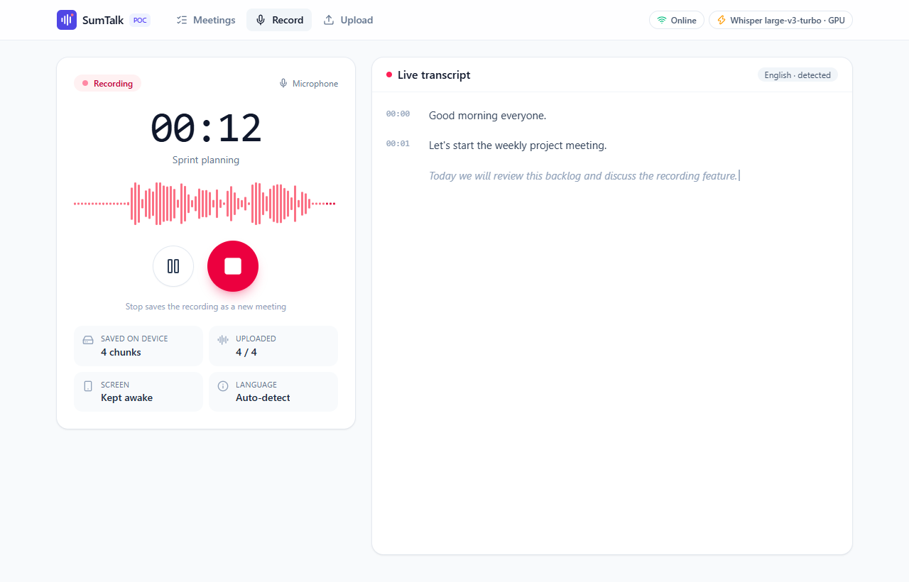
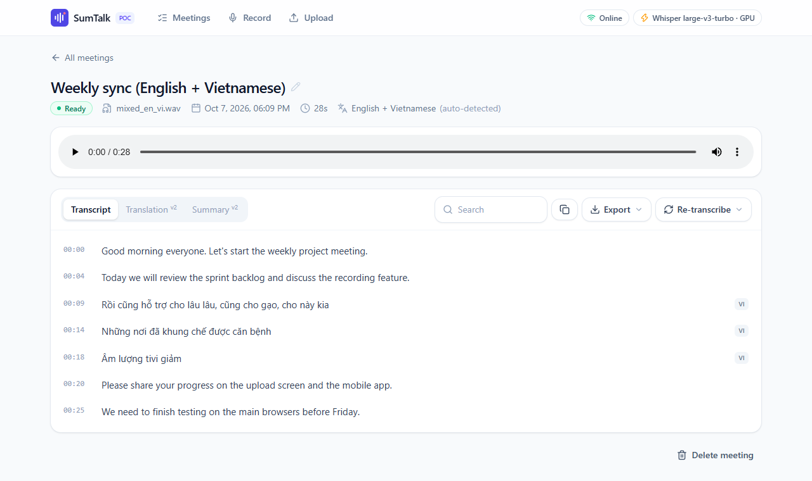
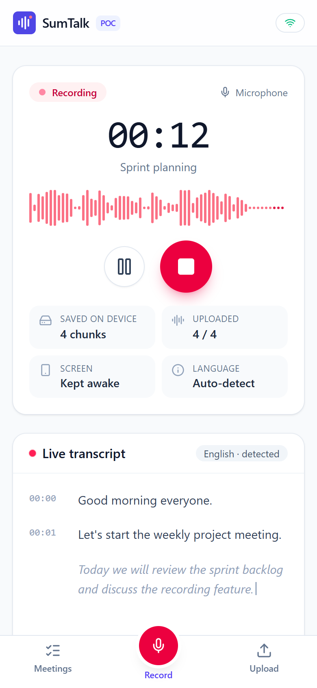

# SumTalk – meeting transcription POC (v1)

Record a meeting in the browser (or on a phone, even offline) or upload an existing audio file, and get
the transcript **in the language each person spoke**: live while recording, then an accurate final
version. Speech recognition runs locally with Whisper (no cloud, no API key), on an NVIDIA GPU when
available.

v1 scope = backlog epic **E1 – Capture meetings** + original-language transcript.
Translation (e.g. English → Vietnamese) and summaries are planned for v2.



## Quick start (Windows)

Requirements: **Python 3.10+** (tested 3.13), **Node.js 20+** (tested 22), Chrome or Edge.
An NVIDIA GPU is optional (much faster; no CUDA install needed).

```bat
setup.bat      :: once - Python env, packages, web app build (installs GPU libraries if nvidia-smi exists)
start.bat      :: runs http://localhost:8000 and opens the browser
```

The first start downloads the Whisper model (`large-v3-turbo` ≈ 1.6 GB with a GPU, `small` ≈ 0.5 GB
on CPU). The header shows *Loading speech model…* until it is ready.

### Any OS, step by step

```bash
cd backend
python -m venv .venv
.venv/Scripts/activate              # macOS/Linux: source .venv/bin/activate
pip install -r requirements-dev.txt
pip install -r requirements-gpu.txt # optional, NVIDIA GPU on Windows/Linux

cd ../frontend
npm install
npm run build                       # the backend serves frontend/dist

cd ../backend
python run.py                       # http://localhost:8000   (API docs: /docs)
```

Development with hot reload: `dev.bat`, or `python run.py --reload` + `npm run dev`
(web app on http://localhost:5173, API calls proxied to :8000).

## What you can do

| Screen | Features |
|---|---|
| **Record** | Start / pause / resume / stop with timer and level meter. Source: *Microphone*, or *Microphone + meeting audio* (shares the Meet/Teams/Zoom tab or the whole screen with sound – desktop Chrome/Edge). Live transcript ~3 s behind speech, sentence by sentence. Audio is stored on the device first and uploaded in 3 s chunks. |
| **Offline / phone** | Keeps recording without a connection; chunks wait in IndexedDB and upload by themselves when the network returns (also after closing the tab). Screen kept awake while recording. Installable as an app (PWA). |
| **Upload** | Drag & drop MP3, WAV, M4A, AAC, OGG/Opus, WEBM, FLAC, WMA, AMR, MP4/MOV/MKV (audio track). Type and size (1 GB) checked before sending; sent in 8 MB parts, 3 in parallel, resumes after network drops. Server converts everything to one standard format (16 kHz mono WAV). |
| **Meeting** | Status and progress, audio player synced with the transcript (click a line to jump), search, copy, export TXT / SRT / VTT / JSON / WAV, rename, re-transcribe with a fixed language, delete. Per-line language badge for mixed-language meetings. |

**Languages.** *Auto-detect* identifies the language of every utterance, so a meeting that switches
between English and Vietnamese keeps each part in its original language (nothing is translated).
Picking the language is faster and avoids rare wrong guesses.

<p align="center">
  
  
</p>

### Using it from a phone

Browsers only allow the microphone on `https://` (or `localhost`). Start the server with a
self-signed certificate and open the printed address on a phone in the same Wi-Fi:

```bat
start.bat --lan --https       :: or: python backend/run.py --lan --https  ->  https://192.168.x.x:8443
```

Accept the certificate warning once. Anyone on that network can then use the app – there is no login
in the POC.

## Configuration

Copy `backend/.env.example` to `backend/.env`. Main options:

| Variable | Default | Meaning |
|---|---|---|
| `WHISPER_MODEL` | `auto` | `auto` = `large-v3-turbo` on GPU, `small` on CPU. Slow CPU: `base`. |
| `WHISPER_DEVICE` | `auto` | `cuda` / `cpu` |
| `LIVE_TRANSCRIPTION` | `true` | Transcribe while recording |
| `FINAL_PASS` | `true` | Re-transcribe the whole recording accurately after Stop |
| `MAX_UPLOAD_MB` | `1024` | Upload size limit (the web app reads it from the server) |

Measured on the dev laptop (i7-13620H, RTX 4050 6 GB): 10.6 min of audio transcribed in 53 s on the GPU;
17 s of audio in ~14 s on CPU with `small`.

## Project structure

```
sumtalk/
├── setup.bat / start.bat / dev.bat     Windows helpers
├── docs/ARCHITECTURE.md                design: diagrams, flows, data model, API, roadmap
├── backend/                            Python · FastAPI · SQLite · faster-whisper
│   ├── run.py                          start the server (--reload, --lan, --https)
│   ├── app/
│   │   ├── main.py                     app, routers, serves the built web app
│   │   ├── config.py                   settings (.env)
│   │   ├── db.py · models.py · schemas.py
│   │   ├── api/                        meetings.py (recordings, transcript, export) · uploads.py · system.py
│   │   └── services/
│   │       ├── pipeline.py             live transcription, finalize, upload processing, final pass
│   │       ├── transcriber.py          Whisper loading (GPU/CPU), per-utterance language detection
│   │       ├── audio.py                PCM/WAV handling, any format → 16 kHz mono WAV (PyAV)
│   │       ├── storage.py              file layout (S3-ready)
│   │       └── jobs.py                 background workers
│   └── tests/                          pytest (fake speech model, runs in ~2 s)
└── frontend/                           React · TypeScript · Vite · Tailwind (PWA)
    ├── public/                         pcm-worklet.js (audio → 16 kHz PCM), sw.js (offline), manifest
    ├── src/
    │   ├── audio/                      recorder.ts (capture + mixing), session.ts (recording state)
    │   ├── offline/                    db.ts (IndexedDB queue), sync.ts (auto upload / finalize)
    │   ├── upload/uploader.ts          chunked resumable upload + validation
    │   ├── pages/                      Meetings, Record, Upload, Meeting
    │   ├── components/ · hooks/ · lib/ · api/
    └── e2e/                            Playwright tests in real Chrome & Edge
```

## Tests

```bash
cd backend && .venv/Scripts/python -m pytest          # API + live-commit logic, 16 tests
cd frontend && npx playwright test                    # needs the server running on :8000
```

The browser tests drive the installed **Chrome and Edge** with a WAV file of English speech as the
microphone: record with live transcript + pause/resume, record mic + meeting audio, upload an MP3,
reject a non-audio file, and record while offline then sync when back online (5 tests × 2 browsers).
Firefox and Safari were not tested automatically – check them by hand (meeting-audio capture is not
available there).

## Backlog coverage

| Task | Where |
|---|---|
| T1.1.1 Recording screen (start/pause/stop, timer) | `pages/RecordPage.tsx`, `audio/session.ts` |
| T1.1.2 Capture microphone audio | `audio/recorder.ts`, `public/pcm-worklet.js` (+ meeting tab/system audio) |
| T1.1.3 Upload the recording in chunks | `offline/sync.ts` → `PUT /api/meetings/{id}/chunks/{seq}` |
| T1.1.4 Save the recording as a new meeting | `POST /api/meetings/{id}/finalize` → `services/pipeline.py` |
| T1.1.5 Test on main browsers | `frontend/e2e/` (Chrome, Edge) |
| T1.2.1 Mobile recording screen | Responsive Record page, bottom tab bar, PWA manifest |
| T1.2.2 Keep recording in the background | Wake Lock, recording survives page changes; true lock-screen recording needs the native wrapper (v2) |
| T1.2.3 Store audio while offline | `offline/db.ts` (IndexedDB), `sw.js` (app opens offline) |
| T1.2.4 Upload automatically when back online | `offline/sync.ts` (online/visibility events, retry with backoff, recovery after a crash) |
| T1.2.5 Test on Android and iOS | Manual: `start.bat --lan --https` |
| T1.3.1 Upload screen | `pages/UploadPage.tsx` |
| T1.3.2 Check file type and size | `upload/uploader.ts` + `api/uploads.py` (+ decoding check) |
| T1.3.3 Upload large files directly to storage | Resumable 8 MB parts → storage; production: presigned S3 URLs |
| T1.3.4 Convert audio to one standard format | `services/audio.py` → 16 kHz mono 16-bit WAV |
| T1.3.5 Create a meeting from the file | `POST /api/uploads/{id}/complete` |

## Known limitations of the POC

- No accounts or access control – run it on your machine or a trusted network.
- iOS stops a web page's microphone when the screen locks; Android keeps it only while the browser stays active.
- One machine: jobs run in threads inside the API process; very long uploads are processed one at a time.
- Whisper can occasionally mis-detect a very short utterance's language or produce text on noise; re-transcribe with a fixed language if needed.
