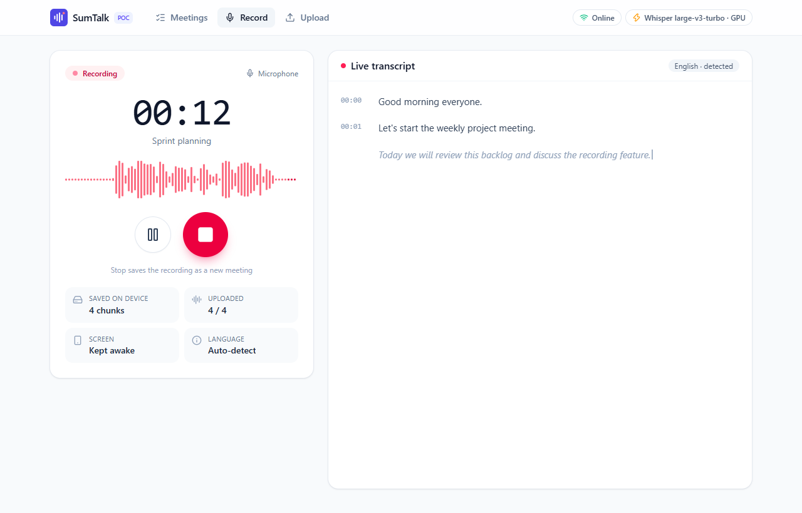
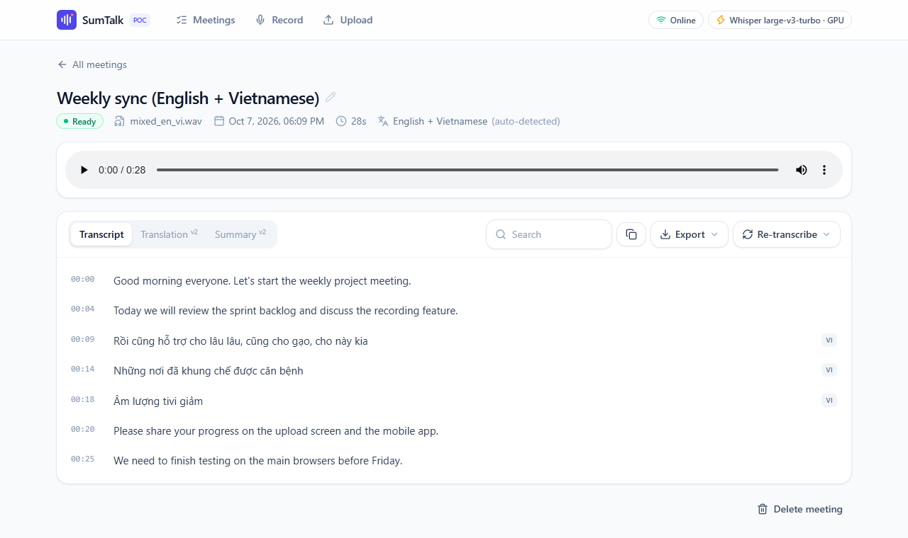
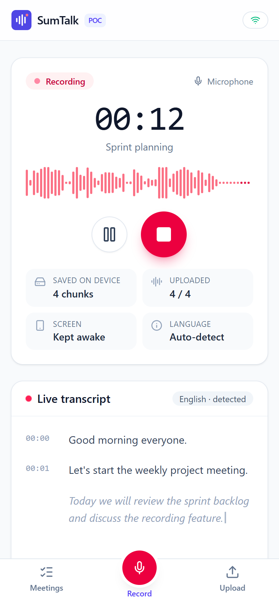

# SumTalk – meeting transcription, summary & translation

Record a meeting in the **Windows desktop app** or the browser (or on a phone, even offline) or upload an
existing audio file, and get the transcript **in the language each person spoke**: live while recording,
then an accurate final version. Speech recognition runs locally with Whisper (no cloud, no API key), on an
NVIDIA GPU when available.

v1 scope = backlog epic **E1 – Capture meetings** + original-language transcript.
Sprint 3 adds an automatic **summary** of each meeting (#67) and **translation** of the transcript into
Vietnamese or English (#60) – see [Summary & Translation](#summary--translation).



## Quick start (Windows)

Requirements: **Python 3.10+** (tested 3.13), **Node.js 20+** (tested 22), Chrome or Edge.
An NVIDIA GPU is optional (much faster; no CUDA install needed).

```bat
setup.bat          :: once - Python env, packages, web app build, desktop shell (GPU libraries if nvidia-smi exists)
desktop.bat        :: opens SumTalk as a desktop app, in its own window
start.bat          :: or: runs http://localhost:8000 and opens the browser
build-desktop.bat  :: makes an installer for other PCs (no Python / Node.js needed there) - see Desktop app
```

The first start downloads the Whisper model (`large-v3-turbo` ≈ 1.6 GB with a GPU, `small` ≈ 0.5 GB
on CPU). The header shows *Loading speech model…* until it is ready.

## Desktop app (Windows)

SumTalk is a desktop app built with **Electron**: the window shows the same React app, and the Python
backend (FastAPI + Whisper) runs hidden next to it on `127.0.0.1` – started when the window opens,
stopped when it closes (also if the app crashes). One window per PC: opening it again brings the running
window to the front.

| | From source: `desktop.bat` | Installed: `SumTalk-Setup-<version>.exe` |
|---|---|---|
| Backend | `backend/.venv` (GPU if installed) | Frozen with PyInstaller into the app, **CPU** (see `--gpu` below) |
| Data (database, audio, Whisper models) | `backend/data` – shared with `start.bat` | `%LOCALAPPDATA%\SumTalk\data` |
| Settings | `backend/.env` | `%LOCALAPPDATA%\SumTalk\sumtalk.env` (copy of `.env.example` on first start) |
| Engine log | `backend/data/logs/desktop-backend.log` | `%LOCALAPPDATA%\SumTalk\logs\backend.log` |

The **File** menu opens the settings file, the data folder and the log, and restarts SumTalk to apply new
settings. **Help › Open in web browser** shows the same app in a browser tab while the window is open.

What changes compared with the browser:

- **Microphone + meeting audio** records the computer's sound output directly (Windows loopback): the
  voices of a Zoom / Teams / Meet call in *any* app, with no "share a tab" dialog. Use headphones so the
  call is not recorded twice through the microphone.
- No service worker / PWA install – the server is always there with the window. Recording keeps running
  while the window is minimised; closing it during a recording asks first (the audio recorded so far is
  kept and processed at the next start).
- Exports and *Download audio* open a Save dialog.

**Build the installer** (on the dev PC, after `setup.bat`; needs internet the first time):

```bat
build-desktop.bat          :: -> desktop\dist\SumTalk-Setup-0.3.0.exe  (~200 MB, ~630 MB installed)
build-desktop.bat --gpu    :: -> desktop\dist\win-unpacked\  with the NVIDIA CUDA libraries (~2.5 GB)
```

`--gpu` is too big for an installer (NSIS stops at 2 GB): zip the `win-unpacked` folder and run
`SumTalk.exe` from it. Steps behind the script (`desktop/package.json`): `npm run build:web` → `npm run
build:backend` (PyInstaller, `desktop/sumtalk-server.spec`) → `electron-builder`.

Notes: the installer is not code-signed, so Windows SmartScreen shows *Windows protected your PC* →
*More info* → *Run anyway*. If recording says the microphone was denied, turn on *Settings › Privacy &
security › Microphone › Let desktop apps access your microphone*. The backend uses port **47821** (the
app's local storage – offline recordings – is tied to it; `SUMTALK_PORT` changes it). Developing the UI
with hot reload inside the window: `API_TARGET=http://127.0.0.1:47821 npm run dev` in `frontend/`, then
`SUMTALK_DEV_URL=http://localhost:5173` + `npm start` in `desktop/`.

### Any OS, step by step

```bash
cd backend
python -m venv .venv
.venv/Scripts/activate              # macOS/Linux: source .venv/bin/activate
pip install -r requirements-dev.txt
pip install -r requirements-gpu.txt # optional, NVIDIA GPU on Windows/Linux

cd ../frontend
npm install
npm run build                       # the backend serves frontend/dist

cd ../backend
python run.py                       # http://localhost:8000   (API docs: /docs)
```

Development with hot reload: `dev.bat`, or `python run.py --reload` + `npm run dev`
(web app on http://localhost:5173, API calls proxied to :8000).

## What you can do

| Screen | Features |
|---|---|
| **Record** | Start / pause / resume / stop with timer and level meter. Source: *Microphone*, or *Microphone + meeting audio* (shares the Meet/Teams/Zoom tab or the whole screen with sound – desktop Chrome/Edge). Live transcript word by word, ~1–2 s behind speech (settled words in black, the end still being corrected in grey). Audio is stored on the device first and uploaded in 1 s chunks. |
| **Offline / phone** | Keeps recording without a connection; chunks wait in IndexedDB and upload by themselves when the network returns (also after closing the tab). Screen kept awake while recording. Installable as an app (PWA). |
| **Upload** | Drag & drop MP3, WAV, M4A, AAC, OGG/Opus, WEBM, FLAC, WMA, AMR, MP4/MOV/MKV (audio track). Type and size (1 GB) checked before sending; sent in 8 MB parts, 3 in parallel, resumes after network drops. Server converts everything to one standard format (16 kHz mono WAV). |
| **Meeting** | Status and progress, audio player synced with the transcript (click a line to jump), search, copy, export TXT / SRT / VTT / JSON / WAV, rename, re-transcribe with a fixed language, delete. Per-line language badge for mixed-language meetings. |
| **Summary tab** | Minutes created automatically after transcription: overview, key points, decisions, action items, open questions. Regenerate in Vietnamese or English (replaces the current one, asks first). Error message + Try again if the model fails. |
| **Translation tab** | Pick the target language; progress bar while translating; original and translation side by side, line by line (stacked on phones). Lines already in that language are kept and labelled. Saved – reopening the meeting does not translate again. Export TXT / SRT, translated only or bilingual. |

**Languages.** *Auto-detect* identifies the language of every utterance, so a meeting that switches
between English and Vietnamese keeps each part in its original language (nothing is translated).
Picking the language is faster and avoids rare wrong guesses.

<p align="center">
  
  
</p>

### Using it from a phone

Browsers only allow the microphone on `https://` (or `localhost`). Start the server with a
self-signed certificate and open the printed address on a phone in the same Wi-Fi:

```bat
start.bat --lan --https       :: or: python backend/run.py --lan --https  ->  https://192.168.x.x:8443
```

Accept the certificate warning once. Anyone on that network can then use the app – there is no login
in the POC.

## Speech engine: on this PC or on a server

Whisper can run on the machine (`STT_PROVIDER=local`, the default) or behind an **OpenAI-compatible API**
(`STT_PROVIDER=remote`) – then nothing is downloaded and a PC without a GPU gets GPU accuracy and speed:

```ini
# backend/.env (or %LOCALAPPDATA%\SumTalk\sumtalk.env in the installed app)
STT_PROVIDER=remote
STT_BASE_URL=https://<your SumTalk server>/v1     # or https://api.groq.com/openai/v1 , https://api.openai.com/v1
STT_API_KEY=<key>
STT_MODEL=whisper-large-v3-turbo                  # OpenAI: whisper-1
```

A SumTalk server with a GPU becomes that engine for every desktop app with `STT_SERVER_API_KEYS=key1,key2`
(it then answers `POST /v1/audio/transcriptions` like OpenAI's API). Long files are cut at pauses and sent in
parallel; an 11.6-minute file took 18 s through a GPU server, with the first lines after 3 s. Details and
measurements: [ARCHITECTURE.md §12](docs/ARCHITECTURE.md#12-speech-engines-local-or-remote-long-files-no-model-on-clients).
To ship the desktop installer already pointing at your server: `set SUMTALK_DEFAULT_STT_PROVIDER=remote`,
`set SUMTALK_DEFAULT_STT_BASE_URL=...`, `set SUMTALK_DEFAULT_STT_API_KEY=...` before `build-desktop.bat`
(anyone with the installer can read the key – use one you can revoke).

## Configuration

Copy `backend/.env.example` to `backend/.env`. Main options:

| Variable | Default | Meaning |
|---|---|---|
| `WHISPER_MODEL` | `auto` | `auto` = `large-v3-turbo` on GPU, `small` on CPU. Slow CPU: `base`. |
| `WHISPER_DEVICE` | `auto` | `cuda` / `cpu` |
| `LIVE_TRANSCRIPTION` | `true` | Transcribe while recording |
| `FINAL_PASS` | `true` | Re-transcribe the whole recording accurately after Stop |
| `MAX_UPLOAD_MB` | `1024` | Upload size limit (the web app reads it from the server) |

Measured on the dev laptop (i7-13620H, RTX 4050 6 GB): 10.6 min of audio transcribed in 53 s on the GPU;
17 s of audio in ~14 s on CPU with `small`.

## Summary & Translation

Both use an LLM through the **OpenAI-compatible API**, so the same code runs against a local
[Ollama](https://ollama.com) server or a cloud provider. Settings in `backend/.env` (see `.env.example`):

| Variable | Default | Meaning |
|---|---|---|
| `LLM_BASE_URL` | `http://localhost:11434/v1` | Ollama, or the provider's OpenAI-compatible URL |
| `LLM_API_KEY` | empty | Cloud provider key (never commit it) |
| `SUMMARY_MODEL` / `TRANSLATION_MODEL` | `gemma4:26b-a4b` | Model names – set the one the team picked in the Sprint 2 benchmark |
| `SUMMARY_CHUNK_CHARS` | `12000` | Longer transcripts are summarized in parts, then merged (map-reduce) |
| `TRANSLATION_BATCH_SEGMENTS` | `20` | Segments per translation call |
| `DEFAULT_SUMMARY_LANGUAGE` | `vi` | Language of the automatic summary |
| `SUMMARY_LANGUAGES` / `TRANSLATION_LANGUAGES` | `["vi","en"]` | Languages offered in the UI |
| `AI_JOB_RETRIES` / `AI_JOB_TIME_LIMIT_SEC` | `2` / `1800` | Retries of a failed job, and the time limit after which it is marked failed |
| `AI_MOCK` | `false` | `true` = fake model with fixed answers (tests, CI, demos without a model) |

Local model with Ollama:

```bat
ollama pull gemma4:26b-a4b        :: or the model named in SUMMARY_MODEL / TRANSLATION_MODEL
start.bat
```

Try the screens without any model: set `AI_MOCK=true` in `backend/.env` (or `$env:AI_MOCK='true'` before
`python backend/run.py`). The summary then reads "Bản tóm tắt thử nghiệm (mock)…" and translations are
the original line prefixed with `[vi]` / `[en]`.

How it works (details in [docs/ARCHITECTURE.md §9](docs/ARCHITECTURE.md#9-summary--translation-sprint-3)):
the summary is queued as soon as the final transcript is ready; translation starts when a language is
picked. Both run in a background worker separate from speech-to-text, are retried, and end as `done` or
`failed` with a message – never stuck. Token counts and an estimated cost are stored per run.

Quality evaluation for QC (#66, #72) – replace the synthetic samples in `backend/scripts/eval_samples/`
with the real ones and the BA's reference summaries / translations:

```bash
cd backend
pip install -r requirements-eval.txt
python scripts/eval_summary.py        # ROUGE-L, decision coverage, language check -> scripts/eval_out/*.csv|md
python scripts/eval_translation.py    # chrF++, BLEU, English-term preservation
```

## Project structure

```
sumtalk/
├── setup.bat / start.bat / dev.bat     Windows helpers
├── desktop.bat / build-desktop.bat     desktop app: open from source / build the installer
├── docs/ARCHITECTURE.md                design: diagrams, flows, data model, API, roadmap
├── desktop/                            Electron shell (Windows desktop app)
│   ├── main.js                         window, menu, permissions, system-audio capture, app lifecycle
│   ├── lib/backend.js                  starts / health-checks / stops the Python backend
│   ├── preload.js · loading.html       tells the web app it is in the desktop app · start-up screen
│   ├── sumtalk-server.spec             PyInstaller recipe: backend → sumtalk-server.exe
│   └── scripts/                        build-backend.js · smoke-test.js
├── backend/                            Python · FastAPI · SQLite · faster-whisper
│   ├── run.py                          start the server (--reload, --lan, --https)
│   ├── app/
│   │   ├── main.py                     app, routers, serves the built web app
│   │   ├── config.py                   settings (.env)
│   │   ├── db.py · models.py · schemas.py
│   │   ├── api/                        meetings.py (recordings, transcript, export) · uploads.py · system.py
│   │   │                               ai.py (summary, translations, translated export)
│   │   ├── ai/                         llm_client.py · jsonutil.py · summary/ · translation/  (no DB, no queue)
│   │   └── services/
│   │       ├── pipeline.py             live transcription, finalize, upload processing, final pass
│   │       ├── transcriber.py          Whisper loading (GPU/CPU), per-utterance language detection
│   │       ├── audio.py                PCM/WAV handling, any format → 16 kHz mono WAV (PyAV)
│   │       ├── storage.py              file layout (S3-ready)
│   │       ├── ai_jobs.py              summary + translation background jobs (retry, time limit, progress)
│   │       └── jobs.py                 background workers
│   ├── scripts/                        eval_summary.py · eval_translation.py · eval_samples/
│   └── tests/                          pytest (fake speech model + mock LLM, runs in ~5 s)
└── frontend/                           React · TypeScript · Vite · Tailwind (PWA)
    ├── public/                         pcm-worklet.js (audio → 16 kHz PCM), sw.js (offline), manifest
    ├── src/
    │   ├── audio/                      recorder.ts (capture + mixing), session.ts (recording state)
    │   ├── offline/                    db.ts (IndexedDB queue), sync.ts (auto upload / finalize)
    │   ├── upload/uploader.ts          chunked resumable upload + validation
    │   ├── pages/                      Meetings, Record, Upload, Meeting
    │   ├── components/ · hooks/ · lib/ · api/
    └── e2e/                            Playwright tests in real Chrome & Edge
```

## Tests

```bash
cd backend && .venv/Scripts/python -m pytest          # API, live-commit logic, summary, translation: 68 tests
cd backend && .venv/Scripts/python -m ruff check app tests scripts
cd frontend && npm run build                          # type check + build
cd frontend && npx playwright test                    # needs the server running on :8000
cd frontend && npx playwright test e2e/sprint3.spec.ts  # server started with AI_MOCK=true
cd desktop && npm test                                # desktop app: window, mic, system audio, clean quit
cd desktop && npm test -- --packaged                  # same on desktop\dist\win-unpacked after build-desktop.bat
```

The browser tests drive the installed **Chrome and Edge** with a WAV file of English speech as the
microphone: record with live transcript + pause/resume, record mic + meeting audio, upload an MP3,
reject a non-audio file, and record while offline then sync when back online (5 tests × 2 browsers).
Firefox and Safari were not tested automatically – check them by hand (meeting-audio capture is not
available there).

## Backlog coverage

| Task | Where |
|---|---|
| T1.1.1 Recording screen (start/pause/stop, timer) | `pages/RecordPage.tsx`, `audio/session.ts` |
| T1.1.2 Capture microphone audio | `audio/recorder.ts`, `public/pcm-worklet.js` (+ meeting tab/system audio) |
| T1.1.3 Upload the recording in chunks | `offline/sync.ts` → `PUT /api/meetings/{id}/chunks/{seq}` |
| T1.1.4 Save the recording as a new meeting | `POST /api/meetings/{id}/finalize` → `services/pipeline.py` |
| T1.1.5 Test on main browsers | `frontend/e2e/` (Chrome, Edge) |
| T1.2.1 Mobile recording screen | Responsive Record page, bottom tab bar, PWA manifest |
| T1.2.2 Keep recording in the background | Wake Lock, recording survives page changes; true lock-screen recording needs the native wrapper (v2) |
| T1.2.3 Store audio while offline | `offline/db.ts` (IndexedDB), `sw.js` (app opens offline) |
| T1.2.4 Upload automatically when back online | `offline/sync.ts` (online/visibility events, retry with backoff, recovery after a crash) |
| T1.2.5 Test on Android and iOS | Manual: `start.bat --lan --https` |
| T1.3.1 Upload screen | `pages/UploadPage.tsx` |
| T1.3.2 Check file type and size | `upload/uploader.ts` + `api/uploads.py` (+ decoding check) |
| T1.3.3 Upload large files directly to storage | Resumable 8 MB parts → storage; production: presigned S3 URLs |
| T1.3.4 Convert audio to one standard format | `services/audio.py` → 16 kHz mono 16-bit WAV |
| T1.3.5 Create a meeting from the file | `POST /api/uploads/{id}/complete` |

Sprint 3 (Azure Boards IDs):

| Task | Where |
|---|---|
| #68 Set up summary model + prompt | `backend/app/ai/summary/` (schema, prompts, `format_transcript`), `ai/jsonutil.py`, `ai/llm_client.py` |
| #69 Handle long transcripts | `summarize()` map-reduce + `chunk_lines()` in `ai/summary/summarizer.py` |
| #70 Summary step, storage and API | `services/ai_jobs.py`, `Summary` model, `GET/POST /api/meetings/{id}/summary…` |
| #71 Summary tab with Regenerate | `frontend/src/components/SummaryPanel.tsx` |
| #61 Set up translation model | `backend/app/ai/translation/` (`translate_batch`, `detect_language`) |
| #62 Store translations + API | `Translation`, `SegmentTranslation` models, `api/ai.py` |
| #63 Translation step with progress | `run_translation_job` in `services/ai_jobs.py` |
| #64 Language picker + side-by-side tab | `frontend/src/components/TranslationPanel.tsx` |
| #65 Export TXT / SRT | `GET …/translations/{lang}/export`, Export menu in the Translation tab |
| #66, #72 Quality evaluation | `backend/scripts/eval_translation.py`, `eval_summary.py` |
| #99, #100 End-to-end tests | `docs/testing/sprint3-test-cases.md`, `frontend/e2e/sprint3.spec.ts`, `backend/tests/test_summary_translation_api.py` |

## Known limitations of the POC

- No accounts or access control – run it on your machine or a trusted network.
- The desktop app is Windows only for now (Electron and the backend build would also work on macOS/Linux,
  but system-audio capture and the build scripts are Windows-specific). The installer transcribes on the
  CPU; GPU needs the `--gpu` folder build. No auto-update: install the new version over the old one.
- `desktop.bat` and `start.bat` share `backend/data`: do not run both at the same time.
- iOS stops a web page's microphone when the screen locks; Android keeps it only while the browser stays active.
- One machine: jobs run in threads inside the API process; very long uploads are processed one at a time.
- No speaker labels yet, so summaries and exports have no `Speaker:` prefix.
- Summary and translation share one worker thread: a long translation waits for a running summary.
- Whisper can occasionally mis-detect a very short utterance's language or produce text on noise; re-transcribe with a fixed language if needed.
