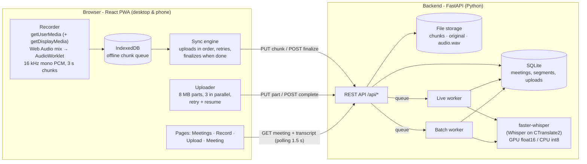
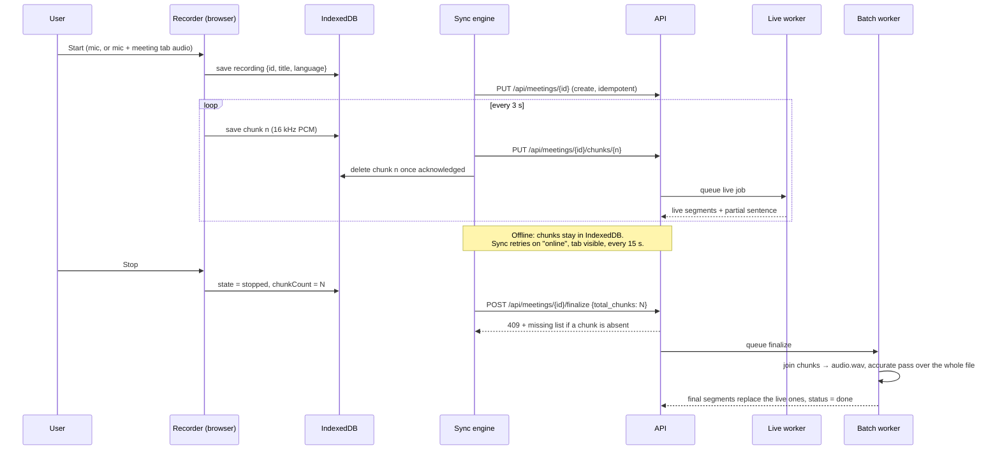
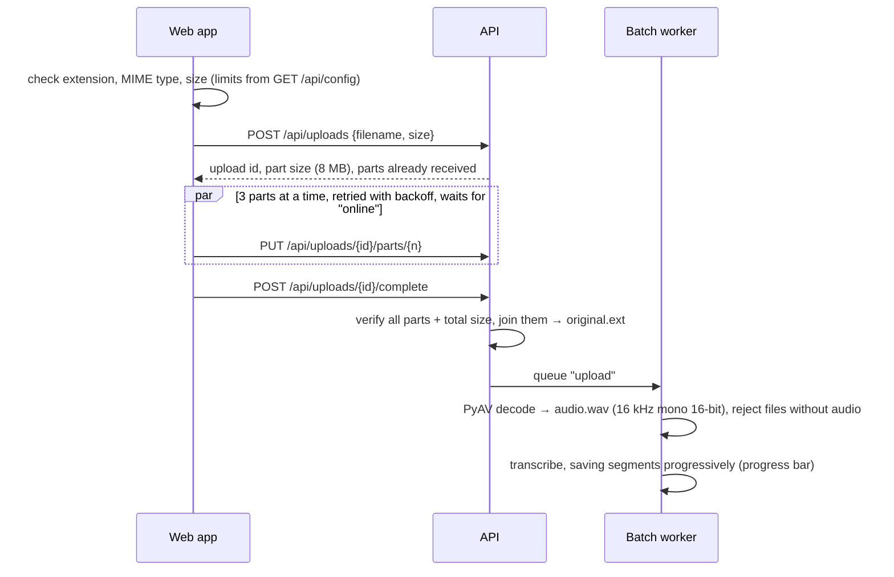
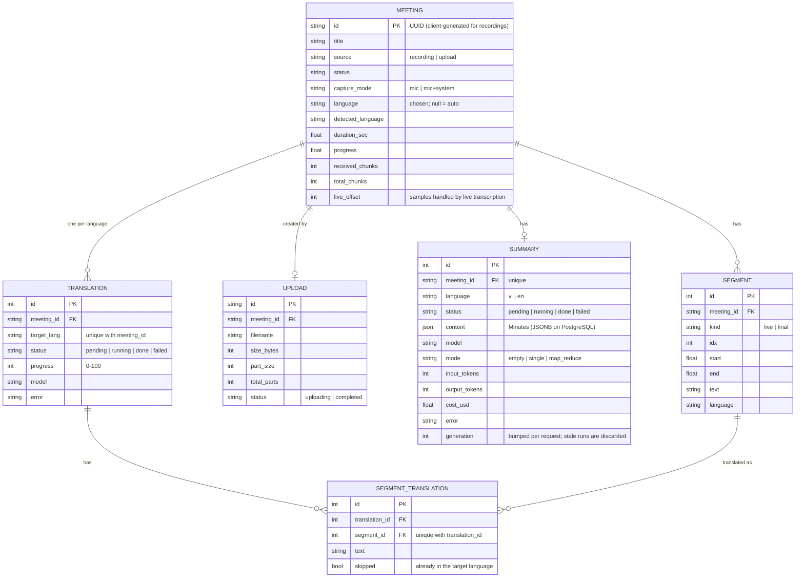
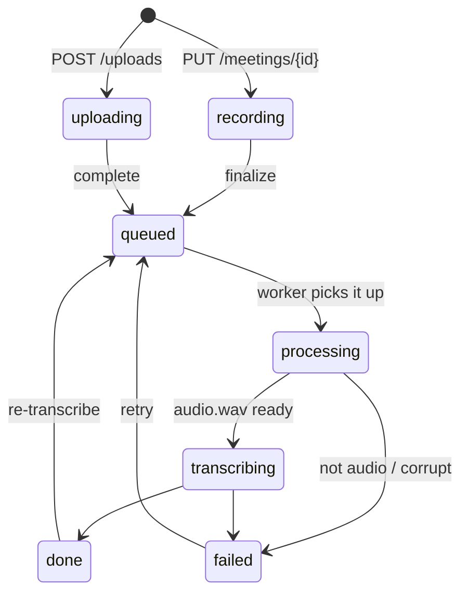
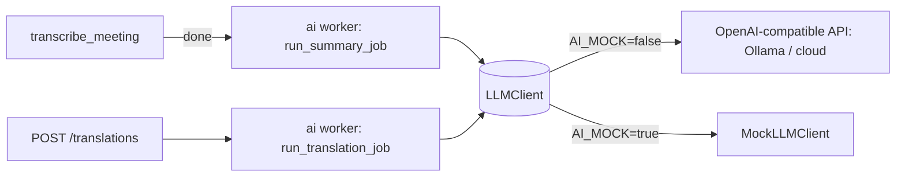
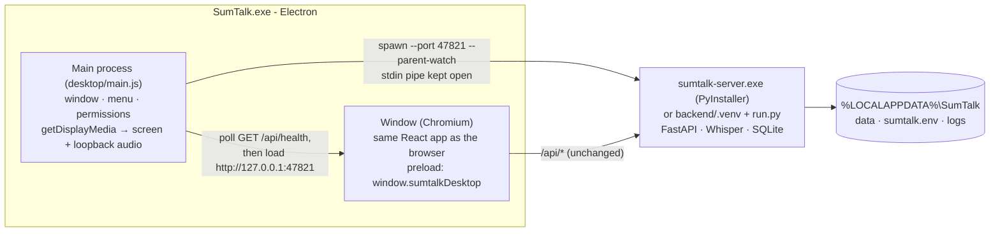
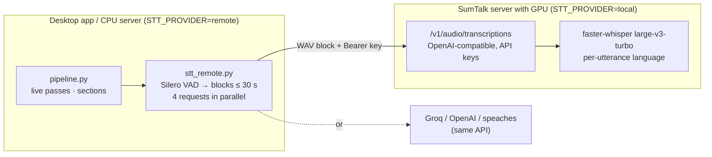

# SumTalk – Architecture (POC v1 + Sprint 3: summary & translation)

SumTalk records or imports a meeting and returns a transcript **in the language each person spoke**.
v1 covers epic **E1 – Capture meetings** plus transcription. Translation (e.g. English → Vietnamese)
and summaries are v2 and plug into the same pipeline (section 9).

## 1. System overview



Everything runs locally: no cloud service, no API key. The first start downloads the Whisper model.

## 2. Technology choices

| Layer | Choice | Why |
|---|---|---|
| Web app | React 19 + TypeScript + Vite, Tailwind CSS 4, react-router 7, `idb`, lucide icons | Most common stack, fast to build, one code base for desktop and phones (installable PWA) |
| Audio capture | `getUserMedia`, `getDisplayMedia` (tab/system audio), Web Audio API, AudioWorklet | Works in every modern browser; the worklet outputs exactly the format Whisper wants, so every chunk is independently usable (no codec, no gaps) |
| Offline | IndexedDB + Service Worker + Web Locks + Wake Lock | Audio is written to the device before it is sent; the app shell opens without a connection |
| API | Python 3.13, FastAPI, Uvicorn, SQLAlchemy 2 + SQLite | Python is where speech/AI libraries live; FastAPI gives typed endpoints + OpenAPI docs at `/docs` |
| Speech-to-text | **faster-whisper** (OpenAI Whisper re-implemented on CTranslate2), Silero VAD | Free, offline, 99 languages incl. Vietnamese, word timestamps; 4× faster than the reference implementation. `large-v3-turbo` on NVIDIA GPUs, `small` on CPU |
| Audio conversion | PyAV (FFmpeg libraries, installed with faster-whisper) | Any format → standard WAV without installing FFmpeg separately |
| Jobs | In-process worker threads | Enough for one machine; same interface as Celery/RQ |
| Desktop app | Electron 45 (Chromium) + backend frozen with PyInstaller, NSIS installer (electron-builder) | Reuses the web app and the Python backend unchanged; Chromium keeps every audio API, and adds system-audio loopback capture on Windows (section 11) |

## 3. Recording flow (US1.1, US1.2)

The browser chooses the meeting id (UUID), so a recording can start **without a connection** and every
request can be retried safely (all writes are idempotent).



**Meeting audio for online calls.** "Microphone + meeting audio" asks the browser to share the
Meet/Teams/Zoom tab (or the entire screen) *with audio*. Both streams are mixed with the Web Audio API,
so the transcript contains the local speaker and the remote participants. Desktop Chrome/Edge only.
In the Windows desktop app the same `getDisplayMedia()` call is answered by the app with the system
audio output (loopback), so no tab has to be shared and calls in native Zoom/Teams apps work too.

**Phones.** The page keeps the screen awake (Wake Lock) while recording, flushes audio to IndexedDB
continuously and asks for persistent storage. A web page cannot keep the microphone running with the
screen locked on iOS – that needs the native app wrapper planned after the POC (section 9).

## 4. Live transcription

The recorder sends 1 s chunks; every chunk queues a live job for the meeting. The job transcribes the
audio received since the last committed point (a window of 1–15 s) with fast settings (beam size 1, word
timestamps), then decides what is final:

| Situation in the window | Action |
|---|---|
| No speech | Skip ahead, keep the last second (speech may be starting) |
| Pause after the last sentence | Commit everything |
| Last sentence still running into the window edge | Commit the earlier segments **and** every finished sentence inside the last one (split on `. ? !` using word times); the unfinished rest is shown greyed-out as `partial` and transcribed again with more audio |
| Window past 8 s, nobody pauses | Commit the words the last **two passes agree on** (LocalAgreement-2) as a line, resume at the next word – keeps every pass short |
| Window at 15 s | Commit every word that has ended, resume at the next word (never inside a word) |

The part still being spoken is returned as `partial`, with `partial_stable` = its start that two passes
agreed on; the page shows the stable words in normal ink and the rest in grey italics, polling every
0.7 s while recording. Measured on the dev laptop (RTX 4050, `large-v3-turbo`): new words show about
1 s after they are spoken, a finished sentence is committed 1.9 s after it ends on average (max 2.3 s),
the same through the remote engine (section 12). `LIVE_INTERVAL_SEC` spaces passes out for paid APIs. After **Stop**, the whole file is transcribed again with accurate settings (beam size 5)
and replaces the live draft (`FINAL_PASS=true`).

## 5. Languages – always the original language

Whisper decodes each 30 s window in one language; a window mixing English and Vietnamese gets one of
them dropped or translated. So when the language is "Auto-detect":

1. Silero VAD splits the audio at pauses into utterances.
2. The language is detected once per ~30 s group of utterances. If the detector is less than 90 % sure
   (mixed languages), each utterance ≥ 1 s is detected on its own; shorter ones inherit a neighbour's.
3. Consecutive utterances with the same language form a block, transcribed with that language.
   A text prompt is only carried over between blocks of the same language (a prompt in another
   language makes Whisper translate).

Every segment stores its language (shown as a badge when it differs from the meeting's main language).
If the user picks a language, detection is skipped. Wrong guess? *Re-transcribe* with a fixed language.

## 6. Upload flow (US1.3)



## 7. Data model



New tables are created by `init_db()` (`create_all`) on start-up, like the Sprint 1 tables: there is no
Alembic in the repo yet. Statuses are strings (not DB enums) to match the existing tables.



Storage layout (`backend/data/`, maps 1:1 to object-storage keys):

```
app.db                                   SQLite database
models/                                  downloaded Whisper models
meetings/<id>/chunks/000000.pcm          recording chunks (deleted after finalize)
meetings/<id>/original.<ext>             uploaded file as received
meetings/<id>/audio.wav                  standard format: 16 kHz, mono, 16-bit PCM
uploads/<upload-id>/000000.part          parts of an upload in progress
```

## 8. API

Interactive docs: `http://localhost:8000/docs`.

| Method & path | Purpose |
|---|---|
| `GET /api/health` | Server up + speech model status (model, device) |
| `GET /api/config` | Limits the web app uses (chunk length, max upload, allowed types) |
| `GET /api/meetings` | List meetings |
| `PUT /api/meetings/{id}` | Create a recording (idempotent) |
| `GET / PATCH / DELETE /api/meetings/{id}` | Read, rename, delete (with its audio) |
| `PUT /api/meetings/{id}/chunks/{seq}` | Recording chunk: raw PCM s16le, 16 kHz, mono (`X-Sample-Rate: 16000`) |
| `POST /api/meetings/{id}/finalize` | `{total_chunks}`; 409 lists missing chunks. Without it: finish with what arrived |
| `GET /api/meetings/{id}/transcript?kind=&after=` | Incremental transcript (`kind` live/final, `partial` text while recording) |
| `GET /api/meetings/{id}/audio` | Normalized WAV, supports HTTP Range (seeking) |
| `GET /api/meetings/{id}/export?format=txt\|srt\|vtt\|json` | Download the transcript |
| `POST /api/meetings/{id}/retranscribe` | Run again, optionally with a fixed language |
| `POST /api/uploads` | Start an upload (validates type and size) |
| `GET /api/uploads/{id}` | Parts received so far (resume) |
| `PUT /api/uploads/{id}/parts/{n}` | One part (exact size checked) |
| `POST /api/uploads/{id}/complete` | Join parts, create the meeting, queue processing |
| `DELETE /api/uploads/{id}` | Cancel |
| `GET /api/meetings/{id}/summary` | `{status, language, content, error, updated_at, …}`; 404 when there is none |
| `POST /api/meetings/{id}/summary/regenerate` | `{language?}` → 202, replaces the summary when done; 409 while running or before the transcript |
| `POST /api/meetings/{id}/translations` | `{target_lang}` → 200 with the saved translation if it exists (never re-translated), else 202 and start |
| `GET /api/meetings/{id}/translations` | Languages already translated, with status/progress |
| `GET /api/meetings/{id}/translations/{lang}` | `{status, progress, error, segments: [{segment_id, start, end, speaker, original, translation, skipped}]}` |
| `POST /api/meetings/{id}/translations/{lang}/retry` | Only when `failed`; keeps the segments already translated |
| `GET /api/meetings/{id}/translations/{lang}/export?format=txt\|srt&mode=translated\|bilingual` | Download; TXT has a UTF-8 BOM; 409 until done |

## 9. Summary & translation (Sprint 3)



- **Code:** `app/ai/` has no dependency on the database or the job queue: `llm_client.py` (OpenAI-compatible
  client with timeout + retry on 429/5xx, mock client, token/cost accounting), `jsonutil.py` (JSON out of a
  model answer, one repair retry), `summary/` (schema, prompts, `summarize`), `translation/` (prompts,
  `detect_language`, `translate_batch`). `services/ai_jobs.py` runs them as background jobs.
- **Summary:** queued automatically when the final transcript is ready, in the language used last time for
  the meeting (or `DEFAULT_SUMMARY_LANGUAGE`). Transcript lines are sent as `[segment idx] [hh:mm:ss] text`.
  Up to `SUMMARY_CHUNK_CHARS`: one call. Longer: the lines are cut at segment boundaries into chunks that
  overlap by 2 segments, each chunk is summarized (map), then the partial minutes are merged (reduce; in
  groups first if they do not fit one prompt). `action_items[].segment_ids` are kept for Sprint 4 (#79).
- **Translation:** final segments in time order. Segments already in the target language (Whisper's
  per-segment label, checked with a Vietnamese-letter heuristic) are stored as `skipped` without an LLM call.
  The rest go in batches of `TRANSLATION_BATCH_SEGMENTS` as JSON `[{id, text}]` with the 2 previous lines as
  context; ids missing from the answer are requested again on their own. Each batch is saved with the
  progress, so a retry only translates what is missing. `translate_batch` works for one segment, for live
  translation in Sprint 4 (#84).
- **Reliability:** a job is retried as a whole `AI_JOB_RETRIES` times with backoff, then marked `failed` with
  the error; `AI_JOB_TIME_LIMIT_SEC` is checked between model calls and each HTTP call has `LLM_TIMEOUT_SEC`,
  so nothing stays `running`. Interrupted jobs are queued again on start-up. Summary and translation run on
  their own worker thread, so a failure never re-runs speech-to-text.
- **Re-transcribe:** translations are deleted (they point at the old segments) and the summary is rebuilt.
- **Budget (R6):** every run stores calls, input/output tokens and an estimated cost
  (`LLM_PRICE_INPUT_PER_1M`, `LLM_PRICE_OUTPUT_PER_1M`); the server log prints one line per summary.
- **Quality evaluation:** `backend/scripts/eval_summary.py` (ROUGE-L, decision coverage, language check,
  optional BERTScore) and `eval_translation.py` (chrF++, BLEU, English-term preservation), CSV + Markdown.

Differences from the Sprint 3 spec, because the repo is built differently: no Celery/Redis (in-process worker
thread, same retry/time-limit behaviour), SQLite only with `create_all` instead of Alembic, routes under
`/api/meetings/...` like the existing API instead of `/api/v1`, no speaker field (diarization is not built:
`speaker` is always `null`), no `preferred_language` on meetings so translation is never started
automatically, the meeting status is not given a `summarizing` stage (the summary has its own status), and
there was no `benchmark/` folder to copy prompts from, so they were written in `app/ai/`.

## 10. From POC to product

| Topic | POC v1 | Next step |
|---|---|---|
| Translation | Sprint 3: on request, per segment, any OpenAI-compatible LLM | Live translation while recording (#84), automatic translation to a user's preferred language |
| Summary | Sprint 3: automatic after transcription, vi / en, map-reduce | Action items view with links to the transcript (#79) |
| Mobile background recording | Screen kept awake, offline queue | Capacitor/React Native wrapper with a background audio session / foreground service, same API |
| Storage | Local disk, upload through the API | S3/MinIO with presigned multipart URLs (browser uploads straight to storage) |
| Jobs | Threads in the API process | Celery/RQ + Redis, separate GPU workers; faster-whisper batched pipeline for long files |
| Database | SQLite | PostgreSQL + Alembic migrations |
| Security | None (localhost) | Accounts, per-user access, HTTPS certificates, retention policy for audio |
| Speakers | – | Diarization (who spoke when), e.g. pyannote |
| Desktop app | Windows, CPU in the installer, GPU as a folder build, no auto-update | Code signing, auto-update (electron-updater), GPU libraries downloaded on first start, macOS build |

## 11. Desktop app (Windows)



- **No second code base.** The window loads the app from the backend exactly like a browser does, so
  every API call, the offline queue and the recorder are the same code. The page only learns it is in the
  desktop app through `window.sumtalkDesktop` (no Node.js access: context isolation + sandbox), and uses it
  to skip the service worker and to adapt the meeting-audio wording.
- **Start-up.** Single-instance lock → loading screen → free port (47821 first: the page's IndexedDB and
  localStorage belong to the origin, port included, so it must stay the same between runs) → spawn the
  backend → wait for `/api/health` (the Whisper model keeps loading in the background, as in the browser
  version) → load the app. Missing files or a backend that exits during start-up show an error with the
  last log lines.
- **Shutdown.** The backend is started with `--parent-watch`: it reads its stdin until EOF and then stops
  Uvicorn gracefully. Electron closes that pipe when the last window has closed (`will-quit`); if the app
  crashes, Windows closes it anyway, so no server is left running. After 8 s Electron kills the process
  tree. Interrupted jobs resume on the next start (`_resume_unfinished`).
- **Permissions.** Microphone, clipboard, wake lock… are granted only to the backend's origin. Other
  links open in the default browser. `getDisplayMedia()` is answered without a picker with the primary
  screen + `audio: 'loopback'`; the recorder drops the video track as before.
- **Recording safety.** `backgroundThrottling: false` keeps chunk uploads running while minimised. The
  Record page's `beforeunload` guard becomes a native "A recording is in progress" dialog
  (`will-prevent-unload`).
- **Packaging.** `desktop/sumtalk-server.spec` freezes `backend/run.py` (collects the CTranslate2, PyAV/FFmpeg,
  ONNX Runtime and tokenizer binaries and the Silero VAD model). `config.py` detects the frozen build and
  defaults the data folder to `%LOCALAPPDATA%\SumTalk\data`; Electron also passes `DATA_DIR`,
  `FRONTEND_DIST` and `SUMTALK_ENV_FILE` explicitly. electron-builder puts the web build in
  `resources/web`, the backend in `resources/backend` and builds a per-user NSIS installer. The CUDA
  libraries (~2 GB) only go into the `--gpu` folder build; `transcriber.py` also looks for them inside the
  bundle.

## 12. Speech engines: local or remote (long files, no model on clients)



- **`STT_PROVIDER=local`** (default): faster-whisper on the machine, as before.
- **`STT_PROVIDER=remote`**: `transcriber.transcribe()` keeps its interface but `stt_remote.RemoteTranscriber`
  sends the audio to `STT_BASE_URL` (`POST /audio/transcriptions`, `verbose_json`, word timestamps). Nothing
  is downloaded: Silero VAD (2 MB, inside faster-whisper) splits the audio at pauses into blocks of at most
  `STT_BLOCK_SEC`, so silence is never sent, every request stays far below the 25 MB limit of public APIs, and
  the language is detected per block. Retries on 429/5xx with back-off; a refused key shows as an error in the
  header.
- **This server as an engine**: with `STT_SERVER_API_KEYS` set, `/v1/audio/transcriptions` and `/v1/models`
  answer like OpenAI's API, backed by the local Whisper. Each segment carries its own `language`, so a remote
  client keeps the per-utterance language of mixed meetings. The desktop installer can be built with
  `SUMTALK_DEFAULT_STT_PROVIDER=remote` + URL + key, so customers install it and start without a model.
- **Long files**: `transcribe_meeting` cuts `audio.wav` into sections of `LONG_SECTION_SEC` (300 s) at the
  quietest 50 ms near each boundary, reads one section at a time (`audio.read_wav`), passes the previous
  section's text as the prompt and saves segments as they come. Measured with an 11.6-minute file: first lines
  after 3–5 s; done in 57 s on the local GPU (12× real time) and 18 s through the remote engine (39×, blocks
  in parallel). An hour is therefore 1.5–5 minutes on a GPU.
- **Live at length**: chunk sizes come from one directory scan (`storage.chunk_index`, `chunk_stats`), so the
  cost of a pass does not grow with the length of the recording.

| Engine | Accuracy | Live latency | Client install | Cost |
|---|---|---|---|---|
| Local GPU `large-v3-turbo` | best | ~1–2 s | 1.6 GB model + NVIDIA GPU | free |
| Local CPU `small` | lower | grows on long sentences | 0.5 GB model | free |
| Remote: SumTalk GPU server | = local GPU | ~1–2 s + network | nothing | EC2 GPU hours |
| Remote: Groq `whisper-large-v3-turbo` | ≈ local GPU | ~1–2 s + network | nothing | per audio hour (check the provider's price) |

