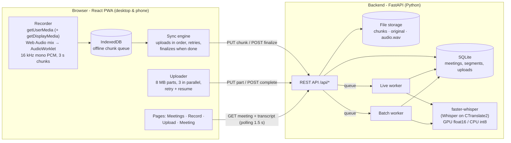
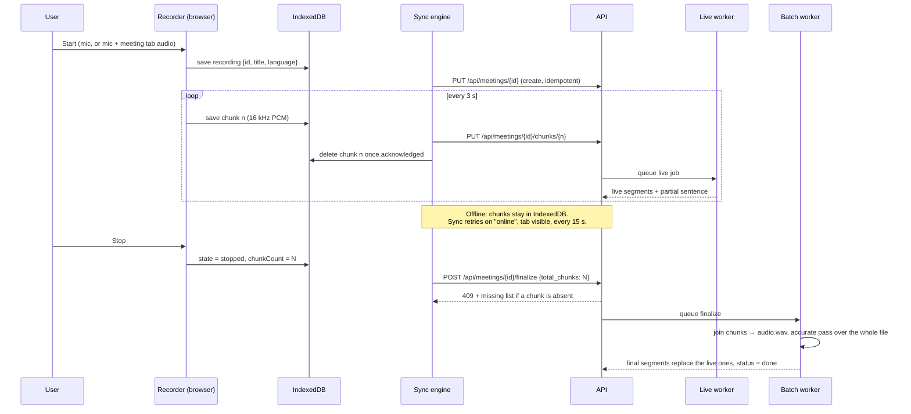
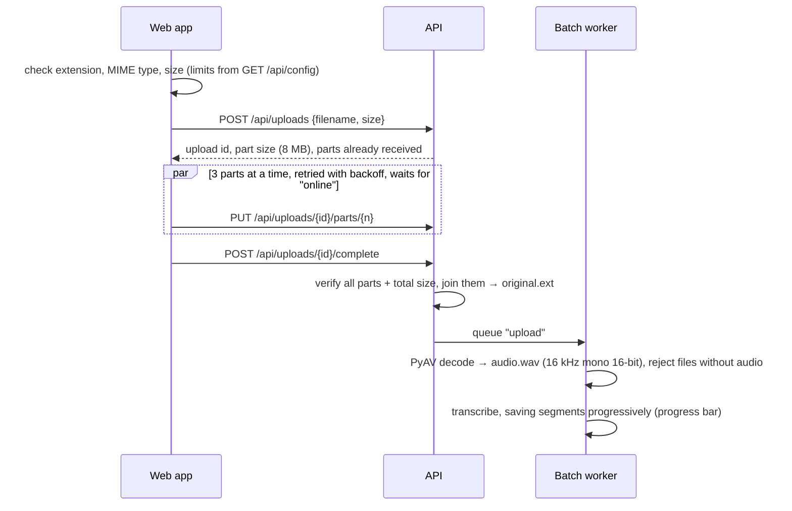
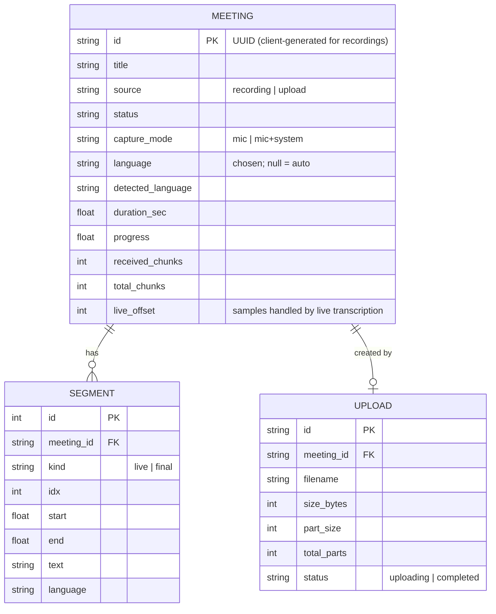
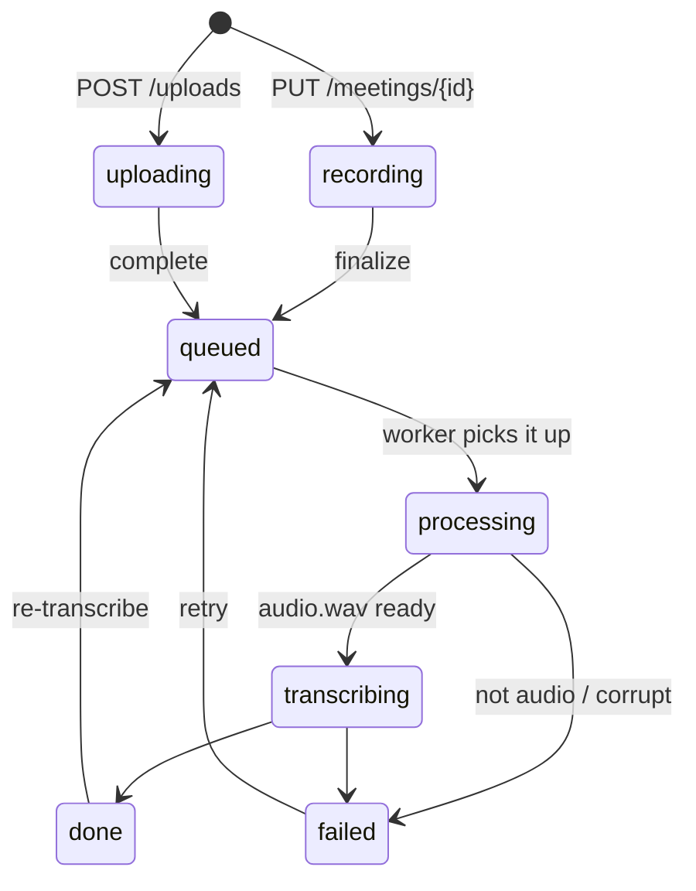

# SumTalk – Architecture (POC v1)

SumTalk records or imports a meeting and returns a transcript **in the language each person spoke**.
v1 covers epic **E1 – Capture meetings** plus transcription. Translation (e.g. English → Vietnamese)
and summaries are v2 and plug into the same pipeline (section 9).

## 1. System overview



Everything runs locally: no cloud service, no API key. The first start downloads the Whisper model.

## 2. Technology choices

| Layer | Choice | Why |
|---|---|---|
| Web app | React 19 + TypeScript + Vite, Tailwind CSS 4, react-router 7, `idb`, lucide icons | Most common stack, fast to build, one code base for desktop and phones (installable PWA) |
| Audio capture | `getUserMedia`, `getDisplayMedia` (tab/system audio), Web Audio API, AudioWorklet | Works in every modern browser; the worklet outputs exactly the format Whisper wants, so every chunk is independently usable (no codec, no gaps) |
| Offline | IndexedDB + Service Worker + Web Locks + Wake Lock | Audio is written to the device before it is sent; the app shell opens without a connection |
| API | Python 3.13, FastAPI, Uvicorn, SQLAlchemy 2 + SQLite | Python is where speech/AI libraries live; FastAPI gives typed endpoints + OpenAPI docs at `/docs` |
| Speech-to-text | **faster-whisper** (OpenAI Whisper re-implemented on CTranslate2), Silero VAD | Free, offline, 99 languages incl. Vietnamese, word timestamps; 4× faster than the reference implementation. `large-v3-turbo` on NVIDIA GPUs, `small` on CPU |
| Audio conversion | PyAV (FFmpeg libraries, installed with faster-whisper) | Any format → standard WAV without installing FFmpeg separately |
| Jobs | In-process worker threads | Enough for one machine; same interface as Celery/RQ |

## 3. Recording flow (US1.1, US1.2)

The browser chooses the meeting id (UUID), so a recording can start **without a connection** and every
request can be retried safely (all writes are idempotent).



**Meeting audio for online calls.** "Microphone + meeting audio" asks the browser to share the
Meet/Teams/Zoom tab (or the entire screen) *with audio*. Both streams are mixed with the Web Audio API,
so the transcript contains the local speaker and the remote participants. Desktop Chrome/Edge only.

**Phones.** The page keeps the screen awake (Wake Lock) while recording, flushes audio to IndexedDB
continuously and asks for persistent storage. A web page cannot keep the microphone running with the
screen locked on iOS – that needs the native app wrapper planned after the POC (section 9).

## 4. Live transcription

Every chunk queues a live job for the meeting. The job transcribes the audio received since the last
committed point (a window of 2.5–25 s) with fast settings (beam size 1, word timestamps), then decides
what is final:

| Situation in the window | Action |
|---|---|
| No speech | Skip ahead, keep the last second (speech may be starting) |
| Pause after the last sentence | Commit everything |
| Last sentence still running into the window edge | Commit the earlier segments **and** every finished sentence inside the last one (split on `. ? !` using word times); the unfinished rest is shown greyed-out as `partial` and transcribed again with more audio |
| One sentence longer than 25 s | Cut at the window edge |

Result: text appears ~3 s after it is spoken, sentence by sentence, without words cut at chunk
boundaries. After **Stop**, the whole file is transcribed again with accurate settings (beam size 5)
and replaces the live draft (`FINAL_PASS=true`).

## 5. Languages – always the original language

Whisper decodes each 30 s window in one language; a window mixing English and Vietnamese gets one of
them dropped or translated. So when the language is "Auto-detect":

1. Silero VAD splits the audio at pauses into utterances.
2. The language is detected once per ~30 s group of utterances. If the detector is less than 90 % sure
   (mixed languages), each utterance ≥ 1 s is detected on its own; shorter ones inherit a neighbour's.
3. Consecutive utterances with the same language form a block, transcribed with that language.
   A text prompt is only carried over between blocks of the same language (a prompt in another
   language makes Whisper translate).

Every segment stores its language (shown as a badge when it differs from the meeting's main language).
If the user picks a language, detection is skipped. Wrong guess? *Re-transcribe* with a fixed language.

## 6. Upload flow (US1.3)



## 7. Data model





Storage layout (`backend/data/`, maps 1:1 to object-storage keys):

```
app.db                                   SQLite database
models/                                  downloaded Whisper models
meetings/<id>/chunks/000000.pcm          recording chunks (deleted after finalize)
meetings/<id>/original.<ext>             uploaded file as received
meetings/<id>/audio.wav                  standard format: 16 kHz, mono, 16-bit PCM
uploads/<upload-id>/000000.part          parts of an upload in progress
```

## 8. API

Interactive docs: `http://localhost:8000/docs`.

| Method & path | Purpose |
|---|---|
| `GET /api/health` | Server up + speech model status (model, device) |
| `GET /api/config` | Limits the web app uses (chunk length, max upload, allowed types) |
| `GET /api/meetings` | List meetings |
| `PUT /api/meetings/{id}` | Create a recording (idempotent) |
| `GET / PATCH / DELETE /api/meetings/{id}` | Read, rename, delete (with its audio) |
| `PUT /api/meetings/{id}/chunks/{seq}` | Recording chunk: raw PCM s16le, 16 kHz, mono (`X-Sample-Rate: 16000`) |
| `POST /api/meetings/{id}/finalize` | `{total_chunks}`; 409 lists missing chunks. Without it: finish with what arrived |
| `GET /api/meetings/{id}/transcript?kind=&after=` | Incremental transcript (`kind` live/final, `partial` text while recording) |
| `GET /api/meetings/{id}/audio` | Normalized WAV, supports HTTP Range (seeking) |
| `GET /api/meetings/{id}/export?format=txt\|srt\|vtt\|json` | Download the transcript |
| `POST /api/meetings/{id}/retranscribe` | Run again, optionally with a fixed language |
| `POST /api/uploads` | Start an upload (validates type and size) |
| `GET /api/uploads/{id}` | Parts received so far (resume) |
| `PUT /api/uploads/{id}/parts/{n}` | One part (exact size checked) |
| `POST /api/uploads/{id}/complete` | Join parts, create the meeting, queue processing |
| `DELETE /api/uploads/{id}` | Cancel |

## 9. From POC to product

| Topic | POC v1 | Next step |
|---|---|---|
| Translation (v2) | – | New pipeline stage after `transcribe_meeting`: translate each final segment to the user's language (LLM or NLLB), store as `segment_translations` |
| Summary (v2) | – | LLM summary + action items from the final transcript |
| Mobile background recording | Screen kept awake, offline queue | Capacitor/React Native wrapper with a background audio session / foreground service, same API |
| Storage | Local disk, upload through the API | S3/MinIO with presigned multipart URLs (browser uploads straight to storage) |
| Jobs | Threads in the API process | Celery/RQ + Redis, separate GPU workers; faster-whisper batched pipeline for long files |
| Database | SQLite | PostgreSQL + Alembic migrations |
| Security | None (localhost) | Accounts, per-user access, HTTPS certificates, retention policy for audio |
| Speakers | – | Diarization (who spoke when), e.g. pyannote |
