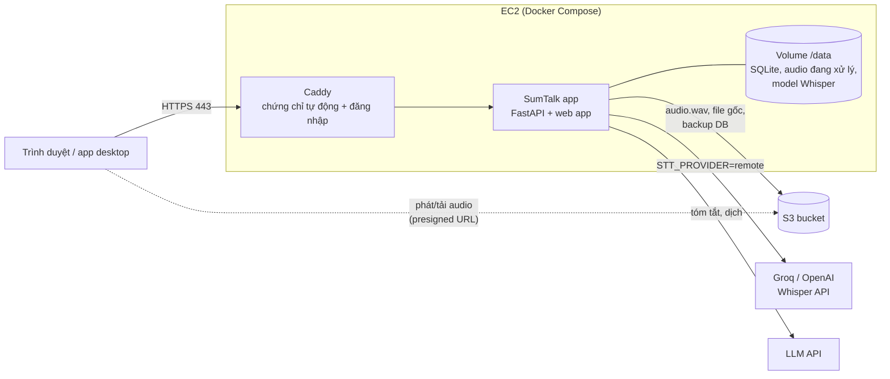

# Triển khai SumTalk lên AWS (EC2 + S3)

Hướng dẫn đưa bản web SumTalk lên một máy EC2 để nhóm test và demo cho khách mà không cần cài app. Kết quả là
một địa chỉ `https://...` có trang đăng nhập. Audio đã xử lý xong được lưu trên S3, còn database được tự động
sao lưu lên S3. Thời gian làm lần đầu khoảng 45–60 phút.

> Các file dùng trong hướng dẫn: [`Dockerfile`](../../Dockerfile), [`deploy/`](../../deploy) (compose, Caddyfile,
> `.env.example`, script), [`deploy/aws/iam-policy-s3.json`](../../deploy/aws/iam-policy-s3.json).

## 0. Kiến trúc và chọn cấu hình



| | **A. CPU + Whisper API** (khuyên dùng cho test) | **B. GPU tự chạy Whisper** |
|---|---|---|
| EC2 | `t3.large` (2 vCPU, 8 GB) | `g4dn.xlarge` (T4 16 GB) hoặc `g6.xlarge` (L4 24 GB) |
| AMI | Ubuntu Server 24.04 LTS | Deep Learning Base OSS Nvidia Driver GPU AMI (Ubuntu 22.04/24.04) |
| Speech-to-text | Groq `whisper-large-v3-turbo` (hoặc OpenAI `whisper-1`) | Whisper `large-v3-turbo` chạy trên GPU của máy |
| Làm engine cho app desktop | Không | Có (`STT_SERVER_API_KEYS`), máy khách không phải tải model |
| Chi phí máy (ước tính, Singapore, chạy 24/7) | khoảng 75–80 USD/tháng | khoảng 530 USD/tháng (g4dn); bật/tắt theo giờ test thì rẻ hơn nhiều |
| Chi phí STT | Groq khoảng 0.04 USD/giờ audio, OpenAI khoảng 0.36 USD/giờ | Không tốn thêm |

> Giá trên chỉ là ước tính để tham khảo. Trước khi tạo tài nguyên, hãy kiểm tra lại trên
> [AWS Pricing Calculator](https://calculator.aws/) và trang giá của Groq/OpenAI. Ngoài ra còn các khoản nhỏ:
> EBS gp3 30–50 GB, S3 (một giờ audio WAV khoảng 115 MB), Elastic IP/public IPv4 khoảng 3.6 USD/tháng.

Region nên chọn **ap-southeast-1 (Singapore)** vì gần Việt Nam. S3 bucket và EC2 phải ở cùng region.

## 1. Chuẩn bị

1. Có tài khoản AWS và quyền tạo EC2, S3, IAM. Bật **MFA** cho tài khoản root, rồi dùng một IAM user hoặc
   IAM Identity Center để làm việc.
2. **Đưa code lên GitHub**, vì máy EC2 sẽ `git clone`. Hiện các nhánh mới chỉ có ở máy dev, do lệnh push bị từ
   chối (403): tài khoản `datanthan` chưa có quyền ghi vào `DatTapTanhCode/SumTalk`. Chủ repo cần thêm tài khoản
   đó làm collaborator, hoặc đăng nhập đúng tài khoản rồi chạy:
   ```bash
   git push -u origin feature/sprint3-summary-translation feature/desktop-app feature/streaming-stt feature/aws-deploy
   ```
   Nếu repo private, trên EC2 cần thêm deploy key hoặc personal access token. Cách khác là chép code lên bằng
   `scp`.
3. Chuẩn bị key API:
   - Cấu hình A: Groq API key (console.groq.com) hoặc OpenAI API key.
   - Tóm tắt/dịch: key của một LLM chuẩn OpenAI (OpenAI, Groq, OpenRouter…). Muốn demo mà chưa có key thì đặt
     `AI_MOCK=true`.
4. (Tuỳ chọn) Một tên miền. Nếu không có, dùng `sslip.io`, ví dụ IP `13.229.10.20` thành địa chỉ
   `13-229-10-20.sslip.io`.

## 2. Tạo S3 bucket

Vào **S3 → Create bucket**:

| Mục | Giá trị |
|---|---|
| Bucket name | duy nhất toàn cầu, ví dụ `sumtalk-audio-<tên-nhóm>` |
| Region | ap-southeast-1 |
| Object Ownership | ACLs disabled |
| Block all public access | **Bật** (audio chỉ được phát qua presigned URL có hạn dùng) |
| Bucket Versioning | Tuỳ chọn (nên bật nếu muốn khôi phục khi xoá nhầm) |
| Default encryption | SSE-S3 (mặc định) |

Tuỳ chọn: mục **Management → Lifecycle rule** cho prefix `sumtalk/backups/`, xoá bản cũ hơn 30 ngày.

App chỉ dùng prefix `sumtalk/` trong bucket:
- `sumtalk/meetings/<id>/audio.wav` và `original.<đuôi>`: audio đã phiên âm xong.
- `sumtalk/backups/app-YYYYMMDD-HHMMSS.db`: bản sao database, mặc định 6 giờ một lần.

## 3. IAM role cho EC2 (không dùng access key)

1. **IAM → Policies → Create policy → JSON**: dán nội dung
   [`deploy/aws/iam-policy-s3.json`](../../deploy/aws/iam-policy-s3.json), thay `REPLACE_WITH_BUCKET_NAME` bằng
   tên bucket. Đặt tên `SumTalkS3Access`.
2. **IAM → Roles → Create role** → Trusted entity: **AWS service → EC2** → gắn policy `SumTalkS3Access` (có thể
   thêm `AmazonSSMManagedInstanceCore` nếu muốn vào máy bằng Session Manager thay cho SSH) → đặt tên
   `SumTalkEC2Role`.

App lấy quyền từ role này qua instance metadata, nên **không cần** đặt `AWS_ACCESS_KEY_ID` trong `.env`.

## 4. Security group

**EC2 → Security Groups → Create**, đặt tên `sumtalk-web`, chọn VPC mặc định:

| Type | Port | Source | Lý do |
|---|---|---|---|
| SSH | 22 | **My IP** | quản trị (không mở 0.0.0.0/0) |
| HTTP | 80 | 0.0.0.0/0, ::/0 | lấy chứng chỉ, tự chuyển sang HTTPS |
| HTTPS | 443 | 0.0.0.0/0, ::/0 | web app, API |
| Custom UDP | 443 | 0.0.0.0/0, ::/0 | HTTP/3 (tuỳ chọn) |

## 5. Tạo máy EC2

**EC2 → Launch instance**:

| Mục | Cấu hình A (CPU) | Cấu hình B (GPU) |
|---|---|---|
| AMI | Ubuntu Server 24.04 LTS (x86_64) | Deep Learning Base OSS Nvidia Driver GPU AMI (Ubuntu) |
| Instance type | `t3.large` | `g4dn.xlarge` (nếu chưa được cấp quota GPU thì xin tăng quota "Running On-Demand G and VT instances" ≥ 4 vCPU) |
| Key pair | tạo mới (`.pem`) và cất kỹ | như A |
| Network | security group `sumtalk-web`, Auto-assign public IP: Enable | như A |
| Storage | 30 GB gp3 | 80 GB gp3 (driver, image CUDA, model) |
| Advanced → IAM instance profile | `SumTalkEC2Role` | như A |

Rồi bấm **Launch**.

## 6. Elastic IP và địa chỉ web

1. **EC2 → Elastic IPs → Allocate** → **Associate** với máy vừa tạo, để IP không đổi khi stop/start máy.
2. Chọn địa chỉ:
   - Có tên miền: tạo bản ghi **A** `sumtalk.<tên-miền>` trỏ tới Elastic IP (Route 53 hoặc nhà cung cấp tên miền).
   - Không có: dùng `<IP thay dấu chấm bằng gạch>.sslip.io`, ví dụ `13-229-10-20.sslip.io`.

Địa chỉ này là `SITE_ADDRESS` ở bước 8. Trình duyệt chỉ cho dùng micro trên HTTPS, nên **không** dùng IP trần.

## 7. Vào máy và cài đặt

```bash
chmod 400 sumtalk.pem                                  # Windows: dùng PowerShell/Git Bash hoặc PuTTY
ssh -i sumtalk.pem ubuntu@<ELASTIC_IP>

# Cài Docker, tạo swap, clone code (thay URL/nhánh cho đúng)
curl -fsSL https://raw.githubusercontent.com/DatTapTanhCode/SumTalk/feature/aws-deploy/deploy/scripts/ec2-bootstrap.sh \
  | bash -s -- https://github.com/DatTapTanhCode/SumTalk.git feature/aws-deploy
exit                                                   # thoát rồi SSH lại để dùng docker không cần sudo
ssh -i sumtalk.pem ubuntu@<ELASTIC_IP>
```

Repo private, hoặc chưa push được: chép code lên rồi chạy script trong đó.

```bash
# trên máy dev (Git Bash), trong thư mục sumtalk
git archive --format=tar.gz -o sumtalk.tgz HEAD
scp -i sumtalk.pem sumtalk.tgz ubuntu@<ELASTIC_IP>:~
# trên EC2
mkdir -p ~/sumtalk && tar -xzf ~/sumtalk.tgz -C ~/sumtalk && bash ~/sumtalk/deploy/scripts/ec2-bootstrap.sh
```

## 8. Cấu hình `deploy/.env`

```bash
cd ~/sumtalk/deploy
docker run --rm caddy:2.10 caddy hash-password --plaintext 'MatKhauTest@2026'   # chép chuỗi $2a$14$...
nano .env
```

| Biến | Giá trị | Ghi chú |
|---|---|---|
| `SITE_ADDRESS` | `sumtalk.ten-mien.vn` hoặc `13-229-10-20.sslip.io` | không có `https://` |
| `BASIC_AUTH_USER` / `BASIC_AUTH_HASH` | user / hash vừa tạo | **giữ dấu nháy đơn** quanh hash |
| `GPU` | `0` (A) hoặc `1` (B) | |
| `STT_PROVIDER` | A: `remote`; B: `local` | |
| `STT_BASE_URL`, `STT_API_KEY`, `STT_MODEL` | A: `https://api.groq.com/openai/v1`, key Groq, `whisper-large-v3-turbo` | OpenAI: `https://api.openai.com/v1`, `whisper-1` |
| `LIVE_INTERVAL_SEC` | A: `1.5` | giảm số request khi ghi live, đỡ tốn tiền và đỡ bị rate limit |
| `STT_SERVER_API_KEYS` | B: một hoặc vài chuỗi ngẫu nhiên, cách nhau dấu phẩy | để app desktop dùng GPU của server |
| `STORAGE_BACKEND`, `S3_BUCKET`, `S3_REGION` | `s3`, tên bucket, `ap-southeast-1` | |
| `S3_DB_BACKUP_HOURS` | `6` | `0` = tắt sao lưu |
| `AI_MOCK` / `LLM_BASE_URL` / `LLM_API_KEY` / `SUMMARY_MODEL` / `TRANSLATION_MODEL` | | `AI_MOCK=true` để demo không cần LLM |

Tạo chuỗi key ngẫu nhiên bằng: `openssl rand -hex 24`.

## 9. Chạy và kiểm tra

```bash
cd ~/sumtalk/deploy
docker compose up -d --build                                                    # cấu hình A
# docker compose -f docker-compose.yml -f docker-compose.gpu.yml up -d --build  # cấu hình B
docker compose ps                         # app: healthy, caddy: running
docker compose logs -f caddy              # đợi dòng "certificate obtained successfully"
docker compose logs -f app                # xem lỗi STT/S3 nếu có
curl -s -u sumtalk:'MatKhauTest@2026' https://$SITE_ADDRESS/api/health
```

Lần build đầu mất khoảng 5–10 phút. Với cấu hình B, lần chạy đầu còn tải model Whisper 1.6 GB vào volume.

Kiểm tra trên trình duyệt, mở `https://<SITE_ADDRESS>` rồi đăng nhập:
1. Góc trái phía dưới hiện `whisper-large-v3-turbo · Server` (A) hoặc `Whisper large-v3-turbo · GPU` (B).
2. **Record**: cho phép micro, nói khoảng 30 giây. Chữ phải hiện theo lời nói, trễ khoảng 1–3 giây.
3. **Upload**: tải một file MP3 dài vài phút lên, phải thấy các dòng đầu sau vài giây.
4. Trên AWS Console → S3: sau khi meeting xong, phải có `sumtalk/meetings/<id>/audio.wav`; nút Play vẫn phát
   được (qua presigned URL).

## 10. (Cấu hình B) Dùng server làm engine cho app desktop

Trên từng máy cài app SumTalk, mở **File → Settings…** rồi sửa:

```ini
STT_PROVIDER=remote
STT_BASE_URL=https://<SITE_ADDRESS>/v1
STT_API_KEY=<một key trong STT_SERVER_API_KEYS>
```

Rồi chọn **File → Restart SumTalk**. Muốn bản cài có sẵn cấu hình này thì khi build trên máy dev chạy:
`set SUMTALK_DEFAULT_STT_PROVIDER=remote`, `set SUMTALK_DEFAULT_STT_BASE_URL=https://<SITE_ADDRESS>/v1`,
`set SUMTALK_DEFAULT_STT_API_KEY=<key>`, sau đó `build-desktop.bat`. `/v1` không đi qua trang đăng nhập
mà được bảo vệ bằng key, nên khi lộ key chỉ cần đổi key đó trong `.env` rồi `docker compose up -d`.

## 11. Cập nhật phiên bản mới

```bash
cd ~/sumtalk && bash deploy/scripts/update.sh feature/aws-deploy     # hoặc main sau khi merge
```

Script sẽ pull code, build lại và khởi động lại. Database (volume `sumtalk-data`) và audio trên S3 được giữ
nguyên.

## 12. Sao lưu và khôi phục

- Audio đã xong nằm trên S3. Database được app tự sao lưu lên `s3://<bucket>/sumtalk/backups/` mỗi
  `S3_DB_BACKUP_HOURS` giờ.
- Nên bật thêm snapshot EBS hằng ngày: **EC2 → Lifecycle Manager → Create policy** cho volume của máy.
- Khôi phục database:
  ```bash
  cd ~/sumtalk/deploy
  docker compose stop app
  aws s3 cp s3://<bucket>/sumtalk/backups/app-YYYYMMDD-HHMMSS.db ./app.db    # máy cần AWS CLI: sudo snap install aws-cli --classic
  docker compose cp ./app.db app:/data/app.db
  docker compose start app
  ```

## 13. Giám sát và kiểm soát chi phí

- **Billing → Budgets → Create budget**, ví dụ 30 USD/tháng, có cảnh báo qua email ở mức 80%.
- Không test thì **Stop** máy: EC2 không tính tiền giờ chạy, chỉ còn EBS + Elastic IP. Khi **Start** lại, app tự
  chạy (`restart: unless-stopped`).
- Xem log: `docker compose logs --since 1h app`. Xem tải: `docker stats`. Với GPU: `nvidia-smi`.
- Tuỳ chọn: CloudWatch alarm khi `StatusCheckFailed` để biết máy chết.

## 14. Gỡ bỏ hoàn toàn

1. EC2 → Terminate instance (EBS gốc bị xoá theo).
2. EC2 → Elastic IPs → **Release** (nếu không release vẫn bị tính tiền).
3. S3 → Empty bucket → Delete bucket (nếu không cần giữ audio).
4. IAM → xoá role `SumTalkEC2Role` và policy `SumTalkS3Access`; xoá security group `sumtalk-web`.

## 15. Xử lý sự cố

| Triệu chứng | Nguyên nhân thường gặp | Cách xử lý |
|---|---|---|
| Caddy báo lỗi lấy chứng chỉ | DNS chưa trỏ đúng IP, hoặc cổng 80/443 chưa mở | `dig +short <SITE_ADDRESS>` phải ra Elastic IP; kiểm tra security group; `docker compose restart caddy` |
| Trình duyệt hỏi đăng nhập liên tục | Hash sai, hoặc mất dấu nháy đơn trong `.env` | Tạo lại hash, đặt trong `'...'`, rồi `docker compose up -d` |
| Header báo "Speech model error … refused the key" | Sai `STT_API_KEY` | Sửa `.env`, `docker compose up -d` |
| Lỗi HTTP 429 trong log app | Vượt rate limit của Groq/OpenAI | Tăng `LIVE_INTERVAL_SEC` lên 2–3, giảm `STT_CONCURRENCY`, hoặc nâng gói của nhà cung cấp |
| Upload xong nhưng không phát được audio | Role thiếu quyền S3, hoặc sai bucket/region | `docker compose logs app \| grep -i s3`; kiểm tra policy và `S3_BUCKET`/`S3_REGION` |
| Cấu hình B chạy CPU thay vì GPU | Thiếu NVIDIA Container Toolkit, hoặc quên file gpu.yml | `docker run --rm --gpus all nvidia/cuda:12.4.1-base-ubuntu22.04 nvidia-smi`; chạy lại với `-f docker-compose.gpu.yml` |
| Build hết RAM | Máy nhỏ | Script đã tạo swap 2 GB; hoặc build image trên máy khác rồi push lên ECR |

## Checklist

- [ ] Bucket S3 private, cùng region với EC2
- [ ] Role `SumTalkEC2Role` gắn vào máy; không có access key trong `.env`
- [ ] SSH chỉ mở cho IP của mình
- [ ] `SITE_ADDRESS` trỏ đúng Elastic IP, HTTPS hoạt động, có trang đăng nhập
- [ ] Ghi âm thử: chữ hiện theo lời nói; upload thử: audio lên S3
- [ ] Đã đặt Budget cảnh báo chi phí
- [ ] `deploy/.env` không bị commit (đã có trong `.gitignore`)
