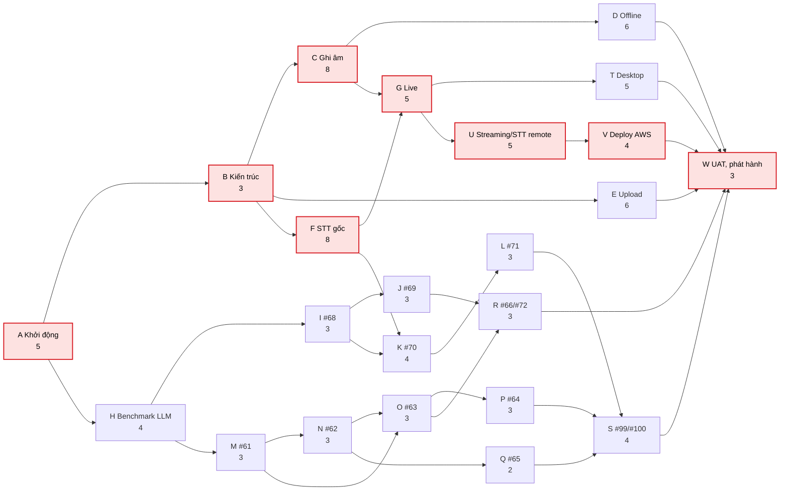
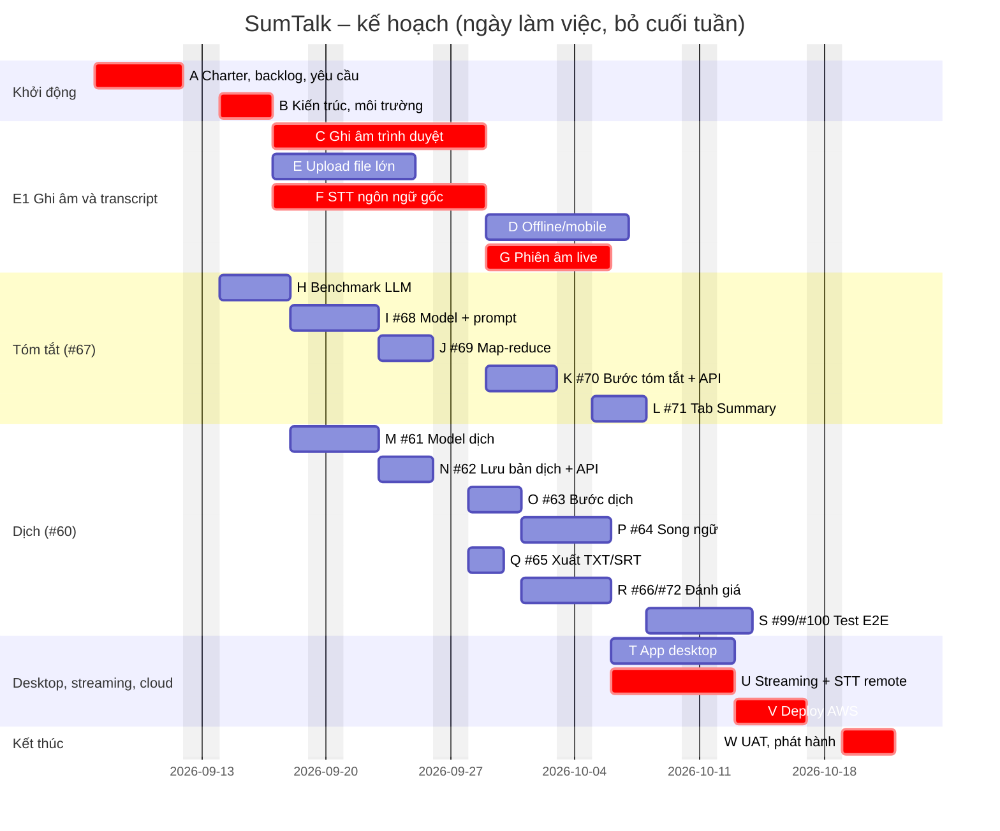
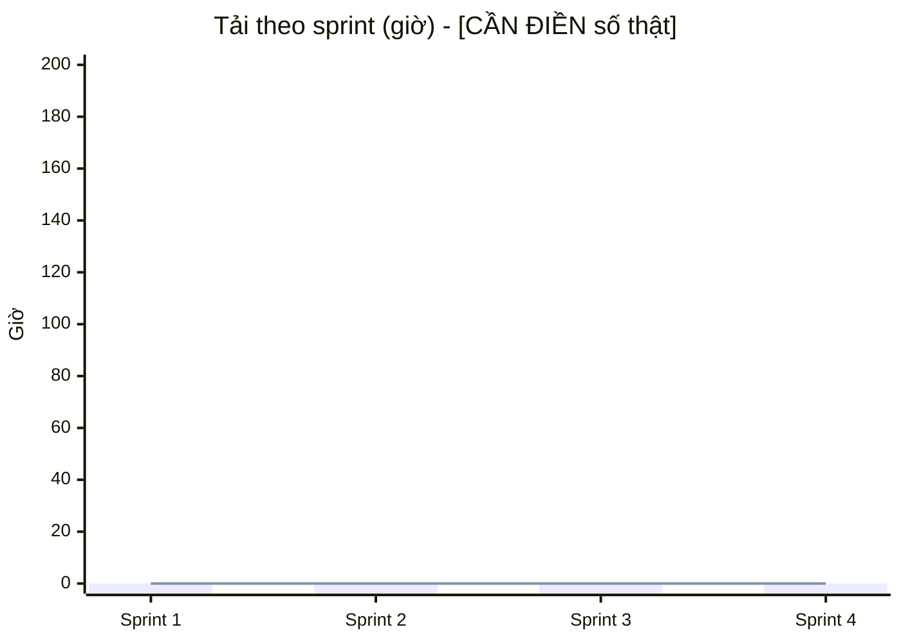

# Project Management Plan – Kế hoạch quản lý dự án

| | |
|---|---|
| Dự án | SumTalk – ghi âm, phiên âm, tóm tắt và dịch biên bản cuộc họp |
| Mã tài liệu | SUMTALK-PMP |
| Phiên bản | 2.0 – 13/11/2026 |
| Người lập | [CẦN ĐIỀN: Project Manager] |
| Người duyệt | Sponsor, Product Owner, Project Manager |
| Trạng thái | Chờ duyệt |

**Mục đích:** Kế hoạch tổng thể để thực hiện và kiểm soát dự án: phạm vi (WBS), ước lượng, lịch trình và đường găng, rủi ro, nguồn lực, chi phí, tổ chức nhóm và truyền thông. Kế hoạch chất lượng và kiểm thử nằm ở tài liệu Chất lượng và kiểm thử.

> Ô `[CẦN ĐIỀN]` là số liệu đã có ở Azure Boards, dashboard chi phí hoặc biên bản họp nhưng chưa chép vào đây.
> **Giả định** là con số đặt ra để tính toán; bảng ghi rõ công thức để tính lại khi có số thật.

## Mục lục

1. [Work Breakdown Structure (WBS)](#wbs)
2. [Ước lượng effort](#effort)
3. [Lịch trình: sơ đồ mạng, CPM, Gantt, release plan](#schedule)
4. [Risk Register và quản lý rủi ro](#risk)
5. [Kế hoạch và phân bổ nguồn lực](#resource)
6. [Kế hoạch chi phí và ngân sách](#cost)
7. [Tổ chức nhóm, RACI và kế hoạch truyền thông](#communication)

## Lịch sử phiên bản

| Phiên bản | Ngày | Nội dung | Người thực hiện |
|---|---|---|---|
| 1.0 | 12/11/2026 | Bản đầu, gồm các tài liệu riêng: 06-wbs, 07-effort-estimation, 08-schedule-cpm-gantt, 09-risk-register, 10-resource-plan, 11-cost-budget-plan, 13-communication-raci | [CẦN ĐIỀN] |
| 2.0 | 13/11/2026 | Gộp thành một tài liệu, đánh lại số mục (CR-08) | [CẦN ĐIỀN] |

<a id="wbs"></a>

## 1. Work Breakdown Structure (WBS)

**Tóm tắt:** dự án được phân rã thành 9 nhánh cấp 1: 1 nhánh quản lý dự án, 7 nhánh theo epic, 1 nhánh kiểm thử
và phát hành. Gói công việc ở cấp thấp nhất tương ứng với task trên Azure Boards (T1.x, #61–#72, #99, #100) hoặc
các commit theo task trên GitHub.

### 1.1 Sơ đồ WBS (cấp 1–2)

```mermaid
flowchart TB
  P["SumTalk"] --> M["1 Quản lý dự án"]
  P --> E1["2 E1 Ghi lại cuộc họp"]
  P --> E2["3 E2 Transcript"]
  P --> E3["4 E3 Tóm tắt #67"]
  P --> E4["5 E4 Dịch #60"]
  P --> E5["6 E5 App desktop"]
  P --> E6["7 E6 Engine STT dùng chung"]
  P --> E7["8 E7 Triển khai web AWS"]
  P --> Q["9 Kiểm thử và phát hành"]
  M --> M1["1.1 Khởi động"] & M2["1.2 Lập kế hoạch"] & M3["1.3 Theo dõi, kiểm soát"] & M4["1.4 Kết thúc"]
  E1 --> E11["2.1 Ghi âm trình duyệt"] & E12["2.2 Offline, điện thoại"] & E13["2.3 Upload"]
  E2 --> E21["3.1 STT ngôn ngữ gốc"] & E22["3.2 Live"] & E23["3.3 Trang cuộc họp, xuất file"]
  E3 --> E31["4.1 Model, prompt"] & E32["4.2 Map-reduce"] & E33["4.3 Job, API"] & E34["4.4 Giao diện"]
  E4 --> E41["5.1 Model dịch"] & E42["5.2 Lưu trữ, API"] & E43["5.3 Job có tiến độ"] & E44["5.4 Giao diện, xuất"]
```



### 1.2 Từ điển WBS (đến gói công việc)

| Mã WBS | Gói công việc | Sản phẩm bàn giao | Liên kết board / repo |
|---|---|---|---|
| 1.1 | Khởi động | Charter, Business Case, chọn phương pháp | [Hồ sơ khởi động dự án](01-project-initiation.md) |
| 1.2 | Lập kế hoạch | Backlog, yêu cầu, ước lượng, lịch, rủi ro, nguồn lực, chi phí, chất lượng, RACI | [Đặc tả yêu cầu](02-software-requirements-specification.md), tài liệu này, [Chất lượng và kiểm thử](04-quality-and-test.md) |
| 1.3 | Theo dõi và kiểm soát | Sprint report, EVA, biên bản, Change Log | [Báo cáo theo dõi và kiểm soát](05-monitoring-and-control-report.md) |
| 1.4 | Kết thúc | SOW/nghiệm thu, test summary, release notes, lessons learned | [Báo cáo kết thúc dự án](06-project-closure-report.md), [Test Summary](04-quality-and-test.md#test-summary) |
| 2.1 | Ghi âm trên trình duyệt | Màn hình ghi âm, recorder (micro + âm thanh họp), gửi chunk, tạo meeting | T1.1.1–T1.1.5 |
| 2.2 | Offline và điện thoại | IndexedDB, đồng bộ, Wake Lock, PWA | T1.2.1–T1.2.5 |
| 2.3 | Upload | Màn hình upload, kiểm tra file, upload theo phần, chuẩn hoá audio | T1.3.1–T1.3.5 |
| 3.1 | STT ngôn ngữ gốc | Whisper GPU/CPU, nhận ngôn ngữ từng câu, lọc chữ "ảo" | `services/transcriber.py` |
| 3.2 | Transcript live | Live theo LocalAgreement, chunk 1 s, chữ chắc chắn/chữ tạm | nhánh `feature/streaming-stt` |
| 3.3 | Trang cuộc họp | Player đồng bộ, tìm kiếm, xuất TXT/SRT/VTT/JSON/WAV, phiên âm lại | `pages/MeetingPage.tsx` |
| 3.4 | File dài | Chia đoạn tại chỗ im lặng, lưu dần | nhánh `feature/streaming-stt` |
| 4.1 | Model + prompt tóm tắt | Schema, prompt, client LLM | #68 |
| 4.2 | Transcript dài | Map-reduce | #69 |
| 4.3 | Job tóm tắt, lưu trữ, API | Worker, retry, model dữ liệu, endpoint | #70 |
| 4.4 | Giao diện tóm tắt | Tab Summary + Regenerate | #71 |
| 4.5 | Đánh giá tóm tắt | `eval_summary.py` | #72 |
| 5.1 | Model dịch | Prompt, batch, nhận ngôn ngữ | #61 |
| 5.2 | Lưu bản dịch, API | Model dữ liệu, endpoint | #62 |
| 5.3 | Job dịch có tiến độ | Worker | #63 |
| 5.4 | Giao diện và xuất | Chọn ngôn ngữ, song ngữ, xuất TXT/SRT | #64, #65 |
| 5.5 | Đánh giá dịch | `eval_translation.py` | #66 |
| 6.1 | Vỏ Electron | Cửa sổ, menu, quyền, vòng đời backend | `desktop/main.js`, `lib/backend.js` |
| 6.2 | Đóng gói | PyInstaller, bộ cài NSIS, bản GPU | `desktop/sumtalk-server.spec`, `build-desktop.bat` |
| 6.3 | Thích nghi web app | Nhận biết desktop, âm thanh hệ thống | `lib/desktop.ts` |
| 7.1 | Client STT remote | VAD, chia block, song song, retry | `services/stt_remote.py` |
| 7.2 | API STT chuẩn OpenAI | `/v1/audio/transcriptions`, API key | `api/stt_server.py` |
| 7.3 | Cấu hình bộ cài | `SUMTALK_DEFAULT_*` | `desktop/scripts/build-backend.js` |
| 8.1 | Lưu trữ S3 | Lưu audio, presigned URL, sao lưu DB | `services/storage.py` |
| 8.2 | Container và proxy | Dockerfile, Compose, Caddy | `Dockerfile`, `deploy/` |
| 8.3 | Hướng dẫn deploy | Tài liệu từng bước | `docs/deploy/AWS-EC2-S3.md` |
| 9.1 | Test tự động | pytest, Playwright (trình duyệt, desktop) | `backend/tests`, `frontend/e2e`, `desktop/scripts/smoke-test.js` |
| 9.2 | Test E2E Sprint 3 | Test case, kịch bản | #99, #100 |
| 9.3 | UAT và phát hành | Biên bản UAT, release notes, bộ cài, bản web | [Test Summary Report](04-quality-and-test.md#test-summary), [Release Notes](06-project-closure-report.md#release-notes) |

### 1.3 Quy tắc phân rã

- Gói công việc (cấp thấp nhất) làm được trong ≤ 3 ngày và có sản phẩm kiểm tra được (quy tắc 8/80 giờ, nhóm dùng
  ≤ 24 giờ).
- Mỗi gói có đúng một người chịu trách nhiệm (xem RACI [Tổ chức nhóm, RACI và kế hoạch truyền thông](#communication)).
- Gói công việc map 1–1 với task trên Azure Boards; commit trên GitHub ghi mã task (ví dụ `(#70)`).

<a id="effort"></a>

## 2. Ước lượng effort

**Phương pháp chính:** Story Point với Planning Poker, theo từng sprint, rồi quy ra giờ bằng velocity thực tế.
**Đối chiếu:** COCOMO 81 cơ bản (từ số dòng code thật của repo) và Function Point (từ số API và bảng dữ liệu
thật). Hai phương pháp đối chiếu cho kết quả 3.500–5.100 giờ cho cả sản phẩm, nếu làm theo kiểu công ty với một
nhóm toàn thời gian. Con số này dùng để kiểm tra độ hợp lý, không thay cho số giờ thực tế của nhóm.

### 2.1 Story Point và Planning Poker

Quy trình mỗi buổi Sprint Planning:
1. PO đọc user story và acceptance criteria (xem [Product Backlog / PRD và mô tả tính năng](02-software-requirements-specification.md#product-backlog)).
2. Mỗi thành viên chọn lá bài Fibonacci: 1, 2, 3, 5, 8, 13, 21, ?.
3. Lật bài cùng lúc. Người chọn cao nhất và thấp nhất giải thích; vote lại tối đa 2 vòng.
4. Story trên 13 điểm phải tách nhỏ. Story mốc tham chiếu: **#65 Xuất TXT/SRT = 2 điểm**.
5. Quy ra giờ khi lập kế hoạch: giờ ≈ điểm × (giờ thực tế / điểm hoàn thành của 2 sprint gần nhất).

### 2.2 Bảng ước lượng theo backlog

Cột "SP" là điểm đề xuất để nhóm đối chiếu với điểm đã vote trên Azure Boards. Cột "Giờ TT" lấy từ board.

| Task / Story | Nội dung | SP đề xuất | Giờ ước lượng | Giờ TT |
|---|---|---|---|---|
| T1.1.1–T1.1.5 | Ghi âm trên trình duyệt, gửi chunk, tạo meeting, test trình duyệt | 13 | | [CẦN ĐIỀN] |
| T1.2.1–T1.2.5 | Ghi trên điện thoại, offline, tự đồng bộ | 13 | | [CẦN ĐIỀN] |
| T1.3.1–T1.3.5 | Upload file lớn, kiểm tra định dạng, chuẩn hoá audio | 8 | | [CẦN ĐIỀN] |
| STT | Whisper, transcript ngôn ngữ gốc, live | 13 | | [CẦN ĐIỀN] |
| #68 | Model + prompt tóm tắt | 5 | | [CẦN ĐIỀN] |
| #69 | Transcript dài (map-reduce) | 5 | | [CẦN ĐIỀN] |
| #70 | Bước tóm tắt, lưu trữ, API | 5 | | [CẦN ĐIỀN] |
| #71 | Tab Summary + Regenerate | 3 | | [CẦN ĐIỀN] |
| #61 | Model dịch | 3 | | [CẦN ĐIỀN] |
| #62 | Lưu bản dịch + API | 3 | | [CẦN ĐIỀN] |
| #63 | Bước dịch có tiến độ | 3 | | [CẦN ĐIỀN] |
| #64 | Chọn ngôn ngữ + hiển thị song ngữ | 3 | | [CẦN ĐIỀN] |
| #65 | Xuất TXT/SRT (mốc tham chiếu) | 2 | | [CẦN ĐIỀN] |
| #66, #72 | Đánh giá chất lượng dịch, tóm tắt | 5 | | [CẦN ĐIỀN] |
| #99, #100 | Test E2E Sprint 3 | 5 | | [CẦN ĐIỀN] |
| D-1 | App desktop (Electron, đóng gói, bộ cài) | 8 | | [CẦN ĐIỀN] |
| S-1 | Live streaming + STT remote + file dài | 13 | | [CẦN ĐIỀN] |
| O-1 | Deploy AWS (Docker, S3, hướng dẫn) | 8 | | [CẦN ĐIỀN] |
| **Tổng** | | **125** | | |

### 2.3 Velocity

| Sprint | SP cam kết | SP hoàn thành | Giờ thực tế | Giờ/SP |
|---|---|---|---|---|
| Sprint 1 | [CẦN ĐIỀN] | [CẦN ĐIỀN] | [CẦN ĐIỀN] | |
| Sprint 2 | [CẦN ĐIỀN] | [CẦN ĐIỀN] | [CẦN ĐIỀN] | |
| Sprint 3 | [CẦN ĐIỀN] | [CẦN ĐIỀN] | [CẦN ĐIỀN] | |
| **Trung bình** | | | | |

Velocity dùng để lập kế hoạch = trung bình SP hoàn thành của 3 sprint gần nhất. Số sprint còn lại =
SP còn lại trong backlog / velocity.

### 2.4 Đối chiếu bằng COCOMO 81 (cơ bản)

Kích thước đo trong repo ngày 12/11/2026, chỉ tính code viết tay, không tính dòng trống/comment, test và
component UI sinh tự động:

| Thành phần | Dòng code |
|---|---|
| Backend Python (`backend/app`, `run.py`) | 3.386 |
| Frontend TypeScript/React (trừ `components/ui`) | 4.518 |
| Desktop (Electron, build) | 749 |
| **Tổng** | **8.650 dòng (8,65 KLOC)** |

```latex
E = a \cdot KLOC^{b} \;(\text{người-tháng}) \qquad T = c \cdot E^{d} \;(\text{tháng}) \qquad N = E / T
```

| Chế độ | a, b, c, d | Effort E | Thời gian T | Số người N | Giờ (152 h/tháng) | Chi phí (100.000 VND/h) |
|---|---|---|---|---|---|---|
| Organic | 2,4; 1,05; 2,5; 0,38 | 23,1 người-tháng | 8,2 tháng | 2,8 | 3.516 h | 351,6 triệu |
| Semi-detached (có AI/ML, nhiều công nghệ) | 3,0; 1,12; 2,5; 0,35 | 33,6 người-tháng | 8,6 tháng | 3,9 | 5.112 h | 511,2 triệu |

### 2.5 Đối chiếu bằng Function Point (IFPUG, trọng số trung bình)

Đếm từ hệ thống thật: 27 endpoint API, 6 bảng dữ liệu.

| Loại | Đếm từ hệ thống | Số lượng | Trọng số | Điểm |
|---|---|---|---|---|
| EI – nhập liệu | tạo meeting, gửi chunk, finalize, đổi tên, xoá, upload (tạo, part, complete, huỷ), retranscribe, regenerate/dịch | 11 | 4 | 44 |
| EO – xuất có xử lý | export transcript (5 định dạng), export bản dịch, transcript live, tóm tắt, phát audio, API /v1 transcription | 7 | 5 | 35 |
| EQ – truy vấn | danh sách meeting, chi tiết, transcript, health, config, trạng thái upload, danh sách bản dịch, bản dịch, models | 9 | 4 | 36 |
| ILF – dữ liệu nội bộ | Meeting, Segment, Upload, Summary, Translation, SegmentTranslation | 6 | 10 | 60 |
| EIF – dữ liệu ngoài | API LLM, API Whisper/S3 | 2 | 7 | 14 |
| **UFP** | | | | **189** |

Hệ số điều chỉnh VAF = 0,65 + 0,01 × 38 = 1,03 (tổng 14 đặc tính hệ thống, giả định 38 điểm). Từ đó
AFP ≈ **195 FP**. Với năng suất 8 giờ/FP, effort ≈ **1.560 giờ**.

### 2.6 So sánh và kết luận

| Phương pháp | Effort | Ghi chú |
|---|---|---|
| Story Point (125 SP × giờ/SP thực tế) | [CẦN ĐIỀN] | số dùng để lập kế hoạch |
| Function Point (195 FP × 8 h) | khoảng 1.560 giờ | chỉ phần chức năng, chưa gồm desktop/deploy |
| COCOMO organic | khoảng 3.500 giờ | mô hình công ty, gồm cả quản lý, tài liệu |
| COCOMO semi-detached | khoảng 5.100 giờ | |

Giờ thực tế của nhóm thấp hơn nhiều so với COCOMO. Lý do: dùng framework và thư viện có sẵn
(FastAPI, React, faster-whisper, Electron), có công cụ AI hỗ trợ viết code, phạm vi POC chưa có tài khoản và
phân quyền, và COCOMO 81 được hiệu chỉnh trên dự án những năm 1970–80. Khi báo cáo, dùng Story Point làm số kế
hoạch; FP và COCOMO chỉ để chứng minh quy mô sản phẩm.

<a id="schedule"></a>

## 3. Lịch trình: sơ đồ mạng, CPM, Gantt, release plan

**Đường găng:** A → B → C/F → G → U → V → W, dài **33 ngày làm việc** (khoảng 7 tuần nếu đủ người làm song
song). Phần tóm tắt và dịch (H…S) có độ trễ cho phép 3–12 ngày, nên một thành viên đổ sang phần live/STT khi cần
sẽ không làm trễ dự án.

> Thời lượng (ngày làm việc) là **ước lượng** từ story point ([Ước lượng effort](#effort)). Ngày bắt đầu trong
> Gantt giả định là 07/09/2026: [CẦN ĐIỀN: thay bằng ngày bắt đầu Sprint 1 thật]. Phụ thuộc lấy từ board
> (ví dụ #61→#63, #68→#70) và từ kiến trúc. Bảng được tính lại bằng [`tools/pm_calc.py`](tools/pm_calc.py).

### 3.1 Danh sách công việc và phụ thuộc

| ID | Công việc | Ngày | Phụ thuộc | ES | EF | LS | LF | Dự trữ |
|---|---|---|---|---|---|---|---|---|
| A | Khởi động: charter, backlog, yêu cầu và UI/UX | 5 | – | 0 | 5 | 0 | 5 | **0** |
| B | Kiến trúc + môi trường dev | 3 | A | 5 | 8 | 5 | 8 | **0** |
| C | T1.1 Ghi âm trên trình duyệt + gửi chunk | 8 | B | 8 | 16 | 8 | 16 | **0** |
| D | T1.2 Offline/mobile (IndexedDB, đồng bộ) | 6 | C | 16 | 22 | 24 | 30 | 8 |
| E | T1.3 Upload file lớn + chuẩn hoá audio | 6 | B | 8 | 14 | 24 | 30 | 16 |
| F | STT Whisper, transcript ngôn ngữ gốc | 8 | B | 8 | 16 | 8 | 16 | **0** |
| G | Phiên âm live | 5 | C, F | 16 | 21 | 16 | 21 | **0** |
| H | Benchmark model LLM (Sprint 2) | 4 | A | 5 | 9 | 10 | 14 | 5 |
| I | #68 Model + prompt tóm tắt | 3 | H | 9 | 12 | 16 | 19 | 7 |
| J | #69 Transcript dài (map-reduce) | 3 | I | 12 | 15 | 24 | 27 | 12 |
| K | #70 Bước tóm tắt, lưu trữ, API | 4 | I, F | 16 | 20 | 19 | 23 | 3 |
| L | #71 Tab Summary + Regenerate | 3 | K | 20 | 23 | 23 | 26 | 3 |
| M | #61 Model dịch | 3 | H | 9 | 12 | 14 | 17 | 5 |
| N | #62 Lưu bản dịch + API | 3 | M | 12 | 15 | 17 | 20 | 5 |
| O | #63 Bước dịch có tiến độ | 3 | M, N | 15 | 18 | 20 | 23 | 5 |
| P | #64 Chọn ngôn ngữ + song ngữ | 3 | O | 18 | 21 | 23 | 26 | 5 |
| Q | #65 Xuất TXT/SRT | 2 | N | 15 | 17 | 24 | 26 | 9 |
| R | #66/#72 Đánh giá chất lượng | 3 | J, O | 18 | 21 | 27 | 30 | 9 |
| S | #99/#100 Test E2E Sprint 3 | 4 | L, P, Q | 23 | 27 | 26 | 30 | 3 |
| T | App desktop (Electron, PyInstaller) | 5 | G | 21 | 26 | 25 | 30 | 4 |
| U | Streaming + STT remote + file dài | 5 | G | 21 | 26 | 21 | 26 | **0** |
| V | Deploy AWS (Docker, S3, hướng dẫn) | 4 | U | 26 | 30 | 26 | 30 | **0** |
| W | UAT, phát hành, đóng dự án | 3 | S, T, V, R, D, E | 30 | 33 | 30 | 33 | **0** |

ES/EF = bắt đầu/kết thúc sớm nhất; LS/LF = muộn nhất; Dự trữ = LS − ES. Dự trữ 0 là công việc găng.

### 3.2 Sơ đồ mạng (AON), đường găng tô đỏ



### 3.3 Gantt



### 3.4 Release plan theo sprint

| Sprint | Mục tiêu sprint | Công việc | Bản phát hành |
|---|---|---|---|
| Sprint 1 | Ghi âm và transcript gốc chạy được (POC E1) | A, B, C, D, E, F | v0.1 |
| Sprint 2 | Transcript live; chọn model LLM | G, H | v0.2 |
| Sprint 3 | Tóm tắt và dịch hoàn chỉnh, có test E2E | I–S (dời #60 vào sprint này, xem [Change Log (nhật ký thay đổi phạm vi)](05-monitoring-and-control-report.md#change-log)) | v0.3 |
| Sprint 4 | App desktop, live dạng streaming, STT qua server, bản web trên AWS | T, U, V | v0.4 |
| Kết thúc | UAT, nghiệm thu | W | v1.0 |

[CẦN ĐIỀN: đối chiếu cột "Công việc" với việc đã thực sự làm trong từng sprint trên Azure Boards.]

### 3.5 Cách dùng khi theo dõi

- Công việc găng trễ 1 ngày thì cả dự án trễ 1 ngày. Báo ngay trong Daily và ghi vào [Change Log (nhật ký thay đổi phạm vi)](05-monitoring-and-control-report.md#change-log) nếu
  phải dời mốc.
- Công việc có dự trữ (ví dụ E: 16 ngày) là nơi có thể lấy người tạm sang hỗ trợ công việc găng.
- Mỗi sprint, cập nhật ngày thực tế, rồi tính lại bằng `python docs/project/tools/pm_calc.py`.

<a id="risk"></a>

## 4. Risk Register và quản lý rủi ro

**Rủi ro lớn nhất hiện tại:** chi phí và giới hạn của API bên ngoài khi deploy (R6, R8), và độ chính xác STT với
tiếng Việt hoặc họp trộn ngôn ngữ (R1). Cả hai đã có biện pháp kỹ thuật, nhưng cần đo lại trong đợt UAT.

> R1–R6 là các rủi ro đã nêu trong buổi họp của nhóm. Repo chỉ ghi rõ R6 (ngân sách API/LLM); nội dung R1–R5 dưới
> đây là đề xuất. [CẦN ĐIỀN: đối chiếu với biên bản và sửa lại cho khớp tên, mô tả gốc.] R7 trở đi là rủi ro mới
> phát hiện khi làm desktop, streaming và deploy.

### 4.1 Thang đánh giá

| Điểm | Xác suất (P) | Tác động (I) |
|---|---|---|
| 1 | Hiếm (< 10%) | Không đáng kể, xử lý trong ngày |
| 2 | Thấp (10–30%) | Trễ < 2 ngày, không ảnh hưởng mốc |
| 3 | Trung bình (30–50%) | Trễ 1 sprint một phần việc, hoặc tốn thêm < 10% ngân sách |
| 4 | Cao (50–80%) | Lỡ mốc, phải cắt phạm vi, hoặc tốn thêm 10–20% ngân sách |
| 5 | Gần như chắc chắn (> 80%) | Mục tiêu dự án thất bại |

Mức độ = P × I: 1–5 Thấp (theo dõi), 6–11 Trung bình (có kế hoạch ứng phó), 12–25 Cao (xử lý ngay, báo Sponsor).

### 4.2 Sổ rủi ro

| ID | Rủi ro | Hạng mục | P | I | Mức | Chiến lược | Biện pháp ứng phó | Dấu hiệu cảnh báo | Phụ trách | Trạng thái |
|---|---|---|---|---|---|---|---|---|---|---|
| R1 | STT sai với tiếng Việt, họp trộn Anh–Việt, hoặc tự sinh chữ khi im lặng | Kỹ thuật | 3 | 4 | **12** | Giảm | Nhận diện ngôn ngữ theo từng câu; lọc chữ "ảo"; cho chọn cố định ngôn ngữ và phiên âm lại; dùng `large-v3-turbo` qua server GPU | WER cao trong UAT, người dùng sửa nhiều | [Dev STT] | Đang theo dõi |
| R2 | Máy người dùng không có GPU, CPU quá chậm cho live | Kỹ thuật | 4 | 3 | **12** | Giảm | Engine remote (`STT_PROVIDER=remote`): server GPU hoặc Whisper API, client không tải model; bộ cài ghi sẵn cấu hình | Live trễ > 5 s | [Dev] | **Đã xử lý** (Sprint 4) |
| R3 | Trễ tiến độ do làm bán thời gian, trùng lịch công việc khác | Lịch | 4 | 3 | **12** | Giảm | Sprint ngắn; ưu tiên việc găng ([Lịch trình: sơ đồ mạng, CPM, Gantt, release plan](#schedule)); dùng dự trữ của nhánh tóm tắt/dịch | Burndown nằm trên đường lý tưởng 2 ngày liền | PM | Đang theo dõi |
| R4 | Mất dữ liệu ghi âm khi rớt mạng, đóng tab hoặc app | Kỹ thuật | 2 | 4 | 8 | Tránh | Lưu chunk vào IndexedDB trước khi gửi, tự đồng bộ; khôi phục sau crash; hỏi trước khi đóng khi đang ghi | Lỗi đồng bộ trong log | [Dev frontend] | Đã xử lý |
| R5 | Yêu cầu thay đổi, phình phạm vi (thêm desktop, streaming, cloud) | Phạm vi | 4 | 3 | **12** | Chấp nhận có kiểm soát | Mọi thay đổi qua PO + [Change Log](05-monitoring-and-control-report.md#change-log); việc ngoài phạm vi để sau v1.0 | Story mới chen vào giữa sprint | PO | Đang theo dõi |
| R6 | Chi phí API LLM/STT vượt ngân sách | Chi phí | 3 | 3 | 9 | Giảm | Log token và chi phí từng lần chạy; `AI_MOCK` khi demo; `LIVE_INTERVAL_SEC`; VAD bỏ đoạn im lặng không gửi; AWS Budget cảnh báo | Chi phí tuần > 25% ngân sách tháng | PM | Đang theo dõi |
| R7 | Model LLM chạy local (Ollama) quá nặng cho máy nhóm | Kỹ thuật | 3 | 2 | 6 | Chuyển giao | Client chuẩn OpenAI: đổi sang LLM cloud bằng cấu hình | Tóm tắt > 2 phút hoặc hết RAM | [Dev AI] | Đã xử lý |
| R8 | Rate limit của Whisper API (429) khi ghi live | Bên ngoài | 3 | 3 | 9 | Giảm | Retry có back-off; `LIVE_INTERVAL_SEC`; giới hạn `STT_CONCURRENCY`; chuyển sang server GPU riêng | Lỗi 429 trong log | [Dev] | Đang theo dõi |
| R9 | Lộ dữ liệu họp khi deploy công khai (POC chưa có tài khoản) | Bảo mật | 2 | 5 | 10 | Giảm | HTTPS + đăng nhập (Caddy), bucket S3 private + presigned URL ngắn hạn, IAM role tối thiểu, `/v1` có API key, không commit `.env` | Truy cập lạ trong log Caddy | [Dev ops] | Đã xử lý (bản test) |
| R10 | Chi phí AWS phát sinh do quên tắt máy GPU hoặc Elastic IP | Chi phí | 3 | 3 | 9 | Giảm | AWS Budget + email; tắt máy khi không test; checklist gỡ bỏ trong hướng dẫn deploy | Hoá đơn tăng bất thường | PM | Mới |
| R11 | Mất quyền truy cập repo/CI (push bị 403), mất code chưa push | Cấu hình | 3 | 4 | **12** | Giảm | Thêm collaborator đúng tài khoản; push sau mỗi task; nhánh feature theo sprint | `git push` lỗi | PM | **Đang xảy ra** (12/11/2026) |
| R12 | Bộ cài Windows chưa ký số, bị SmartScreen chặn | Triển khai | 4 | 2 | 8 | Chấp nhận | Hướng dẫn "More info → Run anyway"; demo bằng bản web; ký số khi thương mại | Người dùng báo không cài được | [Dev desktop] | Chấp nhận |
| R13 | iOS dừng micro khi khoá màn hình | Kỹ thuật | 5 | 2 | 10 | Chấp nhận | Giữ màn hình sáng (Wake Lock); ghi chú hạn chế; app native ở phiên bản sau | – | PO | Chấp nhận |
| R14 | Thành viên chủ chốt vắng hoặc rời nhóm | Nhân sự | 2 | 4 | 8 | Giảm | Code review chéo; tài liệu README/ARCHITECTURE; HANDOFF khi bàn giao | Task bị kẹt > 2 ngày | PM | Đang theo dõi |

### 4.3 Ma trận rủi ro (trước ứng phó)

| P \ I | 1 | 2 | 3 | 4 | 5 |
|---|---|---|---|---|---|
| **5** | | R13 | | | |
| **4** | | R12 | R2, R3, R5 | | |
| **3** | | R7 | R6, R8, R10 | R1, R11 | |
| **2** | | | | R4, R14 | R9 |
| **1** | | | | | |

Vùng Cao (≥ 12): R1, R2, R3, R5, R11. R2 đã giảm xuống mức 2 × 2 = 4 sau khi có engine remote.

### 4.4 Quy trình quản lý rủi ro

1. **Nhận diện:** mỗi Sprint Planning và Retrospective, hỏi: "Điều gì có thể làm sprint sau thất bại?"
2. **Đánh giá:** chấm P và I theo thang trên, cập nhật bảng.
3. **Ứng phó:** chọn Tránh / Giảm / Chuyển giao / Chấp nhận; ghi biện pháp và người phụ trách.
4. **Theo dõi:** người phụ trách báo tình trạng trong Daily khi dấu hiệu cảnh báo xuất hiện; PM rà toàn bảng mỗi
   sprint review.
5. **Đóng:** rủi ro đã qua hoặc đã xử lý xong được chuyển sang "Đã đóng", ghi bài học vào [Báo cáo tổng kết và Lessons Learned](06-project-closure-report.md#lessons-learned).

### 4.5 Dự phòng ngân sách và thời gian

- Dự phòng ngân sách: 10% tổng ngân sách ([Kế hoạch chi phí và ngân sách](#cost)) cho R6, R8, R10.
- Dự phòng thời gian: dự trữ của nhánh tóm tắt/dịch (3–12 ngày) và 3 ngày UAT cuối dự án.

<a id="resource"></a>

## 5. Kế hoạch và phân bổ nguồn lực

**Tóm tắt:** nguồn lực gồm con người (theo giờ/sprint), máy móc (laptop GPU của nhóm, máy chủ AWS) và dịch vụ
(API Whisper/LLM). Ràng buộc chính là giờ rảnh của từng người, không phải số người. Việc san tải dựa vào dự trữ
của các công việc không găng ([Lịch trình: sơ đồ mạng, CPM, Gantt, release plan](#schedule)).

### 5.1 Nguồn lực con người theo sprint (giờ)

| Thành viên | Vai trò | Sprint 1 | Sprint 2 | Sprint 3 | Sprint 4 | Tổng |
|---|---|---|---|---|---|---|
| [CẦN ĐIỀN] | PO / BA | | | | | |
| [CẦN ĐIỀN] | SM / PM | | | | | |
| [CẦN ĐIỀN] | Dev Backend / STT | | | | | |
| [CẦN ĐIỀN] | Dev Frontend / Desktop | | | | | |
| [CẦN ĐIỀN] | Dev AI | | | | | |
| [CẦN ĐIỀN] | QC | | | | | |
| **Tổng** | | | | | | |

[CẦN ĐIỀN: lấy từ số liệu tải theo người của nhóm (Azure Boards / dashboard chi phí).] Năng lực mỗi người mỗi
sprint = số ngày × giờ rảnh/ngày × 0,8 (trừ họp và gián đoạn).

### 5.2 Phân công công việc theo sprint

| Sprint | Công việc (ID ở [Lịch trình: sơ đồ mạng, CPM, Gantt, release plan](#schedule)) | Người phụ trách chính |
|---|---|---|
| 1 | A Khởi động, B Kiến trúc, C Ghi âm, D Offline, E Upload, F STT | [CẦN ĐIỀN] |
| 2 | G Live, H Benchmark LLM | [CẦN ĐIỀN] |
| 3 | I–L Tóm tắt (#68–#71), M–Q Dịch (#61–#65), R Đánh giá (#66, #72), S Test E2E (#99, #100) | [CẦN ĐIỀN] |
| 4 | T Desktop, U Streaming + STT remote, V Deploy AWS | [CẦN ĐIỀN] |
| Kết thúc | W UAT, phát hành, tài liệu | Cả nhóm |

### 5.3 Resource histogram

Biểu đồ giờ theo người và sprint (vẽ từ bảng mục 5.1; dán số liệu vào là GitHub hiển thị):



Cột = tổng giờ thực tế; đường = năng lực của nhóm. Sprint nào cột vượt đường là quá tải, phải san tải.

Gợi ý vẽ theo từng người: Excel/Google Sheets dùng biểu đồ cột chồng (stacked column), trục X là sprint, mỗi màu
là một thành viên, kèm một đường ngang thể hiện năng lực.

### 5.4 San tải (resource leveling)

| Tình huống | Cách xử lý | Dựa trên |
|---|---|---|
| Sprint 3 dồn nhiều việc AI (tóm tắt + dịch song song) | Dev frontend làm giao diện #71/#64 sau khi API xong; QC viết test case song song | Dự trữ 3–5 ngày của K, L, O, P |
| Dev STT quá tải ở Sprint 4 (G → U → V đều găng) | Đưa T (desktop, dự trữ 4 ngày) cho Dev frontend; deploy (V) chia phần tài liệu cho PM | Dự trữ của T |
| Thành viên bận việc khác trong một giai đoạn | Dời việc không găng (E: 16 ngày dự trữ, J: 12 ngày) sang sau giai đoạn đó | CPM |
| Một người nghỉ đột xuất | Code review chéo; README/ARCHITECTURE và HANDOFF để người khác tiếp quản | R14 |

### 5.5 Nguồn lực máy móc và dịch vụ

| Nguồn lực | Dùng cho | Số lượng / cấu hình | Chi phí |
|---|---|---|---|
| Laptop dev (i7-13620H, RTX 4050 6 GB) | Phát triển, Whisper GPU local, build bộ cài | 1+ | có sẵn |
| Laptop thành viên khác (CPU) | Frontend, test, dùng engine remote | [CẦN ĐIỀN] | có sẵn |
| AWS EC2 | Bản web test: `t3.large` (CPU) hoặc `g4dn.xlarge` (GPU, bật theo giờ) | 1 | xem [Kế hoạch chi phí và ngân sách](#cost) |
| AWS S3 | Audio, sao lưu database | 1 bucket | vài nghìn VND/GB/tháng |
| Whisper API (Groq/OpenAI) | STT cho bản web CPU | theo giờ audio | xem [Kế hoạch chi phí và ngân sách](#cost) |
| LLM API hoặc Ollama local | Tóm tắt, dịch | theo token | xem [Kế hoạch chi phí và ngân sách](#cost) |
| Azure Boards, GitHub | Quản lý công việc, mã nguồn | gói miễn phí | 0 |

<a id="cost"></a>

## 6. Kế hoạch chi phí và ngân sách

**Tóm tắt:** chi phí chính là nhân công, tính theo đơn giá 100.000 VND/giờ trên dashboard chi phí của nhóm. Chi
phí ngoài nhân công nhỏ: bản test trên AWS khoảng 2,5–3 triệu VND/tháng nếu chạy 24/7 cấu hình CPU, gần như 0 nếu
chỉ bật khi demo. Ngân sách gồm thêm 10% dự phòng.

### 6.1 Đơn giá

| Hạng mục | Đơn giá | Nguồn |
|---|---|---|
| Nhân công (mọi vai trò) | 100.000 VND/giờ | dashboard chi phí của nhóm |
| Tỷ giá quy đổi | 26.000 VND/USD | giả định |

### 6.2 Chi phí nhân công theo sprint

| Sprint | Giờ kế hoạch | Chi phí kế hoạch (PV) | Giờ thực tế | Chi phí thực tế (AC) |
|---|---|---|---|---|
| Sprint 1 | [CẦN ĐIỀN] | = giờ × 100.000 | [CẦN ĐIỀN] | |
| Sprint 2 | [CẦN ĐIỀN] | | [CẦN ĐIỀN] | |
| Sprint 3 | [CẦN ĐIỀN] | | [CẦN ĐIỀN] | |
| Sprint 4 | [CẦN ĐIỀN] | | [CẦN ĐIỀN] | |
| **Tổng (BAC)** | | | | |

Giá trị theo từng sprint dùng cho EVA ở [Earned Value Analysis (EVA)](05-monitoring-and-control-report.md#eva).

### 6.3 Chi phí ngoài nhân công

Giá dưới đây là ước tính từ bảng giá công khai, cần kiểm tra lại trên AWS Pricing Calculator và trang giá của nhà
cung cấp trước khi dùng.

| Khoản | Cách tính | Ước tính/tháng | Ghi chú |
|---|---|---|---|
| EC2 `t3.large` (Singapore), 24/7 | khoảng 0,1 USD/giờ × 730 giờ | khoảng 2,0 triệu VND | bật/tắt theo giờ test: rẻ hơn tương ứng |
| EBS gp3 30 GB | khoảng 0,1 USD/GB | khoảng 80.000 VND | |
| Public IPv4 / Elastic IP | khoảng 0,005 USD/giờ | khoảng 95.000 VND | nhớ release khi gỡ |
| S3 Standard | khoảng 0,025 USD/GB; 1 giờ audio khoảng 115 MB | < 50.000 VND cho 100 giờ audio | |
| Whisper API – Groq `whisper-large-v3-turbo` | khoảng 0,04 USD/giờ audio | 100 giờ audio khoảng 104.000 VND | live: cửa sổ ngắn gửi lặp lại, chi phí thực tế cao hơn giờ audio |
| Whisper API – OpenAI `whisper-1` | khoảng 0,006 USD/phút | 100 giờ audio khoảng 940.000 VND | phương án dự phòng |
| LLM tóm tắt/dịch (cloud, model nhỏ) | theo token; app log chi phí từng lần chạy | khoảng 130.000 VND | `LLM_PRICE_*_PER_1M` để log chi phí |
| EC2 GPU `g4dn.xlarge` (nếu cần) | khoảng 0,7 USD/giờ | 20 giờ demo khoảng 370.000 VND | không chạy 24/7 |
| Chứng chỉ HTTPS, tên miền | Let's Encrypt miễn phí; sslip.io miễn phí | 0 | tên miền riêng tuỳ chọn |
| Ký số bộ cài (code signing) | – | 0 | ngoài phạm vi (R12) |
| **Tổng cấu hình A, 24/7** | | **khoảng 2,5–3 triệu VND** | |

### 6.4 Tổng ngân sách

| Khoản | Giá trị |
|---|---|
| Nhân công (BAC nhân công) | [CẦN ĐIỀN: tổng giờ × 100.000] |
| Hạ tầng + API trong thời gian test (giả định 2 tháng) | khoảng 6 triệu VND |
| Dự phòng (10%) | 10% × (nhân công + hạ tầng) |
| **Tổng ngân sách được duyệt** | [CẦN ĐIỀN] |

### 6.5 Kiểm soát chi phí

- **Theo dõi:** dashboard chi phí của nhóm cập nhật giờ mỗi sprint; EVA (CPI/SPI) trong sprint report
  ([Sprint Report / Status Report](05-monitoring-and-control-report.md#status-report), [Earned Value Analysis (EVA)](05-monitoring-and-control-report.md#eva)).
- **Cảnh báo:** AWS Budget (email ở mức 80%); log chi phí token của từng lần tóm tắt/dịch.
- **Ngưỡng hành động:** CPI < 0,9 hoặc chi phí ngoài nhân công vượt 25% ngân sách tháng thì PM báo PO và Sponsor,
  cân nhắc cắt phạm vi (Should/Could) hoặc chuyển cấu hình rẻ hơn (CPU + API, tắt máy khi không dùng).
- **Biện pháp kỹ thuật đã có:** `AI_MOCK=true` khi demo; VAD không gửi đoạn im lặng; `LIVE_INTERVAL_SEC` giảm số
  request khi ghi live; engine remote dùng chung một server GPU cho nhiều máy khách.

<a id="communication"></a>

## 7. Tổ chức nhóm, RACI và kế hoạch truyền thông

**Tóm tắt:** nhóm làm Scrum với 1 PO, 1 Scrum Master/PM, BA, QC và Dev. Mỗi sản phẩm bàn giao có đúng một người
**A** (chịu trách nhiệm cuối). Kênh chính là Azure Boards (công việc), GitHub (code) và nhóm chat (trao đổi nhanh).

### 7.1 Thành viên và vai trò

| Thành viên | Vai trò Scrum | Vai trò chuyên môn | Mảng phụ trách chính |
|---|---|---|---|
| [CẦN ĐIỀN] | Product Owner | BA | Backlog, acceptance criteria, mẫu tham chiếu đánh giá |
| [CẦN ĐIỀN] | Scrum Master / PM | Dev | Kế hoạch, theo dõi chi phí (CPI/SPI), rủi ro, báo cáo |
| [CẦN ĐIỀN] | Developer | Backend / STT | FastAPI, Whisper, pipeline, deploy |
| [CẦN ĐIỀN] | Developer | Frontend / Desktop | React, recorder, offline, Electron |
| [CẦN ĐIỀN] | Developer | AI (LLM) | Tóm tắt, dịch, đánh giá chất lượng |
| [CẦN ĐIỀN] | Developer | QC | Test case, Playwright, báo lỗi |

[CẦN ĐIỀN: chỉnh theo phân vai thật của nhóm; một người có thể giữ nhiều vai.]

### 7.2 Ma trận RACI

R = thực hiện · A = chịu trách nhiệm cuối (mỗi dòng đúng một A) · C = được hỏi ý kiến · I = được thông báo

| Công việc / sản phẩm | PO | PM/SM | Dev Backend | Dev Frontend | Dev AI | QC | Sponsor |
|---|---|---|---|---|---|---|---|
| Project Charter, Business Case | C | **A/R** | I | I | I | I | C (duyệt) |
| Product Backlog, user story, AC | **A/R** | C | C | C | C | C | I |
| Ưu tiên backlog, chấp nhận story | **A** | C | I | I | I | C | I |
| Kế hoạch sprint, lịch, ước lượng | C | **A/R** | R | R | R | R | I |
| Kiến trúc, lựa chọn công nghệ | C | C | **A/R** | R | R | I | I |
| Ghi âm, offline, upload (E1) | C | I | R | **A/R** | I | C | I |
| STT, live streaming, engine remote | C | I | **A/R** | R | I | C | I |
| Tóm tắt, dịch (#67, #60) | C | I | R | R | **A/R** | C | I |
| App desktop | C | I | R | **A/R** | I | C | I |
| Deploy AWS, vận hành bản test | I | C | **A/R** | I | I | C | I |
| Test case, test E2E, báo cáo test | C | I | C | C | C | **A/R** | I |
| Definition of Done, nghiệm thu story | **A** | C | R | R | R | R | I |
| Quản lý rủi ro, Change Log | C | **A/R** | C | C | C | C | I |
| Theo dõi chi phí (EVA, CPI/SPI) | I | **A/R** | I | I | I | I | I |
| Báo cáo trạng thái, sprint report | C | **A/R** | C | C | C | C | I |
| Nghiệm thu cuối, SOW | R | R | I | I | I | C | **A** |

### 7.3 Lịch họp Scrum

| Sự kiện | Khi nào | Thời lượng | Thành phần | Đầu ra |
|---|---|---|---|---|
| Sprint Planning | Đầu sprint | 1–2 giờ | Cả nhóm | Sprint backlog, mục tiêu sprint, ước lượng (Planning Poker) |
| Daily Scrum | [CẦN ĐIỀN: hằng ngày / 3 buổi một tuần] | 15 phút | Dev, SM (PO tuỳ chọn) | Đã làm, sẽ làm, vướng mắc |
| Backlog Refinement | Giữa sprint | 1 giờ | PO, BA, đại diện Dev/QC | Story sẵn sàng cho sprint sau (có AC, đã ước lượng) |
| Sprint Review | Cuối sprint | 1 giờ | Cả nhóm + Sponsor, người dùng thử (khi cần) | Demo, phản hồi, cập nhật backlog |
| Retrospective | Sau review | 45 phút | Cả nhóm | 1–3 hành động cải tiến ([Biên bản họp và Retrospective](05-monitoring-and-control-report.md#minutes)) |

### 7.4 Kế hoạch truyền thông

| Thông tin | Gửi cho | Hình thức | Tần suất | Người gửi |
|---|---|---|---|---|
| Tiến độ task, lỗi | Cả nhóm | Azure Boards (board, Bug) | Liên tục | Người làm task |
| Vướng mắc cần gỡ | SM, người liên quan | Nhóm chat, nêu trong Daily | Khi phát sinh | Bất kỳ |
| Code, review | Dev | GitHub Pull Request trên nhánh feature | Mỗi task | Dev |
| Báo cáo trạng thái (burndown, CPI/SPI, rủi ro) | Sponsor, cả nhóm | [Sprint Report / Status Report](05-monitoring-and-control-report.md#status-report), dashboard chi phí | Mỗi sprint | PM |
| Demo tính năng | Sponsor, người dùng thử | Sprint Review, bản web trên AWS | Mỗi sprint | PO |
| Thay đổi phạm vi | Sponsor, cả nhóm | [Change Log](05-monitoring-and-control-report.md#change-log) + email/chat | Khi có thay đổi | PO/PM |
| Sự cố bản deploy | Dev ops, PM | Nhóm chat | Ngay | Người phát hiện |

**Quy tắc trao đổi:** câu hỏi kỹ thuật trả lời trong ngày làm việc; quyết định phạm vi phải ghi lại trên board
hoặc Change Log, không để lại chỉ trong chat; tài liệu dùng chung nằm trong repo (`docs/`).

### 7.5 Leo thang vấn đề

1. Người làm task tự xử lý (≤ 1 ngày).
2. Báo Scrum Master trong Daily; SM điều phối người hỗ trợ.
3. Ảnh hưởng mục tiêu sprint: PO quyết định cắt hoặc dời story.
4. Ảnh hưởng mốc, ngân sách > 10%, hoặc phạm vi dự án: PM báo Sponsor xin phê duyệt.
