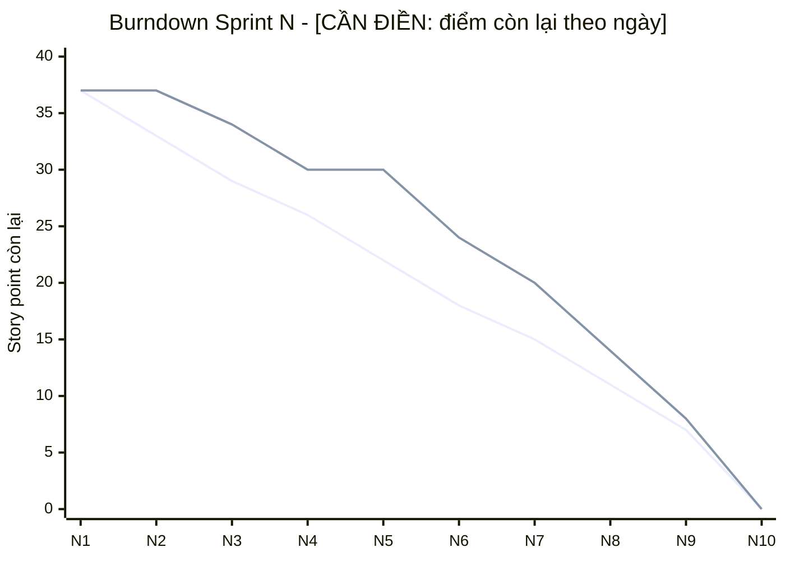
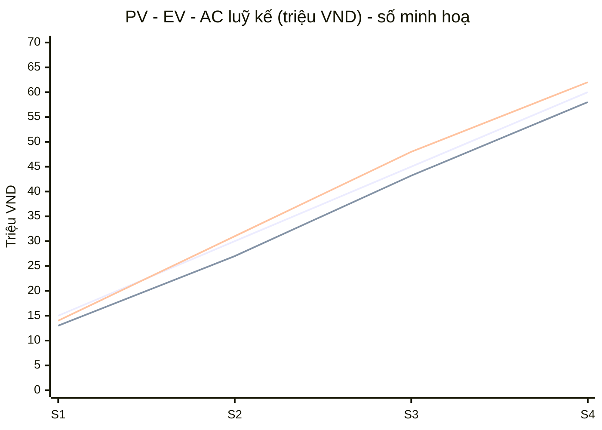

# Monitoring & Control Report – Báo cáo theo dõi và kiểm soát

| | |
|---|---|
| Dự án | SumTalk – ghi âm, phiên âm, tóm tắt và dịch biên bản cuộc họp |
| Mã tài liệu | SUMTALK-MCR |
| Phiên bản | 2.0 – 13/11/2026 |
| Người lập | [CẦN ĐIỀN: Project Manager] |
| Người duyệt | Project Manager, Product Owner (Sponsor nhận bản báo cáo mỗi sprint) |
| Trạng thái | Chờ duyệt |

**Mục đích:** Tập hợp số liệu và hồ sơ sinh ra trong lúc thực hiện dự án: báo cáo từng sprint, phân tích giá trị đạt được (EVA), biên bản họp, retrospective và nhật ký thay đổi phạm vi. Cập nhật sau mỗi sprint.

> Ô `[CẦN ĐIỀN]` là số liệu đã có ở Azure Boards, dashboard chi phí hoặc biên bản họp nhưng chưa chép vào đây.
> **Giả định** là con số đặt ra để tính toán; bảng ghi rõ công thức để tính lại khi có số thật.

## Mục lục

1. [Sprint Report / Status Report](#status-report)
2. [Earned Value Analysis (EVA)](#eva)
3. [Biên bản họp và Retrospective](#minutes)
4. [Change Log (nhật ký thay đổi phạm vi)](#change-log)

## Lịch sử phiên bản

| Phiên bản | Ngày | Nội dung | Người thực hiện |
|---|---|---|---|
| 1.0 | 12/11/2026 | Bản đầu, gồm các tài liệu riêng: 14-sprint-status-reports, 15-earned-value, 16-meeting-minutes-retro, 17-change-log | [CẦN ĐIỀN] |
| 2.0 | 13/11/2026 | Gộp thành một tài liệu, đánh lại số mục (CR-08) | [CẦN ĐIỀN] |

<a id="status-report"></a>

## 1. Sprint Report / Status Report

**Tóm tắt:** mỗi sprint có một báo cáo theo cùng mẫu: mục tiêu, kế hoạch so với thực tế, burndown, velocity, chi phí
(CPI/SPI), vấn đề, rủi ro, quyết định. Sprint 1–3 nhóm đã có số liệu
[CẦN ĐIỀN: chép từ báo cáo S1–S3 hiện có]. Sprint 4 ghi theo các commit trong repo.

### Mẫu báo cáo (chép cho mỗi sprint)

```markdown
### Sprint N – <mục tiêu sprint>   (dd/mm – dd/mm/yyyy)

| Chỉ số | Kế hoạch | Thực tế |
|---|---|---|
| Story point | | |
| Số story Done / cam kết | | |
| Giờ công | | |
| Chi phí (giờ × 100.000 VND) | PV = | AC = |
| EV (giá trị đạt được) | | |
| CPI = EV/AC · SPI = EV/PV | | |

Burndown: <ảnh chụp từ Azure Boards hoặc bảng điểm còn lại theo ngày>
Đã xong: …   Chưa xong (lý do, dời sang đâu): …
Vấn đề phát sinh: …   Rủi ro mới/thay đổi: …   Quyết định và thay đổi phạm vi: … (ghi vào Change Log)
Cải tiến từ retro: …
```

### Tổng hợp các sprint

| Sprint | Mục tiêu | SP cam kết | SP xong | Velocity | CPI | SPI | Ghi chú |
|---|---|---|---|---|---|---|---|
| 1 | Ghi âm, upload, transcript gốc (E1) | [CẦN ĐIỀN] | | | | | |
| 2 | Transcript live, benchmark LLM | [CẦN ĐIỀN] | | | | | |
| 3 | Tóm tắt #67 + dịch #60, test E2E | [CẦN ĐIỀN] | | | | | #60 dời vào sprint này |
| 4 | Desktop, streaming, STT remote, deploy AWS | 37 (đề xuất: D-1 8, S-1 13, O-1 8, US6.2 5, tài liệu 3) | | | | | xem bên dưới |

### Burndown (vẽ từ số liệu)



Đường thứ nhất là đường lý tưởng, đường thứ hai là thực tế. Số trong biểu đồ đang là **ví dụ minh hoạ**, hãy
thay bằng số trên Azure Boards.

### Sprint 4 – Desktop, streaming, cloud (theo repo, 12/11/2026)

| Hạng mục | Kết quả | Bằng chứng |
|---|---|---|
| App desktop Windows | Xong: bộ cài 204 MB, smoke test 8/8 | nhánh `feature/desktop-app` (7 commit) |
| Live streaming | Xong: từ mới khoảng 1 s, câu chốt TB 1,9 s | nhánh `feature/streaming-stt` |
| STT remote, API `/v1` | Xong: máy khách không tải model, độ trễ như GPU local | như trên |
| File dài | Xong: 11,6 phút xử lý trong 18–57 s, dòng đầu sau 3–5 s | như trên |
| Deploy AWS | Xong phần chuẩn bị: image, Compose, Caddy, S3, hướng dẫn; **chưa deploy lên AWS thật** | nhánh `feature/aws-deploy` |
| Tài liệu quản lý | 22 tài liệu `.md`, sau đó gộp thành 6 tài liệu (CR-08) | nhánh `docs/project-management` |
| Test | 88 pytest đạt, ruff sạch | |

**Vấn đề phát sinh:** push lên GitHub bị từ chối (403): tài khoản đang lưu trên máy không có quyền ghi repo (R11).
Các nhánh đang chỉ có ở máy dev.
**Quyết định:** thêm desktop, streaming, cloud vào phạm vi (ghi ở [Change Log (nhật ký thay đổi phạm vi)](#change-log)).
**Việc tiếp theo:** cấp quyền repo và push; deploy thật lên AWS theo hướng dẫn; UAT với người dùng thử; điền số
liệu giờ công Sprint 4.

<a id="eva"></a>

## 2. Earned Value Analysis (EVA)

**Tóm tắt:** EVA so sánh giá trị công việc đã làm được (EV) với chi phí thực tế (AC) và kế hoạch (PV) theo từng
sprint, rồi dự báo tổng chi phí khi hoàn thành (EAC). Nhóm đã có CPI/SPI trên dashboard
[CẦN ĐIỀN: chép số vào bảng mục 2.3]. Tài liệu này ghi phương pháp và cách diễn giải.

### 2.1 Định nghĩa và công thức

| Ký hiệu | Ý nghĩa | Cách lấy trong dự án |
|---|---|---|
| BAC | Ngân sách khi hoàn thành | Tổng giờ kế hoạch × 100.000 VND ([Kế hoạch chi phí và ngân sách](03-project-management-plan.md#cost)) |
| PV | Giá trị kế hoạch đến thời điểm đo | Giờ kế hoạch luỹ kế đến hết sprint × 100.000 |
| EV | Giá trị đạt được | BAC × (SP Done luỹ kế / tổng SP kế hoạch). Chỉ tính story đạt DoD, không tính dở dang |
| AC | Chi phí thực tế | Giờ thực tế luỹ kế × 100.000 |

```latex
CV = EV - AC \qquad SV = EV - PV \qquad CPI = \frac{EV}{AC} \qquad SPI = \frac{EV}{PV}
```
```latex
EAC = \frac{BAC}{CPI} \qquad ETC = EAC - AC \qquad VAC = BAC - EAC \qquad TCPI = \frac{BAC - EV}{BAC - AC}
```

### 2.2 Diễn giải

| Chỉ số | > 1 | = 1 | < 1 |
|---|---|---|---|
| CPI | Tốn ít hơn kế hoạch | Đúng ngân sách | Vượt chi phí: xem lại ước lượng, cắt việc Could |
| SPI | Nhanh hơn kế hoạch | Đúng tiến độ | Chậm: dồn người vào việc găng ([Lịch trình: sơ đồ mạng, CPM, Gantt, release plan](03-project-management-plan.md#schedule)) |
| TCPI | Phải làm hiệu quả hơn trước mới kịp ngân sách | | Còn dư địa |

Ngưỡng hành động của dự án: CPI hoặc SPI < 0,9 thì báo PO/Sponsor ([Kế hoạch chi phí và ngân sách](03-project-management-plan.md#cost)).

### 2.3 Bảng theo dõi theo sprint (luỹ kế)

| Hết sprint | PV (VND) | EV (VND) | AC (VND) | CV | SV | CPI | SPI | EAC |
|---|---|---|---|---|---|---|---|---|
| 1 | [CẦN ĐIỀN] | | | | | | | |
| 2 | [CẦN ĐIỀN] | | | | | | | |
| 3 | [CẦN ĐIỀN] | | | | | | | |
| 4 | [CẦN ĐIỀN] | | | | | | | |

### 2.4 Ví dụ cách tính (số minh hoạ, không phải số của nhóm)

Giả sử BAC = 60 triệu VND (600 giờ), tổng 125 SP. Hết Sprint 3: kế hoạch 450 giờ, thực tế 480 giờ, đã Done 90 SP.

| Bước | Tính | Kết quả |
|---|---|---|
| PV | 450 × 100.000 | 45,0 triệu |
| EV | 60 triệu × 90/125 | 43,2 triệu |
| AC | 480 × 100.000 | 48,0 triệu |
| CPI | 43,2 / 48,0 | 0,90 (vượt chi phí 10%) |
| SPI | 43,2 / 45,0 | 0,96 (chậm 4%) |
| EAC | 60 / 0,90 | 66,7 triệu |
| VAC | 60 − 66,7 | −6,7 triệu (dùng gần hết 10% dự phòng) |
| TCPI | (60 − 43,2) / (60 − 48,0) | 1,40 (phần còn lại phải hiệu quả hơn 40% mới giữ được BAC) |

Kết luận của ví dụ: chạm ngưỡng CPI 0,9, nên PM báo PO để dời một story Should sang phiên bản sau.

### 2.5 Biểu đồ S-curve



Ba đường lần lượt là PV, EV, AC. Thay bằng số thật ở mục 3.

<a id="minutes"></a>

## 3. Biên bản họp và Retrospective

**Tóm tắt:** mẫu biên bản cho 4 loại họp Scrum và bảng kiểm tra độ đầy đủ. Nhóm đã có biên bản các buổi họp
[CẦN ĐIỀN: dán liên kết hoặc chép vào mục 3.4]. Mỗi sprint cần đủ Planning, Review và Retro; Daily chỉ cần ghi
vướng mắc.

### 3.1 Bảng kiểm tra độ đầy đủ

| Sprint | Planning | Review | Retrospective | Ghi chú |
|---|---|---|---|---|
| 1 | [ ] | [ ] | [ ] | |
| 2 | [ ] | [ ] | [ ] | Benchmark LLM; ghi rủi ro R1–R6 |
| 3 | [ ] | [ ] | [ ] | Quyết định dời #60 vào Sprint 3 |
| 4 | [ ] | [ ] | [ ] | Quyết định thêm desktop, streaming, cloud |

### 3.2 Mẫu biên bản

#### Sprint Planning

```markdown
**Sprint N Planning** – ngày … – thành phần: … – chủ trì: SM
Mục tiêu sprint: …
Năng lực (giờ) từng người: …          Velocity tham chiếu: … SP
Story nhận vào (ID, SP, người nhận): …
Ước lượng: Planning Poker, các story phải vote lại: …
Rủi ro, phụ thuộc: …
Quyết định: …
```

#### Sprint Review

```markdown
**Sprint N Review** – ngày … – thành phần: nhóm + Sponsor
Demo: (story – người demo – kết quả: chấp nhận / chưa)
Phản hồi của Sponsor/PO: …
Thay đổi backlog sau review: … (ghi vào Change Log nếu là thay đổi phạm vi)
Số liệu: SP Done …/…, giờ thực tế …, CPI …, SPI …
```

#### Retrospective (Start – Stop – Continue)

```markdown
**Sprint N Retrospective** – ngày …
Điều tốt (Continue): …
Điều chưa tốt (Stop): …
Thử mới (Start): …
Hành động cải tiến (tối đa 3, có người phụ trách và hạn): …
Kiểm tra hành động của retro trước: đã làm / chưa
```

#### Daily Scrum (chỉ ghi khi có vướng mắc)

```markdown
Ngày … – Vướng mắc: … – Người hỗ trợ: … – Hạn gỡ: …
```

### 3.3 Gợi ý nội dung Retrospective Sprint 4 (để nhóm thảo luận)

| Loại | Nội dung |
|---|---|
| Continue | Chia commit theo task, mỗi nhóm việc một nhánh; đo hiệu năng bằng script thay vì ước đoán |
| Continue | Có test tự động cho phần mới (live, STT remote, S3), chạy dưới 10 giây |
| Stop | Để nhiều thay đổi chưa commit trong máy quá lâu (Sprint 3 chưa commit khi bắt đầu Sprint 4) |
| Start | Kiểm tra quyền push repo ngay đầu sprint (sự cố 403 – R11) |
| Start | Deploy bản web sớm để QC test trên môi trường giống thật |

### 3.4 Lưu trữ biên bản

[CẦN ĐIỀN: liên kết tới biên bản các sprint (Azure Boards Wiki, Google Drive…), hoặc chép nội dung vào đây.]

<a id="change-log"></a>

## 4. Change Log (nhật ký thay đổi phạm vi)

**Tóm tắt:** mọi thay đổi phạm vi, mốc hoặc ngân sách phải ghi vào đây trước khi làm, kèm lý do, tác động và người
duyệt. Theo phân quyền trong Charter: thay đổi trong sprint do PO duyệt; thay đổi mốc, ngân sách > 10% hoặc phạm
vi dự án do Sponsor duyệt.

### Quy trình

1. Người đề xuất ghi một dòng (trạng thái "Đề xuất").
2. PM đánh giá tác động: SP/giờ, chi phí, lịch (đường găng [Lịch trình: sơ đồ mạng, CPM, Gantt, release plan](03-project-management-plan.md#schedule)), rủi ro.
3. PO (hoặc Sponsor) duyệt hoặc từ chối.
4. Nếu duyệt: cập nhật backlog, kế hoạch, ngân sách; thông báo theo kế hoạch truyền thông ([Tổ chức nhóm, RACI và kế hoạch truyền thông](03-project-management-plan.md#communication)).

### Nhật ký

| Mã | Ngày | Thay đổi | Lý do | Tác động | Người đề xuất | Người duyệt | Trạng thái |
|---|---|---|---|---|---|---|---|
| CR-08 | 13/11/2026 | Gộp 22 tài liệu quản lý thành 6 tài liệu theo nhóm quy trình (khởi động, yêu cầu, kế hoạch, chất lượng, theo dõi, kết thúc) | Mỗi bên liên quan đọc một tài liệu thay vì nhiều file rời; dễ duyệt và xuất bản | Không đổi lịch, không đổi nội dung | [CẦN ĐIỀN] | [CẦN ĐIỀN] | Đã làm |
| CR-07 | 12/11/2026 | Tài liệu quản lý dự án làm thành 21 file `.md` trong repo thay vì một tài liệu | Dễ chia việc, quản lý phiên bản cùng code | Không đổi lịch | [CẦN ĐIỀN] | [CẦN ĐIỀN] | Đã làm |
| CR-06 | 12/11/2026 | Thêm bản web deploy trên AWS EC2 + S3 (Docker, Caddy, hướng dẫn) | Test và demo cho khách mà không cần cài app | +8 SP; chi phí AWS khoảng 2,5–3 triệu VND/tháng nếu chạy 24/7 | [CẦN ĐIỀN] | [CẦN ĐIỀN] | Đã làm (chưa deploy thật) |
| CR-05 | 12/11/2026 | Engine STT remote + API `/v1`: máy khách không cần model | Máy văn phòng không có GPU; giữ độ chính xác `large-v3-turbo` | +13 SP (gộp với CR-04); thêm phụ thuộc vào server/API | [CẦN ĐIỀN] | [CẦN ĐIỀN] | Đã làm |
| CR-04 | 12/11/2026 | Live "nói tới đâu hiện tới đó" (trễ ≤ 3–5 s) và xử lý file dài ≥ 1 giờ | Yêu cầu của PO sau khi dùng thử | Chunk 1 s, LocalAgreement, chia đoạn file dài | [CẦN ĐIỀN] | [CẦN ĐIỀN] | Đã làm |
| CR-03 | [CẦN ĐIỀN] | Chuyển từ web app sang có thêm app desktop Windows | Khách muốn cài như phần mềm; thu được âm thanh từ Zoom/Teams bản desktop | +8 SP; thêm bộ cài, rủi ro R12 (chưa ký số) | [CẦN ĐIỀN] | [CẦN ĐIỀN] | Đã làm |
| CR-02 | [CẦN ĐIỀN] | Dời story dịch #60 vào Sprint 3 | [CẦN ĐIỀN: lý do theo biên bản] | Sprint 3 nhận thêm 19 SP (#61–#66) | [CẦN ĐIỀN] | [CẦN ĐIỀN] | Đã làm |
| CR-01 | [CẦN ĐIỀN] | [CẦN ĐIỀN: các thay đổi trước đó trong biên bản S1–S2, ví dụ chọn model sau benchmark] | | | | | |

### Thay đổi đã từ chối hoặc hoãn

| Mã | Đề xuất | Lý do hoãn | Xem lại khi |
|---|---|---|---|
| CR-H1 | Nhận diện người nói (diarization) | Tốn thời gian, cần model riêng; không ảnh hưởng mục tiêu chính | Sau v1.0 |
| CR-H2 | Tài khoản, phân quyền | Ngoài phạm vi POC; bản test dùng đăng nhập chung | Trước khi thương mại |
| CR-H3 | Dịch trực tiếp khi đang họp (#84), trang action items (#79) | Ưu tiên Should/Could | Sprint sau |
