# 06 – Work Breakdown Structure (WBS)

**Tóm tắt:** dự án được phân rã thành 9 nhánh cấp 1: 1 nhánh quản lý dự án, 7 nhánh theo epic, 1 nhánh kiểm thử
và phát hành. Gói công việc ở cấp thấp nhất tương ứng với task trên Azure Boards (T1.x, #61–#72, #99, #100) hoặc
các commit theo task trên GitHub.

## 1. Sơ đồ WBS (cấp 1–2)

```mermaid
flowchart TB
  P["SumTalk"] --> M["1 Quản lý dự án"]
  P --> E1["2 E1 Ghi lại cuộc họp"]
  P --> E2["3 E2 Transcript"]
  P --> E3["4 E3 Tóm tắt #67"]
  P --> E4["5 E4 Dịch #60"]
  P --> E5["6 E5 App desktop"]
  P --> E6["7 E6 Engine STT dùng chung"]
  P --> E7["8 E7 Triển khai web AWS"]
  P --> Q["9 Kiểm thử và phát hành"]
  M --> M1["1.1 Khởi động"] & M2["1.2 Lập kế hoạch"] & M3["1.3 Theo dõi, kiểm soát"] & M4["1.4 Kết thúc"]
  E1 --> E11["2.1 Ghi âm trình duyệt"] & E12["2.2 Offline, điện thoại"] & E13["2.3 Upload"]
  E2 --> E21["3.1 STT ngôn ngữ gốc"] & E22["3.2 Live"] & E23["3.3 Trang cuộc họp, xuất file"]
  E3 --> E31["4.1 Model, prompt"] & E32["4.2 Map-reduce"] & E33["4.3 Job, API"] & E34["4.4 Giao diện"]
  E4 --> E41["5.1 Model dịch"] & E42["5.2 Lưu trữ, API"] & E43["5.3 Job có tiến độ"] & E44["5.4 Giao diện, xuất"]
```

## 2. Từ điển WBS (đến gói công việc)

| Mã WBS | Gói công việc | Sản phẩm bàn giao | Liên kết board / repo |
|---|---|---|---|
| 1.1 | Khởi động | Charter, Business Case, chọn phương pháp | [01](01-project-charter.md), [02](02-business-case.md), [03](03-methodology.md) |
| 1.2 | Lập kế hoạch | Backlog, ước lượng, lịch, rủi ro, nguồn lực, chi phí, chất lượng, RACI | [04](04-product-backlog-prd.md)–[13](13-communication-raci.md) |
| 1.3 | Theo dõi và kiểm soát | Sprint report, EVA, biên bản, Change Log | [14](14-sprint-status-reports.md)–[17](17-change-log.md) |
| 1.4 | Kết thúc | SOW/nghiệm thu, test summary, release notes, lessons learned | [18](18-sow-acceptance.md)–[21](21-lessons-learned.md) |
| 2.1 | Ghi âm trên trình duyệt | Màn hình ghi âm, recorder (micro + âm thanh họp), gửi chunk, tạo meeting | T1.1.1–T1.1.5 |
| 2.2 | Offline và điện thoại | IndexedDB, đồng bộ, Wake Lock, PWA | T1.2.1–T1.2.5 |
| 2.3 | Upload | Màn hình upload, kiểm tra file, upload theo phần, chuẩn hoá audio | T1.3.1–T1.3.5 |
| 3.1 | STT ngôn ngữ gốc | Whisper GPU/CPU, nhận ngôn ngữ từng câu, lọc chữ "ảo" | `services/transcriber.py` |
| 3.2 | Transcript live | Live theo LocalAgreement, chunk 1 s, chữ chắc chắn/chữ tạm | nhánh `feature/streaming-stt` |
| 3.3 | Trang cuộc họp | Player đồng bộ, tìm kiếm, xuất TXT/SRT/VTT/JSON/WAV, phiên âm lại | `pages/MeetingPage.tsx` |
| 3.4 | File dài | Chia đoạn tại chỗ im lặng, lưu dần | nhánh `feature/streaming-stt` |
| 4.1 | Model + prompt tóm tắt | Schema, prompt, client LLM | #68 |
| 4.2 | Transcript dài | Map-reduce | #69 |
| 4.3 | Job tóm tắt, lưu trữ, API | Worker, retry, model dữ liệu, endpoint | #70 |
| 4.4 | Giao diện tóm tắt | Tab Summary + Regenerate | #71 |
| 4.5 | Đánh giá tóm tắt | `eval_summary.py` | #72 |
| 5.1 | Model dịch | Prompt, batch, nhận ngôn ngữ | #61 |
| 5.2 | Lưu bản dịch, API | Model dữ liệu, endpoint | #62 |
| 5.3 | Job dịch có tiến độ | Worker | #63 |
| 5.4 | Giao diện và xuất | Chọn ngôn ngữ, song ngữ, xuất TXT/SRT | #64, #65 |
| 5.5 | Đánh giá dịch | `eval_translation.py` | #66 |
| 6.1 | Vỏ Electron | Cửa sổ, menu, quyền, vòng đời backend | `desktop/main.js`, `lib/backend.js` |
| 6.2 | Đóng gói | PyInstaller, bộ cài NSIS, bản GPU | `desktop/sumtalk-server.spec`, `build-desktop.bat` |
| 6.3 | Thích nghi web app | Nhận biết desktop, âm thanh hệ thống | `lib/desktop.ts` |
| 7.1 | Client STT remote | VAD, chia block, song song, retry | `services/stt_remote.py` |
| 7.2 | API STT chuẩn OpenAI | `/v1/audio/transcriptions`, API key | `api/stt_server.py` |
| 7.3 | Cấu hình bộ cài | `SUMTALK_DEFAULT_*` | `desktop/scripts/build-backend.js` |
| 8.1 | Lưu trữ S3 | Lưu audio, presigned URL, sao lưu DB | `services/storage.py` |
| 8.2 | Container và proxy | Dockerfile, Compose, Caddy | `Dockerfile`, `deploy/` |
| 8.3 | Hướng dẫn deploy | Tài liệu từng bước | `docs/deploy/AWS-EC2-S3.md` |
| 9.1 | Test tự động | pytest, Playwright (trình duyệt, desktop) | `backend/tests`, `frontend/e2e`, `desktop/scripts/smoke-test.js` |
| 9.2 | Test E2E Sprint 3 | Test case, kịch bản | #99, #100 |
| 9.3 | UAT và phát hành | Biên bản UAT, release notes, bộ cài, bản web | [19](19-test-summary-report.md), [20](20-release-notes.md) |

## 3. Quy tắc phân rã

- Gói công việc (cấp thấp nhất) làm được trong ≤ 3 ngày và có sản phẩm kiểm tra được (quy tắc 8/80 giờ, nhóm dùng
  ≤ 24 giờ).
- Mỗi gói có đúng một người chịu trách nhiệm (xem RACI [13](13-communication-raci.md)).
- Gói công việc map 1–1 với task trên Azure Boards; commit trên GitHub ghi mã task (ví dụ `(#70)`).
