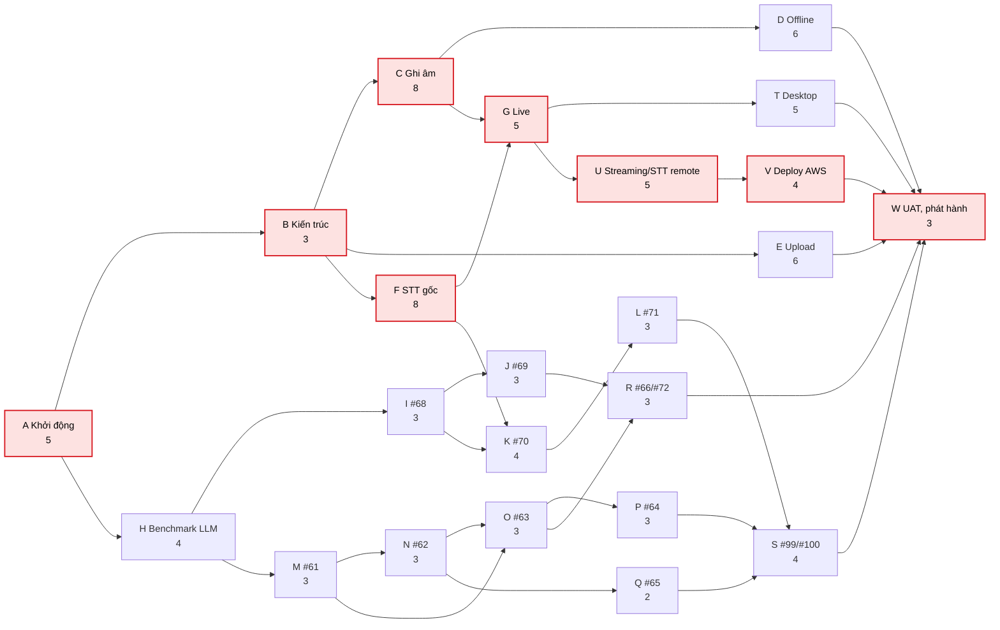
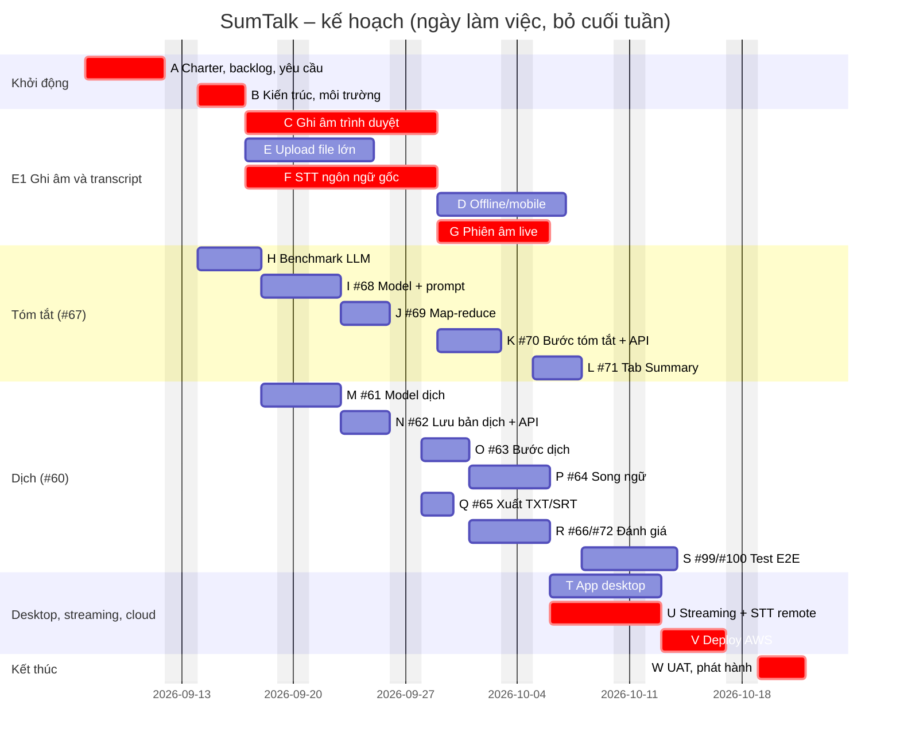

# 08 – Lịch trình: sơ đồ mạng, CPM, Gantt, release plan

**Đường găng:** A → B → C/F → G → U → V → W, dài **33 ngày làm việc** (khoảng 7 tuần nếu đủ người làm song
song). Phần tóm tắt và dịch (H…S) có độ trễ cho phép 3–12 ngày, nên một thành viên đổ sang phần live/STT khi cần
sẽ không làm trễ dự án.

> Thời lượng (ngày làm việc) là **ước lượng** từ story point ([07](07-effort-estimation.md)). Ngày bắt đầu trong
> Gantt giả định là 07/09/2026: [CẦN ĐIỀN: thay bằng ngày bắt đầu Sprint 1 thật]. Phụ thuộc lấy từ board
> (ví dụ #61→#63, #68→#70) và từ kiến trúc. Bảng được tính lại bằng [`tools/pm_calc.py`](tools/pm_calc.py).

## 1. Danh sách công việc và phụ thuộc

| ID | Công việc | Ngày | Phụ thuộc | ES | EF | LS | LF | Dự trữ |
|---|---|---|---|---|---|---|---|---|
| A | Khởi động: charter, backlog, yêu cầu và UI/UX | 5 | – | 0 | 5 | 0 | 5 | **0** |
| B | Kiến trúc + môi trường dev | 3 | A | 5 | 8 | 5 | 8 | **0** |
| C | T1.1 Ghi âm trên trình duyệt + gửi chunk | 8 | B | 8 | 16 | 8 | 16 | **0** |
| D | T1.2 Offline/mobile (IndexedDB, đồng bộ) | 6 | C | 16 | 22 | 24 | 30 | 8 |
| E | T1.3 Upload file lớn + chuẩn hoá audio | 6 | B | 8 | 14 | 24 | 30 | 16 |
| F | STT Whisper, transcript ngôn ngữ gốc | 8 | B | 8 | 16 | 8 | 16 | **0** |
| G | Phiên âm live | 5 | C, F | 16 | 21 | 16 | 21 | **0** |
| H | Benchmark model LLM (Sprint 2) | 4 | A | 5 | 9 | 10 | 14 | 5 |
| I | #68 Model + prompt tóm tắt | 3 | H | 9 | 12 | 16 | 19 | 7 |
| J | #69 Transcript dài (map-reduce) | 3 | I | 12 | 15 | 24 | 27 | 12 |
| K | #70 Bước tóm tắt, lưu trữ, API | 4 | I, F | 16 | 20 | 19 | 23 | 3 |
| L | #71 Tab Summary + Regenerate | 3 | K | 20 | 23 | 23 | 26 | 3 |
| M | #61 Model dịch | 3 | H | 9 | 12 | 14 | 17 | 5 |
| N | #62 Lưu bản dịch + API | 3 | M | 12 | 15 | 17 | 20 | 5 |
| O | #63 Bước dịch có tiến độ | 3 | M, N | 15 | 18 | 20 | 23 | 5 |
| P | #64 Chọn ngôn ngữ + song ngữ | 3 | O | 18 | 21 | 23 | 26 | 5 |
| Q | #65 Xuất TXT/SRT | 2 | N | 15 | 17 | 24 | 26 | 9 |
| R | #66/#72 Đánh giá chất lượng | 3 | J, O | 18 | 21 | 27 | 30 | 9 |
| S | #99/#100 Test E2E Sprint 3 | 4 | L, P, Q | 23 | 27 | 26 | 30 | 3 |
| T | App desktop (Electron, PyInstaller) | 5 | G | 21 | 26 | 25 | 30 | 4 |
| U | Streaming + STT remote + file dài | 5 | G | 21 | 26 | 21 | 26 | **0** |
| V | Deploy AWS (Docker, S3, hướng dẫn) | 4 | U | 26 | 30 | 26 | 30 | **0** |
| W | UAT, phát hành, đóng dự án | 3 | S, T, V, R, D, E | 30 | 33 | 30 | 33 | **0** |

ES/EF = bắt đầu/kết thúc sớm nhất; LS/LF = muộn nhất; Dự trữ = LS − ES. Dự trữ 0 là công việc găng.

## 2. Sơ đồ mạng (AON), đường găng tô đỏ

## 3. Gantt

## 4. Release plan theo sprint

| Sprint | Mục tiêu sprint | Công việc | Bản phát hành |
|---|---|---|---|
| Sprint 1 | Ghi âm và transcript gốc chạy được (POC E1) | A, B, C, D, E, F | v0.1 |
| Sprint 2 | Transcript live; chọn model LLM | G, H | v0.2 |
| Sprint 3 | Tóm tắt và dịch hoàn chỉnh, có test E2E | I–S (dời #60 vào sprint này, xem [17](17-change-log.md)) | v0.3 |
| Sprint 4 | App desktop, live dạng streaming, STT qua server, bản web trên AWS | T, U, V | v0.4 |
| Kết thúc | UAT, nghiệm thu | W | v1.0 |

[CẦN ĐIỀN: đối chiếu cột "Công việc" với việc đã thực sự làm trong từng sprint trên Azure Boards.]

## 5. Cách dùng khi theo dõi

- Công việc găng trễ 1 ngày thì cả dự án trễ 1 ngày. Báo ngay trong Daily và ghi vào [17](17-change-log.md) nếu
  phải dời mốc.
- Công việc có dự trữ (ví dụ E: 16 ngày) là nơi có thể lấy người tạm sang hỗ trợ công việc găng.
- Mỗi sprint, cập nhật ngày thực tế, rồi tính lại bằng `python docs/project/tools/pm_calc.py`.
