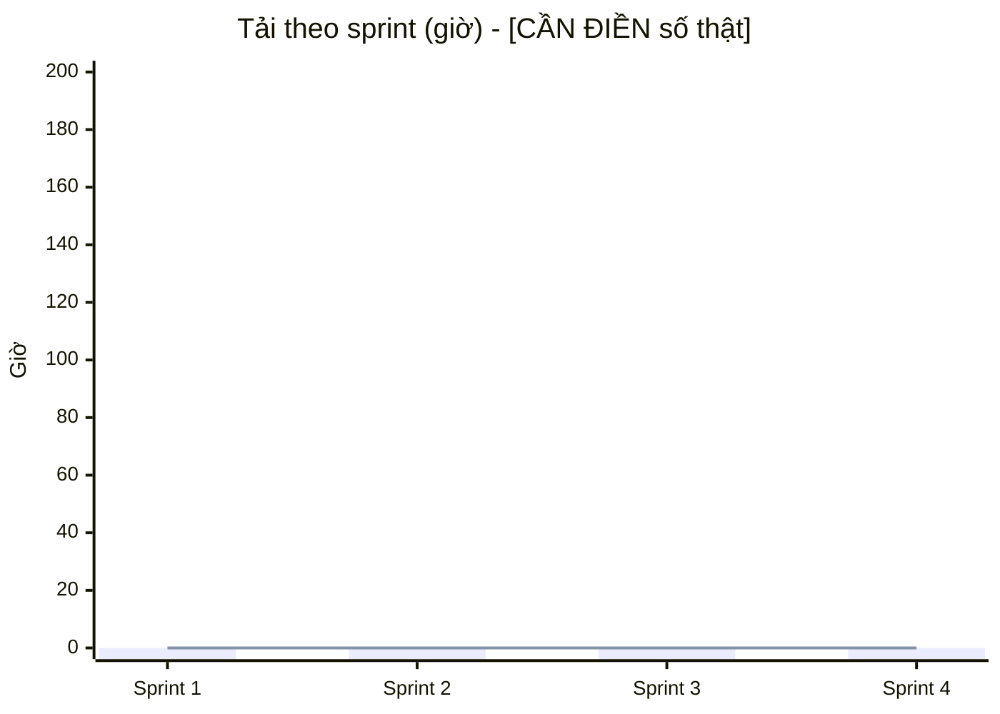

# 10 – Kế hoạch và phân bổ nguồn lực

**Tóm tắt:** nguồn lực gồm con người (theo giờ/sprint), máy móc (laptop GPU của nhóm, máy chủ AWS) và dịch vụ
(API Whisper/LLM). Ràng buộc chính là giờ rảnh của từng người, không phải số người. Việc san tải dựa vào dự trữ
của các công việc không găng ([08](08-schedule-cpm-gantt.md)).

## 1. Nguồn lực con người theo sprint (giờ)

| Thành viên | Vai trò | Sprint 1 | Sprint 2 | Sprint 3 | Sprint 4 | Tổng |
|---|---|---|---|---|---|---|
| [CẦN ĐIỀN] | PO / BA | | | | | |
| [CẦN ĐIỀN] | SM / PM | | | | | |
| [CẦN ĐIỀN] | Dev Backend / STT | | | | | |
| [CẦN ĐIỀN] | Dev Frontend / Desktop | | | | | |
| [CẦN ĐIỀN] | Dev AI | | | | | |
| [CẦN ĐIỀN] | QC | | | | | |
| **Tổng** | | | | | | |

[CẦN ĐIỀN: lấy từ số liệu tải theo người của nhóm (Azure Boards / dashboard chi phí).] Năng lực mỗi người mỗi
sprint = số ngày × giờ rảnh/ngày × 0,8 (trừ họp và gián đoạn).

## 2. Phân công công việc theo sprint

| Sprint | Công việc (ID ở [08](08-schedule-cpm-gantt.md)) | Người phụ trách chính |
|---|---|---|
| 1 | A Khởi động, B Kiến trúc, C Ghi âm, D Offline, E Upload, F STT | [CẦN ĐIỀN] |
| 2 | G Live, H Benchmark LLM | [CẦN ĐIỀN] |
| 3 | I–L Tóm tắt (#68–#71), M–Q Dịch (#61–#65), R Đánh giá (#66, #72), S Test E2E (#99, #100) | [CẦN ĐIỀN] |
| 4 | T Desktop, U Streaming + STT remote, V Deploy AWS | [CẦN ĐIỀN] |
| Kết thúc | W UAT, phát hành, tài liệu | Cả nhóm |

## 3. Resource histogram

Biểu đồ giờ theo người và sprint (vẽ từ bảng mục 1; dán số liệu vào là GitHub hiển thị):

Cột = tổng giờ thực tế; đường = năng lực của nhóm. Sprint nào cột vượt đường là quá tải, phải san tải.

Gợi ý vẽ theo từng người: Excel/Google Sheets dùng biểu đồ cột chồng (stacked column), trục X là sprint, mỗi màu
là một thành viên, kèm một đường ngang thể hiện năng lực.

## 4. San tải (resource leveling)

| Tình huống | Cách xử lý | Dựa trên |
|---|---|---|
| Sprint 3 dồn nhiều việc AI (tóm tắt + dịch song song) | Dev frontend làm giao diện #71/#64 sau khi API xong; QC viết test case song song | Dự trữ 3–5 ngày của K, L, O, P |
| Dev STT quá tải ở Sprint 4 (G → U → V đều găng) | Đưa T (desktop, dự trữ 4 ngày) cho Dev frontend; deploy (V) chia phần tài liệu cho PM | Dự trữ của T |
| Trùng lịch thi | Dời việc không găng (E: 16 ngày dự trữ, J: 12 ngày) sang sau kỳ thi | CPM |
| Một người nghỉ đột xuất | Code review chéo; README/ARCHITECTURE và HANDOFF để người khác tiếp quản | R14 |

## 5. Nguồn lực máy móc và dịch vụ

| Nguồn lực | Dùng cho | Số lượng / cấu hình | Chi phí |
|---|---|---|---|
| Laptop dev (i7-13620H, RTX 4050 6 GB) | Phát triển, Whisper GPU local, build bộ cài | 1+ | có sẵn |
| Laptop thành viên khác (CPU) | Frontend, test, dùng engine remote | [CẦN ĐIỀN] | có sẵn |
| AWS EC2 | Bản web test: `t3.large` (CPU) hoặc `g4dn.xlarge` (GPU, bật theo giờ) | 1 | xem [11](11-cost-budget-plan.md) |
| AWS S3 | Audio, sao lưu database | 1 bucket | vài nghìn VND/GB/tháng |
| Whisper API (Groq/OpenAI) | STT cho bản web CPU | theo giờ audio | xem [11](11-cost-budget-plan.md) |
| LLM API hoặc Ollama local | Tóm tắt, dịch | theo token | xem [11](11-cost-budget-plan.md) |
| Azure Boards, GitHub | Quản lý công việc, mã nguồn | gói miễn phí | 0 |
