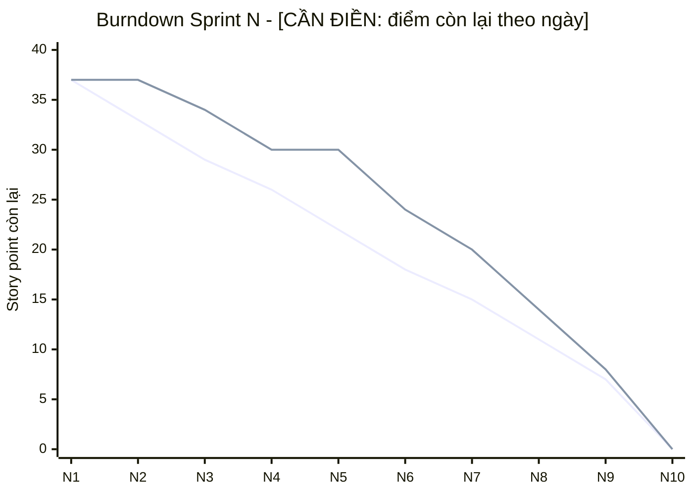

# 14 – Sprint Report / Status Report

**Tóm tắt:** mỗi sprint có một báo cáo theo cùng mẫu: mục tiêu, kế hoạch so với thực tế, burndown, velocity, chi phí
(CPI/SPI), vấn đề, rủi ro, quyết định. Sprint 1–3 nhóm đã có số liệu
[CẦN ĐIỀN: chép từ báo cáo S1–S3 hiện có]. Sprint 4 ghi theo các commit trong repo.

## Mẫu báo cáo (chép cho mỗi sprint)

```markdown
### Sprint N – <mục tiêu sprint>   (dd/mm – dd/mm/yyyy)

| Chỉ số | Kế hoạch | Thực tế |
|---|---|---|
| Story point | | |
| Số story Done / cam kết | | |
| Giờ công | | |
| Chi phí (giờ × 100.000 VND) | PV = | AC = |
| EV (giá trị đạt được) | | |
| CPI = EV/AC · SPI = EV/PV | | |

Burndown: <ảnh chụp từ Azure Boards hoặc bảng điểm còn lại theo ngày>
Đã xong: …   Chưa xong (lý do, dời sang đâu): …
Vấn đề phát sinh: …   Rủi ro mới/thay đổi: …   Quyết định và thay đổi phạm vi: … (ghi vào Change Log)
Cải tiến từ retro: …
```

## Tổng hợp các sprint

| Sprint | Mục tiêu | SP cam kết | SP xong | Velocity | CPI | SPI | Ghi chú |
|---|---|---|---|---|---|---|---|
| 1 | Ghi âm, upload, transcript gốc (E1) | [CẦN ĐIỀN] | | | | | |
| 2 | Transcript live, benchmark LLM | [CẦN ĐIỀN] | | | | | |
| 3 | Tóm tắt #67 + dịch #60, test E2E | [CẦN ĐIỀN] | | | | | #60 dời vào sprint này |
| 4 | Desktop, streaming, STT remote, deploy AWS | 37 (đề xuất: D-1 8, S-1 13, O-1 8, US6.2 5, tài liệu 3) | | | | | xem bên dưới |

## Burndown (vẽ từ số liệu)



Đường thứ nhất là đường lý tưởng, đường thứ hai là thực tế. Số trong biểu đồ đang là **ví dụ minh hoạ**, hãy
thay bằng số trên Azure Boards.

## Sprint 4 – Desktop, streaming, cloud (theo repo, 12/11/2026)

| Hạng mục | Kết quả | Bằng chứng |
|---|---|---|
| App desktop Windows | Xong: bộ cài 204 MB, smoke test 8/8 | nhánh `feature/desktop-app` (7 commit) |
| Live streaming | Xong: từ mới khoảng 1 s, câu chốt TB 1,9 s | nhánh `feature/streaming-stt` |
| STT remote, API `/v1` | Xong: máy khách không tải model, độ trễ như GPU local | như trên |
| File dài | Xong: 11,6 phút xử lý trong 18–57 s, dòng đầu sau 3–5 s | như trên |
| Deploy AWS | Xong phần chuẩn bị: image, Compose, Caddy, S3, hướng dẫn; **chưa deploy lên AWS thật** | nhánh `feature/aws-deploy` |
| Tài liệu quản lý | 21 tài liệu `.md` | nhánh `docs/project-management` |
| Test | 88 pytest đạt, ruff sạch | |

**Vấn đề phát sinh:** push lên GitHub bị từ chối (403): tài khoản đang lưu trên máy không có quyền ghi repo (R11).
Các nhánh đang chỉ có ở máy dev.
**Quyết định:** thêm desktop, streaming, cloud vào phạm vi (ghi ở [17](17-change-log.md)).
**Việc tiếp theo:** cấp quyền repo và push; deploy thật lên AWS theo hướng dẫn; UAT với người dùng thử; điền số
liệu giờ công Sprint 4.
