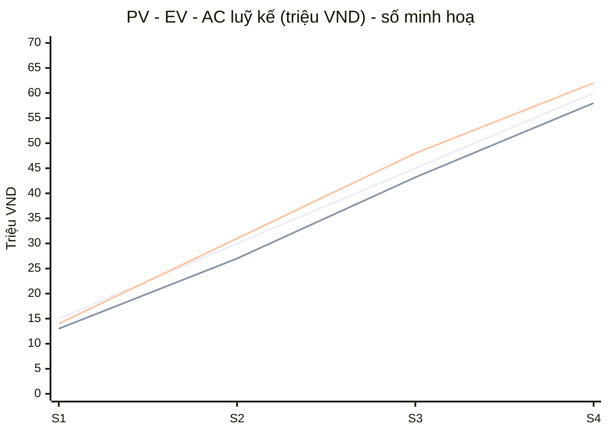

# 15 – Earned Value Analysis (EVA)

**Tóm tắt:** EVA so sánh giá trị công việc đã làm được (EV) với chi phí thực tế (AC) và kế hoạch (PV) theo từng
sprint, rồi dự báo tổng chi phí khi hoàn thành (EAC). Nhóm đã có CPI/SPI trên dashboard
[CẦN ĐIỀN: chép số vào bảng mục 3]. Tài liệu này ghi phương pháp và cách diễn giải.

## 1. Định nghĩa và công thức

| Ký hiệu | Ý nghĩa | Cách lấy trong dự án |
|---|---|---|
| BAC | Ngân sách khi hoàn thành | Tổng giờ kế hoạch × 100.000 VND ([11](11-cost-budget-plan.md)) |
| PV | Giá trị kế hoạch đến thời điểm đo | Giờ kế hoạch luỹ kế đến hết sprint × 100.000 |
| EV | Giá trị đạt được | BAC × (SP Done luỹ kế / tổng SP kế hoạch). Chỉ tính story đạt DoD, không tính dở dang |
| AC | Chi phí thực tế | Giờ thực tế luỹ kế × 100.000 |

```latex
CV = EV - AC \qquad SV = EV - PV \qquad CPI = \frac{EV}{AC} \qquad SPI = \frac{EV}{PV}
```
```latex
EAC = \frac{BAC}{CPI} \qquad ETC = EAC - AC \qquad VAC = BAC - EAC \qquad TCPI = \frac{BAC - EV}{BAC - AC}
```

## 2. Diễn giải

| Chỉ số | > 1 | = 1 | < 1 |
|---|---|---|---|
| CPI | Tốn ít hơn kế hoạch | Đúng ngân sách | Vượt chi phí: xem lại ước lượng, cắt việc Could |
| SPI | Nhanh hơn kế hoạch | Đúng tiến độ | Chậm: dồn người vào việc găng ([08](08-schedule-cpm-gantt.md)) |
| TCPI | Phải làm hiệu quả hơn trước mới kịp ngân sách | | Còn dư địa |

Ngưỡng hành động của dự án: CPI hoặc SPI < 0,9 thì báo PO/Sponsor ([11](11-cost-budget-plan.md)).

## 3. Bảng theo dõi theo sprint (luỹ kế)

| Hết sprint | PV (VND) | EV (VND) | AC (VND) | CV | SV | CPI | SPI | EAC |
|---|---|---|---|---|---|---|---|---|
| 1 | [CẦN ĐIỀN] | | | | | | | |
| 2 | [CẦN ĐIỀN] | | | | | | | |
| 3 | [CẦN ĐIỀN] | | | | | | | |
| 4 | [CẦN ĐIỀN] | | | | | | | |

## 4. Ví dụ cách tính (số minh hoạ, không phải số của nhóm)

Giả sử BAC = 60 triệu VND (600 giờ), tổng 125 SP. Hết Sprint 3: kế hoạch 450 giờ, thực tế 480 giờ, đã Done 90 SP.

| Bước | Tính | Kết quả |
|---|---|---|
| PV | 450 × 100.000 | 45,0 triệu |
| EV | 60 triệu × 90/125 | 43,2 triệu |
| AC | 480 × 100.000 | 48,0 triệu |
| CPI | 43,2 / 48,0 | 0,90 (vượt chi phí 10%) |
| SPI | 43,2 / 45,0 | 0,96 (chậm 4%) |
| EAC | 60 / 0,90 | 66,7 triệu |
| VAC | 60 − 66,7 | −6,7 triệu (dùng gần hết 10% dự phòng) |
| TCPI | (60 − 43,2) / (60 − 48,0) | 1,40 (phần còn lại phải hiệu quả hơn 40% mới giữ được BAC) |

Kết luận của ví dụ: chạm ngưỡng CPI 0,9, nên PM báo PO để dời một story Should sang phiên bản sau.

## 5. Biểu đồ S-curve



Ba đường lần lượt là PV, EV, AC. Thay bằng số thật ở mục 3.
