# 22 – Đặc tả UI/UX (UI/UX Specification)

**Tóm tắt:** mô tả giao diện SumTalk v0.4 đúng như đang chạy: hệ thống thiết kế, bố cục, từng màn hình, các
trạng thái, hộp thoại, khác biệt giữa máy tính, điện thoại và app desktop. Dùng để review UI, viết test case và
làm cơ sở khi thay đổi giao diện.

**Nguồn:**
- Mã nguồn `frontend/src` trên nhánh `docs/project-management`, ngày 12/11/2026.
- Ảnh chụp từ app chạy thật bằng Playwright: máy tính 1440×900, điện thoại 390×844.
- Dữ liệu trong ảnh là dữ liệu mẫu. Server chạy với `AI_MOCK=true`, nên nội dung tab Summary và Translation là
  chữ mẫu (ví dụ "Bản tóm tắt thử nghiệm (mock)", "[vi] …"); bố cục giống hệt khi dùng LLM thật.

Chữ trên giao diện hiện là **tiếng Anh**. Tài liệu giữ nguyên nhãn tiếng Anh (in đậm) để đối chiếu với app.

## 1. Nguyên tắc thiết kế

| # | Nguyên tắc | Thể hiện trên giao diện |
|---|---|---|
| P1 | **Không mất dữ liệu, và cho người dùng thấy điều đó** | Màn ghi âm luôn hiện số chunk đã lưu trên máy và đã gửi; chip kết nối báo Offline và số chunk đang chờ |
| P2 | **Phản hồi tức thì** | Transcript hiện trong lúc nói; phần chữ đã chốt in thường, phần còn có thể sửa in nghiêng xám |
| P3 | **Giữ đúng ngôn ngữ gốc** | Mỗi dòng giữ ngôn ngữ người nói dùng; dòng khác ngôn ngữ chính có nhãn mã ngôn ngữ |
| P4 | **Phong cách "thiết bị đo"** | Đen trắng, font mono cho nhãn, font số kiểu LED cho thời gian; đỏ chỉ dùng cho đang ghi và lỗi |
| P5 | **Một việc chính mỗi màn hình** | Ghi âm, upload, xem cuộc họp tách thành màn riêng; nút chính màu đen, nút phụ màu trắng có viền |
| P6 | **Chạy tốt trên điện thoại** | Thanh menu dưới với nút Record nổi lên; màn hình giữ sáng khi ghi; vùng chạm ≥ 44 px cho nút chính |

## 2. Hệ thống thiết kế

### 2.1 Màu (light theme, `frontend/src/index.css`)

| Token | Mã màu | Dùng cho |
|---|---|---|
| `--background` | `#f2f2f0` | Nền trang, có lưới mờ (`--grid-line`) |
| `--card` | `#ffffff` | Thẻ, bảng, ô nhập |
| `--foreground` / `--primary` | `#0a0a0a` | Chữ chính, nút chính, viền đang chọn |
| `--muted-foreground` | `#6e6e6b` | Chữ phụ, nhãn, mô tả |
| `--secondary` / `--muted` | `#e9e9e6` | Nền hover, tab không chọn, skeleton |
| `--border` / `--input` | `#deddd8` / `#d2d1cc` | Viền thẻ, viền ô nhập |
| `--live` / `--destructive` | `#d71921` | Đang ghi, lỗi, nút xoá, số lỗi > 0 |
| `--live-soft` | `#fbeaea` | Nền badge "Recording" |
| `--online` | `#12b76a` | Chấm "Online" (chỗ duy nhất có màu xanh) |
| `--sidebar` | `#f7f7f5` | Nền thanh phát audio |

Chỉ có giao diện sáng; chưa có dark mode (xem mục 11).

### 2.2 Chữ

| Vai trò | Font | Cỡ, kiểu |
|---|---|---|
| Nội dung, tiêu đề | Geist Variable | Tiêu đề trang 28 px đậm, chữ thường 16 px |
| Eyebrow trên tiêu đề trang | Geist Mono Variable | 16 px, IN HOA, giãn chữ 0,16 em, màu xám |
| Nhãn ô nhập, badge, chip, tiêu đề cột | Geist Mono Variable | 10–11 px, IN HOA, giãn chữ 0,08–0,14 em |
| Thời gian, thời lượng, số đếm, % | Handjet Variable (`.digital`) | Đồng hồ ghi âm 72 px (điện thoại) / 88 px (máy tính) |

### 2.3 Hình khối và thành phần chung

- **Bo góc:** 6 px cho nút và thẻ; 3 px cho badge và chip.
- **Thẻ (`Card`):** nền trắng, viền 1 px. Thẻ quan trọng có dấu góc kiểu bản vẽ kỹ thuật (`.panel-ticks`).
- **Eyebrow:** nhãn nhỏ phía trên tiêu đề trang, ví dụ `LIBRARY`, `RECORDER / 01`, `INGEST / 02`.
- **Nút:** chính (nền đen, chữ trắng), phụ (nền trắng, viền), ghost (chỉ icon), destructive (nền đỏ).
- **Notice:** khung thông báo có vạch trái; đen là thông tin, xám là cảnh báo, đỏ là lỗi. Có thể kèm tiêu đề và
  nút hành động bên phải.
- **ProgressBar:** vạch đen cao 4 px. Khi chưa biết tiến độ, một đoạn chạy qua lại liên tục.
- **StatusBadge:** khung 1 px, chấm vuông, chữ mono. Trạng thái đang xử lý thì chấm nhấp nháy.

| Trạng thái cuộc họp | Nhãn | Màu |
|---|---|---|
| `recording` | **Recording** | Đỏ, nền đỏ nhạt, nhấp nháy |
| `uploading` | **Uploading** | Đen, nhấp nháy |
| `queued` | **Queued** | Xám |
| `processing` | **Preparing audio** | Đen, nhấp nháy |
| `transcribing` | **Transcribing 42%** | Nền xám, nhấp nháy, kèm % |
| `done` | **Ready** | Đen |
| `failed` | **Failed** | Đỏ |
| (chỉ có trên máy) | **On this device** | Xám |

## 3. Bố cục và responsive

| Độ rộng | Bố cục |
|---|---|
| < 768 px (điện thoại) | Thanh trên (logo, pill đang ghi, chip mất mạng); thanh menu dưới 3 mục, nút **Record** nổi lên giữa; nội dung một cột |
| ≥ 768 px (tablet, máy tính) | Sidebar trái cố định 240 px; bảng cuộc họp hiện đủ cột |
| ≥ 1024 px | Màn ghi âm và màn cuộc họp chia hai cột; khung chi tiết cuộc họp hiện bên phải |

Nội dung rộng tối đa 1152 px, căn giữa.

**Sidebar (máy tính)**, từ trên xuống:
1. Logo SumTalk (ô vuông chấm kiểu LED) và nhãn `POC`. Khi đang ghi âm, logo có chấm đỏ.
2. Nút **+ New recording**.
3. Menu **Meetings / Record / Upload**. Mục đang mở có nền trắng và vạch đen bên trái.
4. **Pill đang ghi** (đỏ, `REC 00:12`): chỉ hiện khi đang ghi mà người dùng đang ở màn khác; bấm để quay lại màn ghi.
5. Khu **System** ở đáy: chip kết nối và chip engine nhận dạng giọng nói (mục 8).

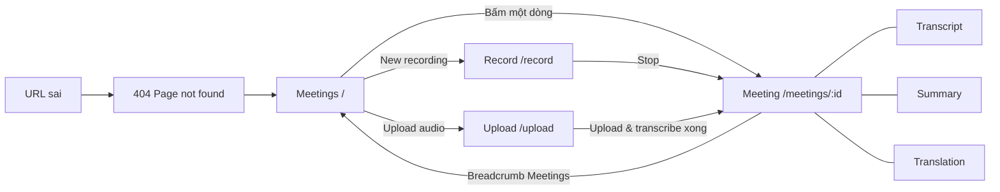

## 4. S1 – Danh sách cuộc họp (`/`)

**Mục đích:** xem, tìm và mở các cuộc họp; bắt đầu ghi hoặc upload. **Story:** US2.3.

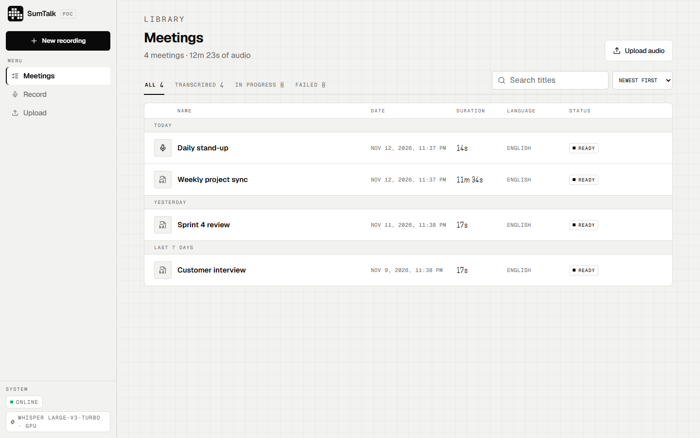

| Khu vực | Thành phần và hành vi |
|---|---|
| Tiêu đề | Eyebrow `LIBRARY`, tiêu đề **Meetings**, dòng tổng "4 meetings · 12m 23s of audio". Nút **Upload audio**; trên điện thoại có thêm nút **Record** |
| Tab lọc | **All / Transcribed / In progress / Failed**, kèm số lượng. Số **Failed** chuyển đỏ khi > 0. Tab **In progress** hiện thêm dòng "~Xm of transcription left" |
| Tìm kiếm | Ô **Search titles** lọc theo tên khi đang gõ; có nút × để xoá |
| Sắp xếp | **Newest first / Oldest first / Longest first / Title A–Z**. Hai kiểu theo ngày thì nhóm thành **Today / Yesterday / Last 7 days / Earlier** theo ngày lịch |
| Bảng (≥ 768 px) | Cột **Name, Date, Duration, Language, Status** và nút ⋯. Icon micro là bản ghi âm, icon file là bản upload. Bấm vào bất kỳ chỗ nào của dòng để mở cuộc họp |
| Dòng (điện thoại) | Tên, rồi một dòng phụ gồm ngày · thời lượng · ngôn ngữ; badge trạng thái bên phải |
| Menu ⋯ | **Rename**: sửa tên ngay trên dòng (Enter lưu, Esc huỷ, bấm ra ngoài cũng lưu). **Delete**: mở hộp thoại xác nhận (mục 9). Trên máy tính, nút ⋯ chỉ hiện khi rê chuột vào dòng |
| Đang xử lý | Badge **Transcribing 42%** kèm "~3m left" (ước lượng trên, giả định tốc độ bằng thời gian thực) |
| Chờ upload | Khu **Waiting to upload from this device** ở trên cùng, liệt kê bản ghi còn chunk trên máy, kèm số chunk và lỗi nếu có |

Danh sách tự cập nhật mỗi 4 giây.

| Trạng thái | Hiển thị |
|---|---|
| Đang tải | 3 dòng skeleton |
| Chưa có cuộc họp | Icon hộp thư, "No meetings yet", hai nút **New recording** và **Upload audio** |
| Lọc không ra kết quả | "No meetings match", nút **Clear filters** |
| Không gọi được server | Notice cảnh báo "Can't load meetings from the server", kèm lời nhắc bản ghi mới vẫn được giữ trên máy |
| Đổi tên/xoá lỗi | Notice đỏ "That didn't work" |

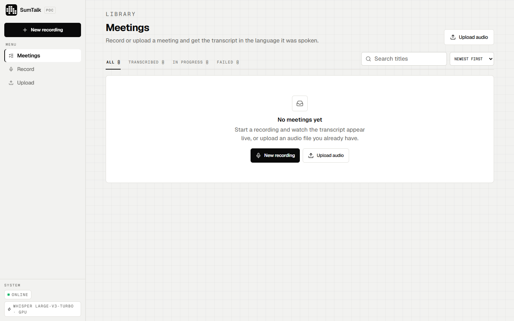

## 5. S2 – Ghi âm (`/record`)

**Mục đích:** ghi cuộc họp và xem transcript ngay khi nói. **Story:** US1.1, US1.2, US2.2.

### 5.1 Trước khi ghi

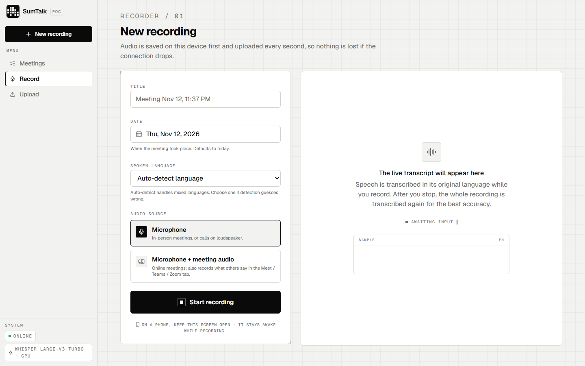

| Thành phần | Hành vi |
|---|---|
| **Title** | Để trống thì dùng tên mặc định "Meeting <ngày giờ>" (hiện sẵn ở placeholder) |
| **Date** | Chọn ngày diễn ra cuộc họp; mặc định hôm nay |
| **Spoken language** | **Auto-detect language** (mặc định, xử lý được họp trộn ngôn ngữ) hoặc 1 trong 15 ngôn ngữ. Lựa chọn được nhớ cho lần sau |
| **Audio source** | Hai thẻ chọn. **Microphone**: họp trực tiếp. **Microphone + meeting audio**: thu cả tiếng người khác trong Meet/Teams/Zoom; bị làm mờ nếu trình duyệt không hỗ trợ ("Needs desktop Chrome or Edge.") |
| Notice theo nguồn | Chọn micro + âm thanh họp trên trình duyệt: hướng dẫn chọn tab họp và bật **Share tab audio**. Trên app desktop: nhắc đeo tai nghe để tiếng không bị thu hai lần |
| **Start recording** | Nút chính cao 56 px; khi đang khởi động thì đổi thành "Starting…" |
| Khung bên phải | "The live transcript will appear here", trạng thái `AWAITING INPUT` có con trỏ nhấp nháy, và một khung chữ mẫu tự gõ để minh hoạ (tắt hiệu ứng khi hệ thống bật giảm chuyển động) |

Lỗi (trình duyệt không hỗ trợ, bị từ chối quyền micro) hiện thành Notice đỏ phía trên form, có nút × để đóng.

### 5.2 Đang ghi

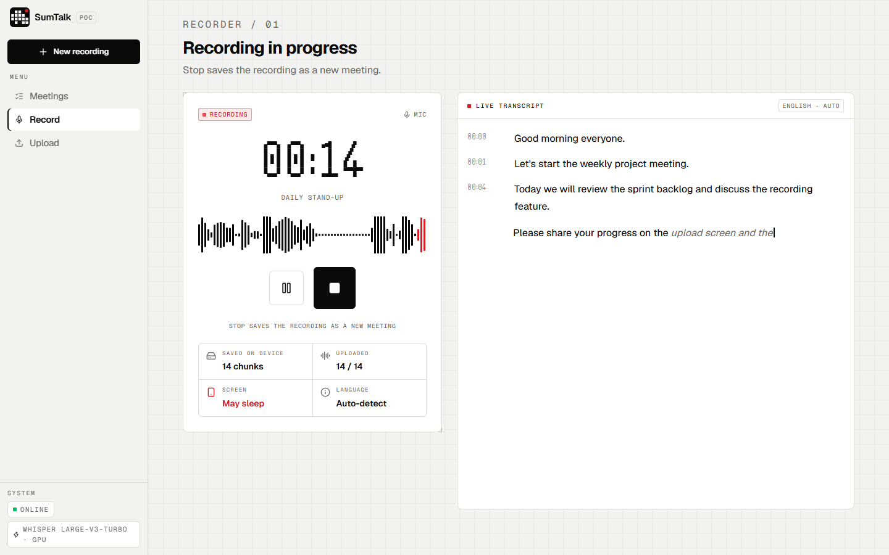

| Thành phần | Hành vi |
|---|---|
| Badge trạng thái | **Recording** (đỏ, nhấp nháy) / **Paused** / **Saving…**; bên phải ghi nguồn đang thu (**Mic** hoặc **Mic + meeting audio**) |
| Đồng hồ | Font số LED cỡ lớn, bên dưới là tên cuộc họp |
| Level meter | Các vạch theo âm lượng thật; vạch mới nhất màu đỏ |
| Nút | **Pause/Resume** (48–56 px) và **Stop** (64–68 px, nền đen). Bấm Stop thì lưu và mở trang cuộc họp |
| 4 ô thông số | **Saved on device** (số chunk), **Uploaded** (đã gửi / tổng; mất mạng thì hiện "Offline - later" màu đỏ), **Screen** (**Kept awake** / **Keep it on** / **May sleep**), **Language** |
| Khung **Live transcript** | Chấm đỏ nhấp nháy, chip ngôn ngữ ("English · auto"). Mỗi dòng có mốc thời gian. Dòng cuối đang nói: phần đã chốt in đen, phần còn có thể đổi in nghiêng xám, con trỏ nhấp nháy |
| Tự cuộn | Luôn cuộn theo chữ mới, trừ khi người dùng đã cuộn lên để đọc (cách đáy hơn 80 px) |
| Mất mạng | Khung transcript báo "You are offline. Audio keeps being saved on this device…"; audio vẫn được ghi |

Chunk 1 giây được gửi lên server ngay; trang hỏi transcript mỗi 0,7 giây. Chữ thường hiện khoảng 1 giây sau
khi nói ([19](19-test-summary-report.md)).

Ảnh chụp bằng trình duyệt tự động nên ô **Screen** hiện **May sleep**. Trên điện thoại hỗ trợ Wake Lock, ô này
hiện **Kept awake**.

## 6. S3 – Upload (`/upload`)

**Mục đích:** biến file ghi âm có sẵn thành một cuộc họp. **Story:** US1.3, US2.4.

| Chưa chọn file | Đã chọn file |
|---|---|
| 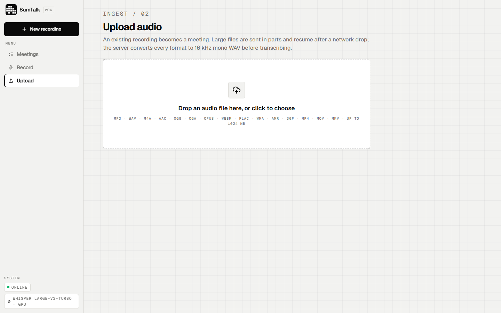 | 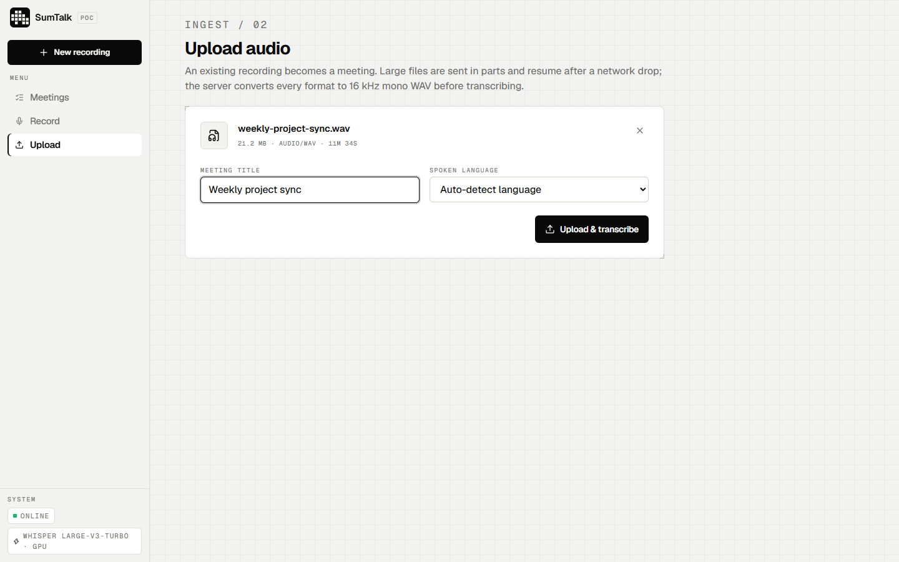 |

| Thành phần | Hành vi |
|---|---|
| Vùng thả file | Viền đứt, bấm để chọn hoặc kéo thả; khi kéo file vào thì viền đậm lên. Dòng dưới liệt kê định dạng hỗ trợ (MP3, WAV, M4A, AAC, OGG, OPUS, WEBM, FLAC, WMA, AMR, 3GP, MP4, MOV, MKV…) và giới hạn "up to 1024 MB" |
| Thẻ file | Tên file, dung lượng, loại, thời lượng (nếu trình duyệt đọc được); nút × để bỏ file |
| Kiểm tra trước khi gửi | Báo lỗi ngay, không gửi: sai đuôi file, không phải audio/video, file rỗng, vượt dung lượng ("This file can't be used") |
| **Meeting title** | Mặc định là tên file bỏ đuôi |
| **Spoken language** | Như màn ghi âm |
| **Upload & transcribe** | Gửi theo từng phần, tự tiếp tục khi rớt mạng |
| Khung tiến độ | Các bước **Starting upload… → Uploading… → Creating the meeting…**; khi mất mạng hiện **Waiting for the network…** với icon đỏ. Có %, số byte, tốc độ, "Part x / y" và nút **Cancel** |
| Xong | Tự mở trang cuộc họp mới (S4) |

## 7. S4 – Trang cuộc họp (`/meetings/:id`)

**Mục đích:** đọc, tìm, nghe lại, xuất transcript; xem tóm tắt và bản dịch. **Story:** US2.1, US2.3, #67, #60.

### 7.1 Khung chung

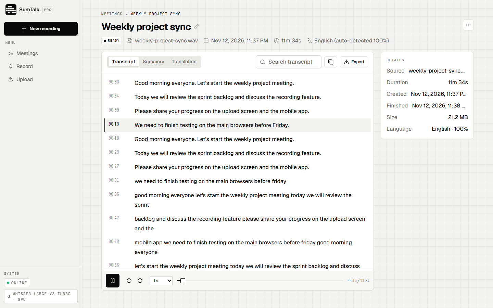

| Khu vực | Thành phần và hành vi |
|---|---|
| Breadcrumb | Máy tính: `MEETINGS > TÊN CUỘC HỌP`. Điện thoại: `← MEETINGS` |
| Tiêu đề | Bấm vào tên (có icon bút chì) để sửa; Enter hoặc bấm ra ngoài thì lưu, Esc thì huỷ |
| Dòng thông tin | Badge trạng thái, nguồn (tên file / **Microphone** / **Mic + meeting audio**), ngày họp, thời lượng, ngôn ngữ ("English (auto-detected 100%)"; họp trộn thì "English + Vietnamese") |
| Menu ⋯ (**More actions**) | **Transcribe again…** (làm mờ khi đang xử lý), **Download audio (.wav)**, **Delete meeting** (đỏ) |
| Khung trạng thái | Hiện giữa tiêu đề và nội dung, thay đổi theo trạng thái (bảng 7.2) |
| Tab | **Transcript** (có chữ đỏ `LIVE` khi đang là bản nháp live), **Summary**, **Translation** |
| Thanh phát audio | Play/Pause, lùi/tới 10 giây, tốc độ 1× / 1,25× / 1,5× / 2×, thanh tua, thời gian hiện tại / tổng |
| Khung **Details** (≥ 1024 px) | Source, Duration, Meeting, Created, Finished, Size, Chunks, Language (kèm độ tin cậy %) |

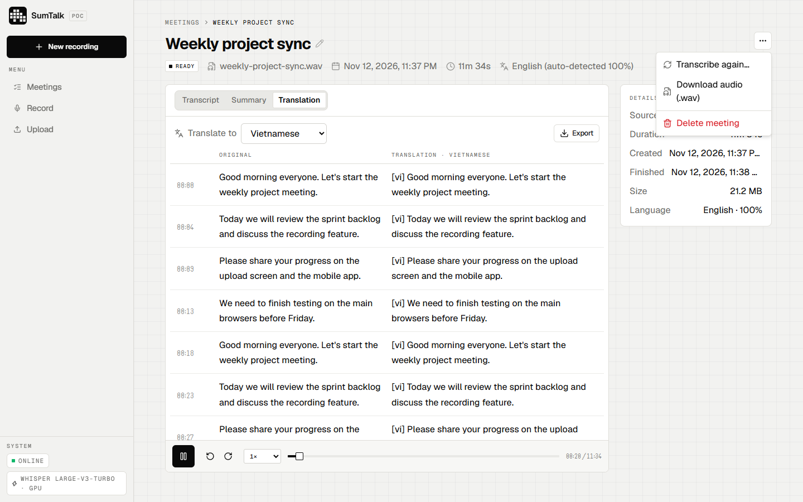

### 7.2 Khung trạng thái theo tình huống

| Tình huống | Hiển thị |
|---|---|
| Đang ghi trên chính thiết bị này | "Recording in progress", link **Open recorder** |
| Đang upload chunk từ thiết bị này | "Uploading the recording", số chunk còn lại |
| Đang ghi ở thiết bị/tab khác | "Receiving audio" |
| Bị kẹt ở trạng thái ghi > 20 giây | Cảnh báo "Still marked as recording", nút **Finish now** để phiên âm phần đã nhận |
| Upload file bị bỏ dở | "Upload not finished" |
| Đang chờ / đang chuẩn hoá audio | "Waiting in the queue…" / "Converting audio to the standard format…", thanh chạy liên tục |
| Đang phiên âm | "Transcribing…" và % (hoặc "Loading the speech model…"). Nếu đang hiện bản nháp live: "Improving the transcript…" kèm ghi chú "Showing the live draft until the accurate full-file transcript is ready." |
| Lỗi | Notice đỏ "Processing failed", lý do, nút **Retry** (nếu còn audio) |

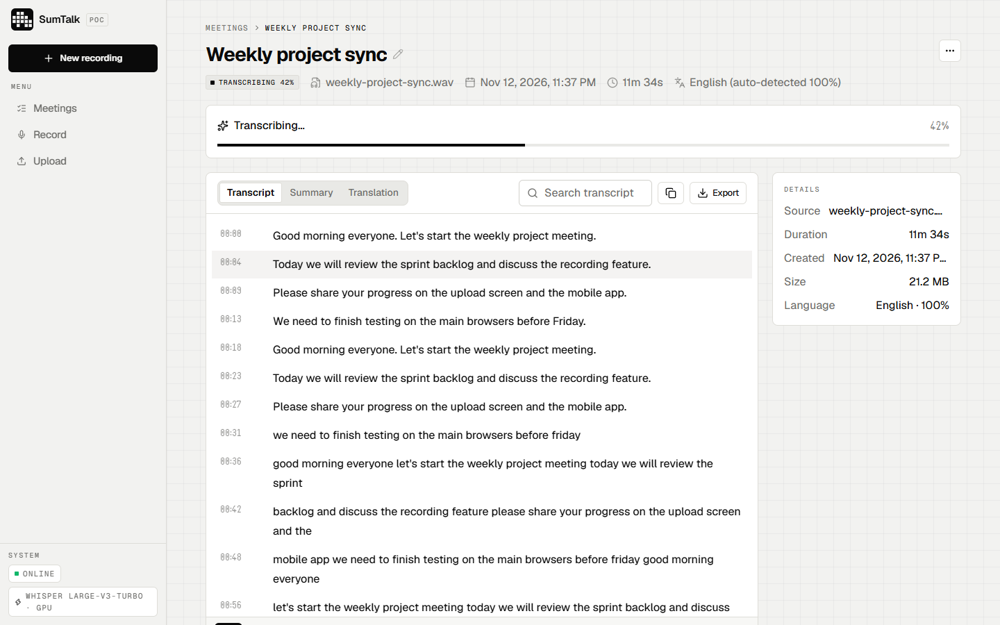

File dài được phiên âm theo từng đoạn khoảng 5 phút, nên các dòng hiện dần khi % tăng; người dùng đọc được ngay
mà không phải chờ hết file.

### 7.3 Tab Transcript

| Thành phần | Hành vi |
|---|---|
| Dòng transcript | Mốc thời gian (font LED) và nội dung. Bấm một dòng thì audio nhảy tới đó và phát |
| Dòng đang phát | Nền xám và vạch đen bên trái; trang tự cuộn để dòng này luôn trong tầm nhìn |
| Nhãn ngôn ngữ | Dòng nói khác ngôn ngữ chính có nhãn nhỏ bên phải (ví dụ `VI` trong cuộc họp tiếng Anh) |
| **Search transcript** | Chỉ giữ các dòng chứa từ khoá, tô nền từ khoá, hiện "N lines match …" |
| Nút copy | Chép toàn bộ transcript kèm mốc thời gian; icon đổi thành dấu ✓ trong 1,5 giây |
| **Export** | **Text (.txt), Subtitles (.srt), WebVTT (.vtt), JSON (.json)** |
| Trống | Đang xử lý: "The transcript will appear here as soon as the first words are recognized." Xong mà không có lời nói: "No speech was recognized in this audio." |

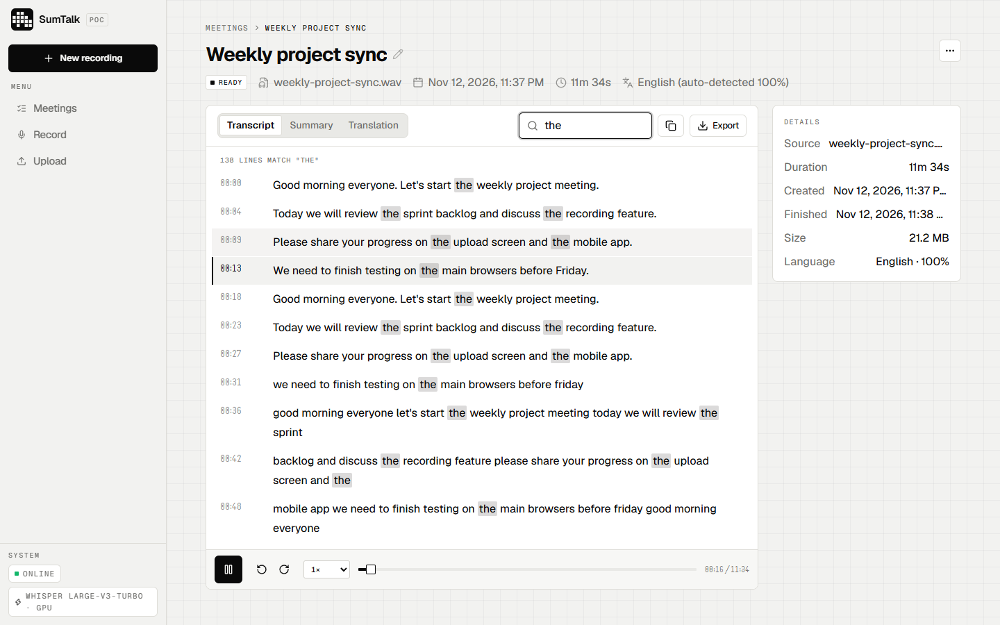

### 7.4 Tab Summary

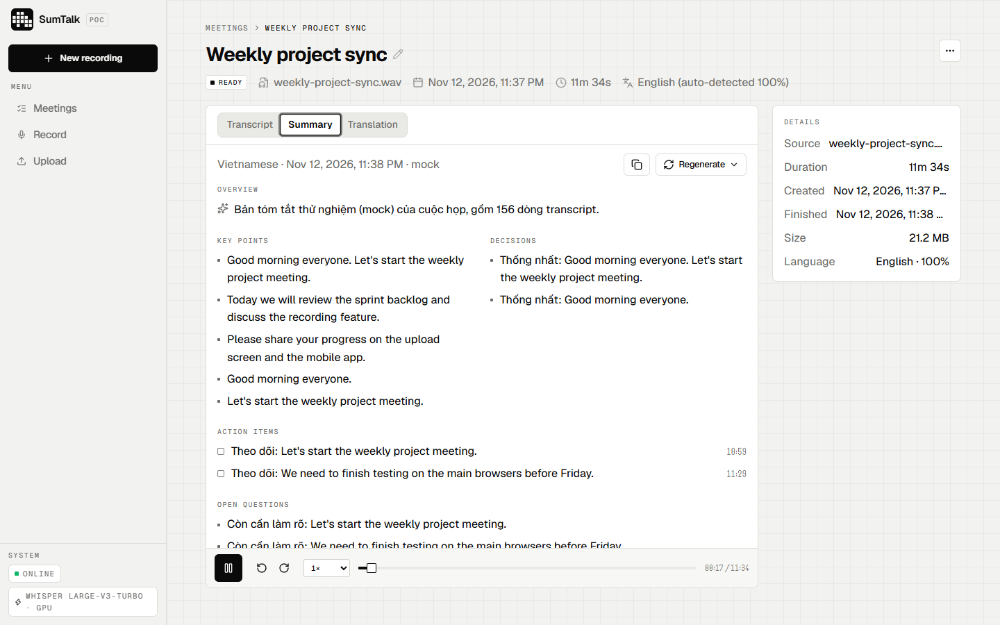

| Thành phần | Hành vi |
|---|---|
| Dòng thông tin | Ngôn ngữ · thời điểm tạo · model (ví dụ "Vietnamese · Nov 12, 2026, 11:35 PM · mock") |
| Nút copy | Chép biên bản dạng chữ |
| **Regenerate ▾** (hoặc **Generate**) | Chọn ngôn ngữ tóm tắt (Vietnamese / English); ngôn ngữ hiện tại có dấu ✓. Thay bản đã có thì phải xác nhận (mục 9) |
| **Overview** | Một đoạn tổng quan, có icon ✦ |
| **Key points** và **Decisions** | Hai cột trên màn ≥ 768 px, một cột trên điện thoại |
| **Action items** | Ô vuông, nội dung việc, người phụ trách · hạn (nếu có), mốc thời gian bấm được để nghe lại đoạn liên quan |
| **Open questions** | Danh sách câu hỏi còn mở |

| Trạng thái | Hiển thị |
|---|---|
| Transcript chưa xong | "The summary is generated automatically as soon as the transcript is ready." |
| Transcript lỗi | "The transcript failed, so there is no summary." |
| Chưa có tóm tắt | "No summary yet. Use Generate to create one." |
| Đang tạo | Vòng xoay, "Summarizing…", "Waiting for the summary model" hoặc "Writing the minutes in <ngôn ngữ>", kèm ghi chú họp dài mất vài phút |
| Lỗi | Notice đỏ "The summary could not be generated", nút **Try again** |

Trong lúc đang tạo, trang hỏi lại kết quả mỗi 3 giây.

### 7.5 Tab Translation

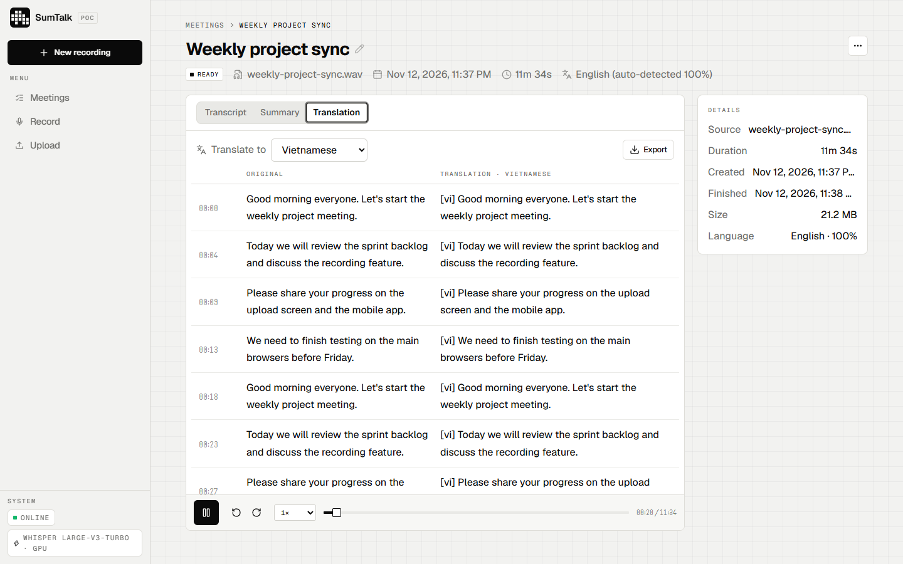

| Thành phần | Hành vi |
|---|---|
| **Translate to** | Chọn Vietnamese / English; ngôn ngữ đã dịch xong có dấu ✓. Ngôn ngữ chọn lần trước được nhớ; mở lại trang thì hiện ngay bản đã lưu, không dịch lại |
| Bảng hai cột | **Original** \| **Translation · Vietnamese**; mỗi dòng có mốc thời gian bấm được để nghe. Trên điện thoại, bản dịch nằm ngay dưới câu gốc |
| Dòng chưa dịch | Thanh xám nhấp nháy (skeleton) |
| Dòng vốn đã đúng ngôn ngữ đích | Giữ nguyên, có nhãn nhỏ "already Vietnamese" |
| Tiến độ | "Translating into Vietnamese… 45%" và thanh tiến độ; hỏi lại mỗi 2 giây |
| **Export** (khi dịch xong) | **Text (.txt)**, **Subtitles (.srt)**, **Text, original + translation**, **Subtitles, original + translation** |
| Lỗi | Notice đỏ "The translation stopped", nút **Try again**; các dòng đã dịch được giữ lại và có ghi số dòng |
| Chưa chọn ngôn ngữ | "Choose a language to translate the transcript. Lines already in that language are kept as they are." |

### 7.6 Cuộc họp chỉ có trên máy (chưa lên server)

Hiện khi mở một bản ghi chưa upload xong (mất mạng hoặc server tắt). Không có ảnh chụp.

| Tình huống | Hiển thị |
|---|---|
| Đang ghi trong tab/cửa sổ này | "Recording in progress" |
| Có mạng, đang upload | "Uploading from this device…", số chunk còn lại, phiên âm tự chạy sau đó |
| Mất mạng | "Saved on this device", nhắc giữ trình duyệt và không xoá dữ liệu trình duyệt (app desktop: chunk được xử lý khi engine chạy lại) |
| Server từ chối | Notice đỏ "The server refused this recording", nút **Retry** và **Discard** (cần xác nhận) |
| Không tìm thấy | "Meeting not found", link **Back to meetings** |

## 8. Trạng thái hệ thống (khu System và thanh trên điện thoại)

| Chip | Trạng thái | Hiển thị |
|---|---|---|
| Kết nối | Bình thường | Chấm xanh, `ONLINE` (trên điện thoại ẩn đi cho gọn) |
| | Đang gửi chunk | Icon mây, `3 QUEUED` |
| | Mất mạng / không gọi được server | Icon wifi gạch, chấm đỏ, `OFFLINE` hoặc `NO SERVER` kèm số chunk chờ; rê chuột thấy giải thích |
| Engine | Đang nạp model | Vòng xoay, `LOADING MODEL` |
| | Sẵn sàng (chạy trên máy) | `WHISPER LARGE-V3-TURBO · GPU` (hoặc `· CPU`) |
| | Sẵn sàng (engine remote) | Icon mây, `<model> · SERVER` |
| | Lỗi model | Chữ đỏ, `SPEECH MODEL ERROR`; rê chuột thấy lý do |

## 9. Hộp thoại

| Hộp thoại | Khi nào | Nội dung | Nút |
|---|---|---|---|
| **Delete this meeting?** | Delete từ danh sách hoặc từ trang cuộc họp | "“<tên>” and its audio will be deleted. This cannot be undone." | **Cancel**, **Delete** (đỏ) |
| **Discard this recording?** | Discard bản ghi bị server từ chối | Xoá khỏi máy, không khôi phục được | **Cancel**, **Discard** (đỏ) |
| **Regenerate the summary?** | Chọn ngôn ngữ khi đã có tóm tắt | "The current summary will be replaced by a new one in <ngôn ngữ>." | **Cancel**, **Regenerate** |
| **Transcribe again** | Menu ⋯ → Transcribe again… | Chọn lại ngôn ngữ nói khi nhận sai; transcript cũ bị thay | **Cancel**, **Start** |

| Xoá cuộc họp | Phiên âm lại |
|---|---|
| 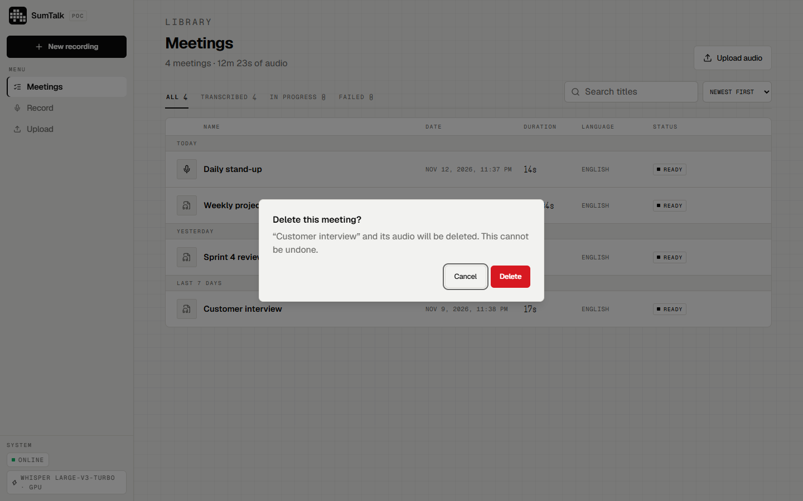 | 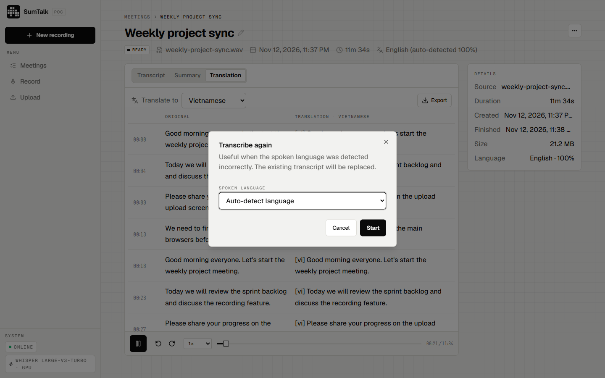 |

Hành động xoá luôn cần xác nhận và dùng màu đỏ. Esc hoặc **Cancel** thì đóng hộp thoại mà không làm gì. Ba hộp
thoại xác nhận (Delete, Discard, Regenerate) không đóng khi bấm ra ngoài, để tránh bấm nhầm; hộp thoại Transcribe
again thì có.

## 10. Điện thoại và app desktop

### 10.1 Điện thoại (390×844)

| Danh sách | Trang cuộc họp | Trước khi ghi | Đang ghi |
|---|---|---|---|
| 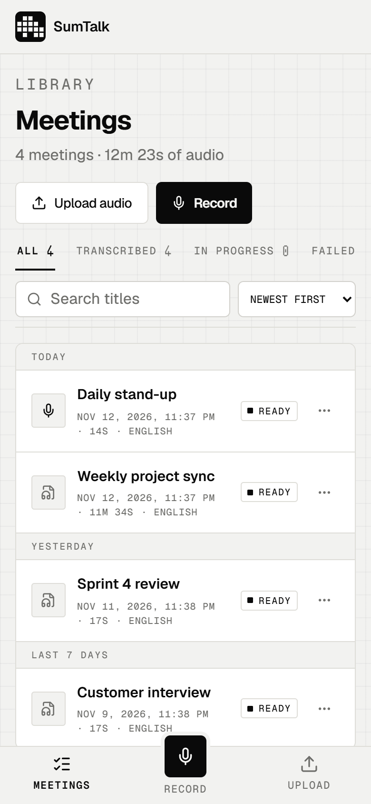 | 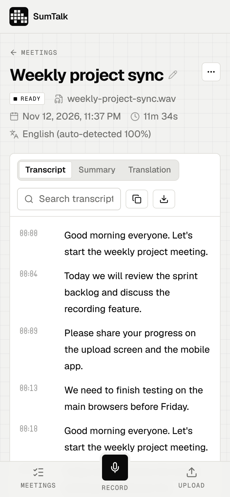 | 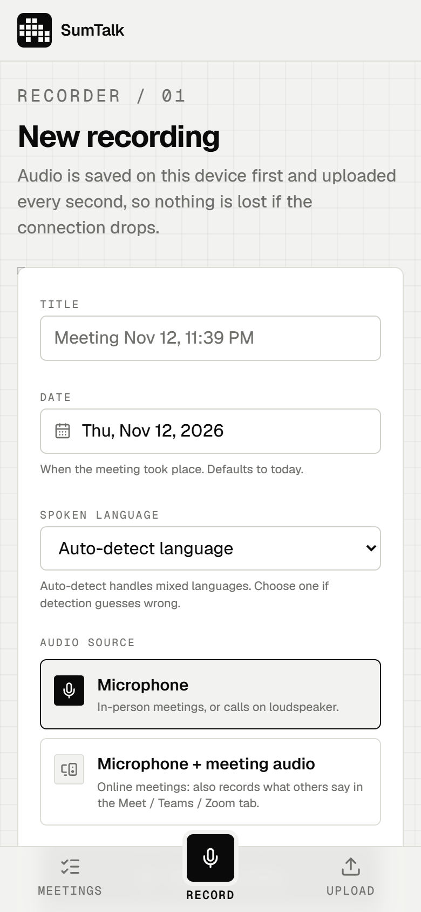 | 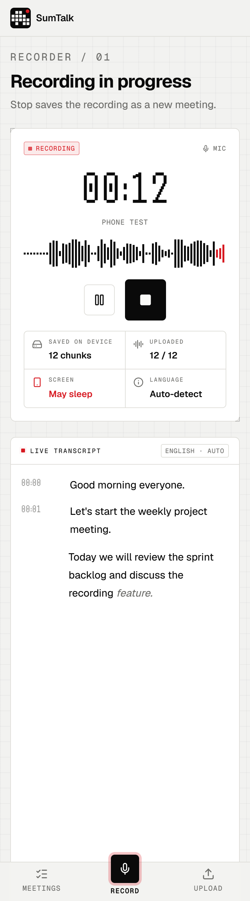 |

Ảnh "Đang ghi" chụp trên màn hình cao 1400 px để thấy cả đồng hồ lẫn transcript; trên điện thoại thật, người
dùng cuộn xuống để xem transcript.

- Thanh menu dưới có 3 mục; nút **Record** nổi lên, có viền đỏ nhạt khi đang ghi.
- Bảng cuộc họp gộp thành một dòng phụ; nút ⋯ luôn hiện (không có hover).
- Nút **Export** chỉ còn icon; khung Details ẩn (thông tin chính đã có ở dòng dưới tiêu đề).
- Khi ghi, màn hình được giữ sáng (Wake Lock). iOS vẫn dừng micro khi khoá màn hình, đây là giới hạn của trình
  duyệt (rủi ro R13).

### 10.2 App desktop (Windows, Electron)

Dùng cùng giao diện web, khác ở các điểm sau:

- Khi mở app: màn chờ "SumTalk – Starting…" trong lúc engine khởi động (khoảng 1,4–1,9 giây).
- **Microphone + meeting audio** thu toàn bộ âm thanh máy đang phát (Zoom/Teams/Meet bản desktop), không cần
  chọn tab. Mô tả và Notice nhắc đeo tai nghe để tiếng không bị thu hai lần.
- Các câu nói "this browser" đổi thành "this window" / "this computer"; bản ghi chưa xử lý được nói là sẽ chạy khi
  "SumTalk engine" hoạt động lại.
- Khi dùng engine remote (`STT_PROVIDER=remote`), chip engine hiện `· SERVER` thay vì `GPU`/`CPU`.

## 11. Khả năng truy cập, tương tác nhỏ và cập nhật dữ liệu

**Khả năng truy cập**
- Nút chỉ có icon đều có `aria-label` (ví dụ "Stop and save", "Copy transcript", "Actions for <tên>").
- Có viền focus rõ khi dùng bàn phím (`focus-visible`).
- Sửa tên dùng Enter/Esc; hộp thoại đóng bằng Esc.
- Tôn trọng cài đặt giảm chuyển động của hệ thống (`prefers-reduced-motion`).
- Thông báo đang chạy (tóm tắt, dịch) dùng `role="status"`.

**Chu kỳ cập nhật dữ liệu (polling)**

| Nơi | Chu kỳ |
|---|---|
| Transcript khi đang ghi | 0,7 giây |
| Trang cuộc họp khi đang xử lý | 1,5 giây |
| Danh sách cuộc họp | 4 giây |
| Tab Summary khi đang tạo | 3 giây |
| Tab Translation khi đang dịch | 2 giây |

## 12. Hạn chế và đề xuất cải tiến UI/UX

| # | Hạn chế hiện tại | Đề xuất | Liên quan |
|---|---|---|---|
| UX-01 | Chữ giao diện chỉ có tiếng Anh, trong khi người dùng chính nói tiếng Việt | Thêm bản tiếng Việt cho giao diện (i18n), chọn theo ngôn ngữ trình duyệt | Đề xuất mới |
| UX-02 | Chưa có dark mode | Thêm bộ token tối theo `prefers-color-scheme` | Đề xuất mới |
| UX-03 | Không có tên người nói trên transcript | Nhận diện người nói, hiện "Người nói:" ở đầu dòng | US8.1 |
| UX-04 | Việc cần làm chỉ nằm trong tab Summary | Trang action items riêng, liên kết tới đoạn transcript | #79 |
| UX-05 | Bản dịch chỉ có sau khi họp xong | Dịch trực tiếp trong khung live transcript | #84 |
| UX-06 | iOS dừng ghi khi khoá màn hình | App native, hoặc cảnh báo rõ hơn trên iOS | US8.3, R13 |
| UX-07 | Chưa có tài khoản, mọi người dùng chung một thư viện | Đăng nhập, phân quyền, chia sẻ cuộc họp | US8.2 |
| UX-08 | Danh sách cuộc họp tải toàn bộ, chưa phân trang | Phân trang hoặc cuộn vô hạn khi có nhiều cuộc họp | Đề xuất mới |

Liên quan: tính năng theo module ở [04](04-product-backlog-prd.md), yêu cầu phi chức năng ở
[05](05-non-functional-requirements.md), kết quả test ở [19](19-test-summary-report.md).
